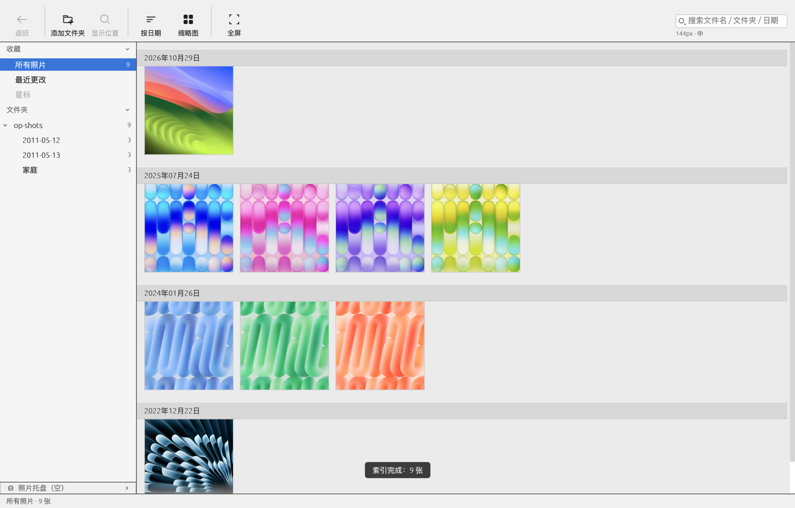
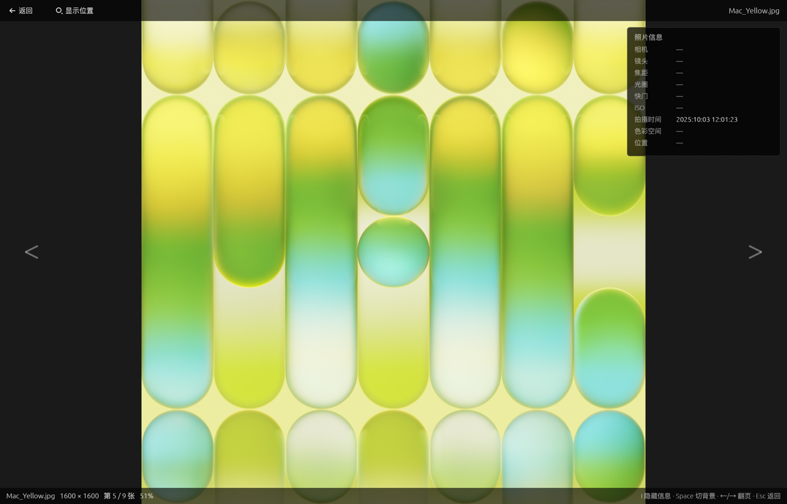

# OpenPicasa

用 Rust 写的桌面照片管理器，**界面与交互对齐 Google Picasa 3.9**，但**数据格式完全自立**——不读、不写、不解析 `.picasa.ini`。

一句话说明它与 Picasa 的关系：**像，但不通。**
视觉布局、栅格密度、操作手感、快捷键向 3.9 靠拢；而照片库用什么格式记，是我们自己的事。

- **界面基准**：Picasa 3.9（Windows 最终版）——仅作视觉与交互参照，不追求数据互通。
- **支持平台**：macOS 14+ / Apple Silicon（arm64）为主要目标；Linux x86_64 可构建并产出 `.deb`。

---

## 产品定位与三层承诺

| | 内容 |
| --- | --- |
| ✅ **承诺** | 界面布局、栅格密度、交互手感、快捷键与 Picasa 3.9 对齐 |
| ✅ **承诺** | **照片目录零写入**——不创建、不修改、不删除、不改权限、不改 mtime 任何文件 |
| ❌ **不承诺** | `.picasa.ini` 兼容、与原版数据互通、读取原版的编辑/星标/说明 |

第三行不是「暂时没做」，是**产品定义本身**。如果有人期待「装上就能看到我原来的星标」，那是对本项目的误解。

### 三条设计红线（不可协商）

| 红线 | 含义 |
| --- | --- |
| **R-1** | **照片目录零写入**。不读不写 `.picasa.ini`——不是「小心不写」，而是**根本没有 ini 代码**。数据只落自家 `Application Support` 与 `Preferences`。 |
| **R-2** | **编辑室入口不存在**（不是置灰）。依赖图里没有 `picasa-edit` crate。 |
| **R-3** | **装得上、打得开、首次授权走得通**。干净 Mac 上双击可运行、拖进「应用程序」可运行、TCC 授权流程正确。 |

> R-1 的产品含义：「你可以把任何照片目录直接拿进来试，**我们只读、不改**。退出后你的文件、文件夹、任何隐藏文件都不会有任何变化。」

---

## 当前界面

下面两张不是设计稿，是**本程序自己窗口帧缓冲的导出**（`crates/picasa-ui/src/capture.rs`），
所以有排版问题就会直接暴露出来，不能靠「示意图」蒙混。





更多基线（含空库首屏）见 [`docs/ui-baseline/`](docs/ui-baseline/README.md)。

---

## 已经能做什么

### 浏览

- 添加任意照片目录作为**关注文件夹**，多根目录并列；子目录树懒加载、带计数与状态点
- 日期分组栅格（吸顶分组头）、三档缩略图尺寸、按行号虚拟化——十万张级也能顺滑滚动
- **缩略图下方显示文件名**（三档都显示，单行、超出省略号）
- 六种排序、文件名/文件夹/日期搜索、选择集、照片托盘
- 全屏查看器：等比缩放、平移、翻页、EXIF 面板、背景切换、在 Finder 显示
- 「最近更改」、「所有照片」两个聚合入口

### 索引

- 后台异步扫描与缩略图生成，**不阻塞界面**（扫描 / 解码 / 落库全在工作线程）
- **索引进度可见**：右下角弹框、进度面板、状态栏入口、左栏状态点、栅格占位格
  **五处读同一份快照**，不会出现「同一件事四个地方四个数字」
- 暂停 / 继续 / 删除索引；重建失败索引只重做被点名的那几张
- 关闭关注文件夹**只改状态、不删索引**，重新添加秒开

### 实时与规模（M3）

- **你在外面动照片，软件几秒内就知道**——每个关注文件夹装文件系统监视
  （macOS FSEvents / Linux inotify）。网络卷、监视句柄不够、权限不足这些
  装不上的情况会**在索引管理页逐行写明原因**并给出修复建议，不静默退化成「几分钟看一眼」
- **启动不再等 20 分钟**：两级校验——先只比目录修改时间（几百毫秒），
  变了才逐文件核对。升级后的第一次启动仍会做一次完整核对，之后才变快
- **缩略图尺寸是连续滑块**（22～512 px，原版在底部状态栏），拖动时画面不闪、
  不卡；`⌘0` 回默认，`⌘+` / `⌘-` 按档跳
- **「包含子文件夹」**：选中一个文件夹，一键看完整棵子树（`⌘⇧R`）；
  计数与树上的递归数、标题栏三处一致
- **格式**：JPEG / PNG / GIF / BMP / TIFF / WebP / SVG 可解；HEIC / AVIF / RAW
  先识别入库（未编译解码器时进可见失败列表，不静默丢弃）
- **改名的照片不会丢身份**：同目录改名、跨目录移动后 `photo_id` 保持不变
  （为后续的星标 / 标签 / 相册保命）

### 数据安全

- 照片目录零写入；缩略图与索引只进自有 SQLite
- 解码是**不可信输入的入口**：超大图在解码前就被尺寸预检拦下，
  畸形文件不崩进程，同一格式连续出错会熔断（而不是把整条流水线拖死）
- 索引库可随时删掉重建——里面不存任何用户创作的数据
- 目录失联 / 无权限 / 解码失败都**在界面上有落点**，不会静默消失

---

## 安装（macOS，Apple Silicon）

1. 把 `OpenPicasa.app` 拖进「应用程序」文件夹。
2. **首次打开如果提示「无法打开，因为 Apple 无法验证此 App 是否包含恶意软件」**：
   - 到「应用程序」里**右键点击 OpenPicasa → 打开**，在弹出的对话框里再点一次「打开」；
   - 或打开「系统设置 → 隐私与安全性」，在页面底部找到提示，点「仍要打开」。
3. 以上只需做一次。

**为什么会有这个提示？** 本应用使用**本地 ad-hoc 签名**、未向 Apple 申请公证（公证需要付费开发者账号）。**这不代表 App 有问题。**

**如果你是通过 U 盘或直接拷贝拿到它的，通常不会看到这个提示**——quarantine 属性取决于文件怎么传过来的，不是签名决定的。

仍然打不开时，可在「终端」执行：

```bash
xattr -d com.apple.quarantine /Applications/OpenPicasa.app
```

> ⚠️ **不要**关闭系统完整性保护或全局关闭 Gatekeeper（`spctl --master-disable`）——那是安全风险，不建议也不支持。

### 首次运行会请求目录访问权限（macOS TCC）

macOS 会保护「图片」「桌面」「下载」「文稿」与外接盘。**第一次添加这些位置的文件夹时，系统会弹窗询问授权——这是正常且必需的。**

- 点「允许」后正常使用；**点「不允许」应用不会崩溃**，会提示你可以去「系统设置 → 隐私与安全性 → 文件与文件夹」重新开启。
- 本应用**不请求全盘访问**，只在你选择某个目录时才请求那个目录。

### 卸载

把 `OpenPicasa.app` 拖到废纸篓，然后删除数据目录：

```bash
rm -rf ~/Library/Application\ Support/app.openpicasa
```

（索引与缩略图缓存在那里。删了不影响你的照片原文件。）

---

## 从源码构建

需要 Rust 工具链（`rust-toolchain.toml` 锁定 stable）与 Xcode Command Line Tools。

```bash
# 1) 开发运行
cargo run --release --bin OpenPicasa

# 2) 构建 .app
./packaging/bundle.sh
# 产物：dist/OpenPicasa.app（arm64 + ad-hoc 签名）

# 3) 打成可双击安装的 DMG
./packaging/make_dmg.sh
# 产物：dist/OpenPicasa-<version>-arm64.dmg（内含 .app + Applications 链接）

# 4) 质量门禁
cargo test --workspace
cargo clippy --workspace --all-targets
```

### 打 DMG 时的一个坑：`hdiutil makehybrid` 不能用

`make_dmg.sh` 用的是 `hdiutil create`。在受限环境（容器、某些 CI、被沙箱限制的终端）里它会失败：

```
newfs_hfs: cannot create filesystem on /dev/rdisk4s1: Operation not permitted
```

**这是权限问题，不是参数问题**——别去改 `-fs` / `-format` 试。直觉上会换成 `hdiutil makehybrid`
（它不需要格式化权限，确实能成功产出一个 DMG），**但那个 DMG 是坏的**：

`makehybrid` 会给镜像里**每个文件**打上 `com.apple.FinderInfo` 扩展属性，装到目标机后
`codesign --verify --deep --strict` 报

```
resource fork, Finder information, or similar detritus not allowed
```

也就是**签名在解镜像那一刻就废了**。`.app` 表面上还能启动（非严格校验会过），但 Gatekeeper
的判定会落到「已损坏」而不是「未验证的开发者」——后者右键打开一次即可，前者用户会以为文件坏了。

所以 `make_dmg.sh` 在**挂载后**才对镜像里的那份 `.app` 跑 `--strict` 校验，就是为了守住这条线；
校验不过就直接 `exit 1` 不产出。

### 在 Linux 上构建（x86_64）

```bash
# 构建期不需要装任何 GUI 开发包：wayland / xkbcommon / vulkan 都是运行时 dlopen 的。
cargo build --release --bin OpenPicasa     # → target/release/OpenPicasa
./run.sh                                    # 直接启动

# 打成 .deb
./packaging/make_deb.sh                     # → dist/openpicasa_<version>-1_amd64.deb
sudo apt install ./dist/openpicasa_<version>-1_amd64.deb
```

三个平台差异要知道：

- **glibc 下限跟着构建机走**。二进制在构建机的 glibc 上链接，`Depends: libc6` 写的就是那个版本。
  要给老发行版用得换更旧的构建环境（容器）或 musl 目标——改 control 里的版本号是没用的，符号就是不够。
- **数据目录仍按 macOS 惯例**落在 `~/Library/Application Support/app.openpicasa/`，XDG 化尚未做。
- **别把 `TMPDIR` 留在 `/tmp`**：部分发行版把 `/tmp` 挂成很小的 tmpfs，
  `libsqlite3-sys` 编译 `sqlite3.c` 的中间文件会 ENOSPC。`packaging/make_deb.sh`
  自己的临时目录也因此放在输出目录旁边。

---

## 项目结构

```text
openpicasa/
├── crates/
│   ├── picasa-db/       # SQLite 索引 + 缩略图 BLOB + schema 迁移（叶子 crate）
│   ├── picasa-imaging/  # 解码 + Orientation 摆正 + 缩略图（无任何效果算子）
│   ├── picasa-core/     # 扫描 / 监视 / 库会话 / 索引服务 / 宽高回填
│   └── picasa-ui/       # eframe 应用（五区面板 + 栅格 + 查看器）
├── packaging/           # Info.plist、bundle.sh、make_dmg.sh、make_deb.sh、图标生成
├── docs/                # 设计与验收文档、ADR、界面基线截图
├── tools/               # 像素探针、只读护栏
└── run.sh
```

依赖方向：

```text
picasa-ui ──┬──> picasa-core ──> picasa-db
            │                └─> picasa-imaging
            └──> picasa-imaging
```

- `picasa-db` 是**叶子 crate**，不依赖任何其他本地 crate，保证可独立测试与迁移。
- `picasa-imaging` 不依赖 `picasa-db`；缓存与索引的协调放在 `picasa-core`。
- `picasa-ui` 是**唯一依赖 `eframe`** 的 crate。

---

## 调试与自动化入口（只读，不碰照片目录）

| 环境变量 | 作用 |
| --- | --- |
| `OPENPICASA_DATA_DIR=<dir>` | 把索引/偏好/日志重定向到 `<dir>`（便携模式、测试、截图基线都用它） |
| `OPENPICASA_SCREENSHOT=<png>` | 跑到第 N 帧后截取**本窗口**帧缓冲、写 PNG、自动退出 |
| `OPENPICASA_SCREENSHOT_WARMUP=<n>` | 截图前预热帧数，默认 40 |
| `OPENPICASA_OPEN_INDEX=<n>` | 启动后自动打开第 n 张的查看器 |
| `OPENPICASA_LOG=debug` | 打开调试日志（默认 release 只记 info） |

配套的像素探针（纯标准库，不需要装任何东西）：

```bash
python3 tools/pngprobe.py shot.png --row 600 --scale 2        # 沿一行量出栏宽/单元格/间距
python3 tools/pngprobe.py shot.png --rect 1180,1495,1380,1540 # 某区域主色
```

> ⚠️ **`open dist/OpenPicasa.app` 不会继承 shell 环境变量**（macOS 的 `open --env` 实测不生效），
> 所以上面这几个入口要作用在 `.app` 里那份可执行文件上：
> `dist/OpenPicasa.app/Contents/MacOS/OpenPicasa`。用 `open` 启动则是纯交互模式。

---

## 文档

| 路径 | 内容 |
| --- | --- |
| `docs/01-产品功能清单.md` | 产品功能域、功能点、优先级、验收要点（PRD） |
| `docs/02-技术架构与选型.md` | 技术架构、crate 选型、自有元数据模型、macOS 打包与 TCC、界面壳层 |
| `docs/03-测试策略与验收计划.md` | 测试分层、界面还原度截图对拍、安装运行测试、零写入测试、性能门禁 |
| `docs/04-M2-需求说明书-关注文件夹与索引.md` | 关注文件夹 + 后台异步缩略图索引的需求与验收 |
| `docs/05-M2.1-规划与路线图.md` | 数据层迁移设计与后续版本路线 |
| `docs/06-M2.2-实现状态与冲突登记.md` | M2.2 实现状态与已知偏差登记 |
| `docs/adr/` | 架构决策记录 0001–0006 |
| `docs/ui-baseline/` | 界面基线截图与实测几何数值（本程序自渲染） |

---

## 许可

原创代码：`MIT OR Apache-2.0`（双许可，Rust 生态惯例）。

**第三方许可注意事项**：

- 当前依赖全部是宽松许可（MIT / Apache-2.0 / BSD / ISC / OFL-1.1）。**不引入任何 LGPL 或 GPL 组件**
  —— 因为不做 RAW（`rawler` 是 LGPL-2.1）、不做元数据写入（`rexiv2` 是 GPL-3.0）。
- **字体**：使用 macOS 系统字体（PingFang SC / SF Pro），**不内嵌字体**，因此没有 OFL 字体许可负担。
- **图标**：不引入任何图标库与 SVG 光栅化器——图标全部用 `egui::Painter` 矢量自绘
  （`crates/picasa-ui/src/icons.rs`），既没有第三方图标许可义务，也避免了「从原版 Picasa 提取位图」
  的版权风险。

分发二进制前必须做许可合规审查。这是本项目的**硬约束**。

---

## 与 Google Picasa 的关系

本项目是**独立的重新实现**，与 Google / 原版 Picasa 没有任何隶属或授权关系。
界面布局作为交互参照，但所有代码、图标、文案均为原创；不包含任何原版 Picasa 的二进制、
图标素材或代码。产品名称中的 "Picasa" 仅用于说明设计参照对象。
