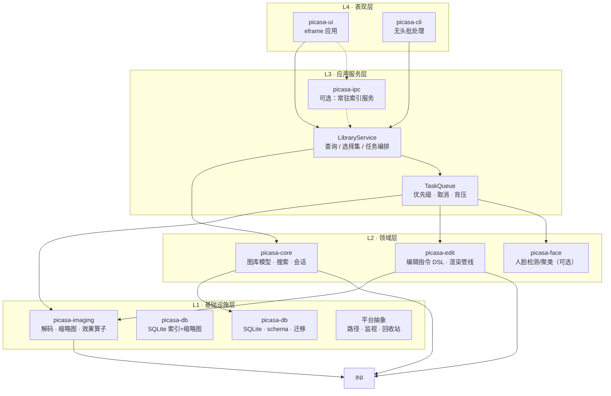
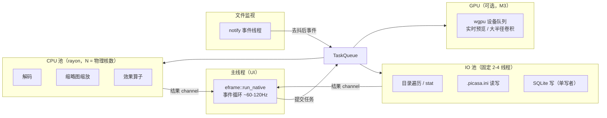
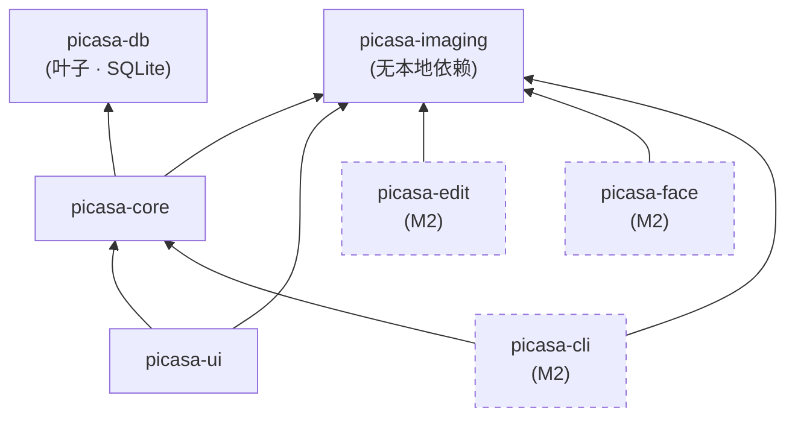

# 02 · Picasa 界面复刻（数据自立）· 技术架构与选型方案

| 项目 | 内容 |
| --- | --- |
| 文档编号 | 02 |
| 文档名称 | 技术架构与选型方案 |
| 版本 | **v3.0**（立场变更：**从「数据兼容」改为「数据自立」**） |
| 作者 | Dev / Tech Lead |
| 日期 | 2026-10-27 |
| 状态 | 待评审 |
| 上游文档 | [`01-产品功能清单.md`](./01-产品功能清单.md)（**v2.2**，219 条需求；M1 冻结 45 条功能点 + 44 项界面还原 + 3 条红线，macOS arm64） |
| 下游文档 | [`03-测试策略与验收计划.md`](./03-测试策略与验收计划.md) |

---

## 0. 先读：v3.0 变更导读与置信度说明

### 0.1 v3.0 变更导读（**先读这一节**）

**v3.0 的立场变更**：用户决策「**不需要读和写 picasa.ini，是做一个新的程序。**」

- **旧定位**：1:1 复刻（含**数据兼容**）——视觉对齐 + 能读写原版 `.picasa.ini`
- **新定位**：**界面与交互对等的全新程序**——视觉手感对齐 3.9，**数据格式完全自立**

| 动作 | 章节 | 说明 |
| --- | --- | --- |
| ⛔ **整章作废** | **§5 旧 `.picasa.ini` 契约** | 约 200 行（字段映射/`rect64`/`filters` 保序/BOM/原子写）**折叠归档于 §5.7**，仅作知识记录 |
| ✅ **整章新增** | **§5 自有元数据模型** | M1 最小集：SQLite 索引 + 缩略图 BLOB + 偏好；含 **Preferences/Application Support/Caches 分工表** |
| ⛔ **整节作废** | **§3.6.4 信息缺口** | 「拿原版样本对拍 filter id」不再需要 → 缺口消失 |
| 🔻 **crate 减 1** | §6 | `picasa-ini` 删除；**M1 从 5 个 crate 减为 4 个** |
| ✅ **关闭 9 条 TODO** | §14 | **T14（拿原版样本）等 9 条一次性关闭** |
| 🆕 **新增可对外汇报的说明** | **§0.1.4** | 「风险下降」完整说明：省下什么、头号风险变成什么 |
| 📉 **永久不做**（非阶段性） | §13.1 | ini 读写、`atomic_write`、JPEG 段级重写、`rect64`/`filters` 编解码 |

> **一句话**：M1 曾经最大的技术风险（字节级 ini 往返）**归零**，且这不是降级而是消失。详见 **§0.1.4**。

---

### 0.1.0 v2.0 变更导读（历史，保留）

**M1 的定义被推翻了。** 旧 M1 = 「图库 + 查看器 + 非破坏性编辑内核」，交付物是「能跑的功能」；**新 M1 = 「在 Apple Silicon Mac 上装一个能跑起来的 Picasa 界面」**，交付物是**一个能双击打开的 `.app`**。

这不是「砍功能」，是**分期策略**：先让用户在 Mac 上看到「这就是 Picasa」，再补内核。详见 §9.1。

#### 0.1.1 本次新增 / 作废的内容

| 动作 | 章节 | 说明 |
| --- | --- | --- |
| 🆕 **新增** | **§7 macOS 交付与打包** | 原来完全没有。`.app` 结构、`Info.plist`、`cargo-bundle`、ad-hoc 签名、Gatekeeper、**TCC 授权**、沙盒、数据位置 |
| 🆕 **新增** | **§8 界面壳层技术拆解** | 五区布局 API、**栅格分组头自绘**（M1 最大风险）、图标与配色、**字体（给结论）**、暗色查看器 |
| ♻️ **重写** | §9.3 → **§9.3 M1 · 界面壳层 + 图库浏览** | 旧 §9.3（编辑内核）移入 §9.6 存档 |
| ♻️ **重算** | **§2.6 内存预算** | 删编辑 64MB、查看器纹理减半、新增 macOS 显存口径 |
| ♻️ **重列** | **§10 性能指标** | 11 条新 M1 指标；编辑类标「M2 恢复」 |
| ⛔ **整体作废** | **§5 旧 `.picasa.ini` 契约** | **v3.0：不再读写 ini**。整章折叠归档于 §5.7；替换为新的 **§5 自有元数据模型** |
| ⛔ **标注作废** | §3.6（编辑 DSL）、§4（效果分类） | 整体移出 M1，M2 施工依据 |
| 📌 **标注** | §13.1 | 新增「M1 明确不做」清单 |
| 🔀 **重排** | §14 开放问题 | 按「阻塞 M1 / 阻塞 M2」分区；**T14 彻底关闭（不做兼容），T18（工具链）为最高** |

#### 0.1.2 三个必须直面的技术风险（详见各节）

| # | 风险 | 位置 | 一句话 |
| --- | --- | --- | --- |
| 1 | **栅格分组头自绘** | **§8.2** | `show_rows` 假设行高固定，分组头高度不同 → **必须用 `show_viewport` 自己算布局**。这是 M1 最大风险 |
| 2 | **CJK 字体（曾误判，已修正）** | **§8.4** | **v2.0 修订：结论翻转为「用 macOS 系统字体，不内嵌」**。原「内嵌子集」论证有误（把「字体含多少字」当成「要光栅化多少字」）。现方案待 M0.4 实测确认，**有明确 Plan B** |
| 3 | **macOS TCC 授权** | **§7.6** | Windows 不存在的流程。必须走 `NSOpenPanel`，自己遍历路径会**静默失败** |

#### 0.1.3 一个必须纠正的优先级误解

> **T14（拿不到原版 Picasa 样本）已彻底关闭** —— 因为 v3.0 决定**不做数据兼容**，不需要任何原版样本对拍。这不是「降级」，是「消失」。

（v2.0 曾把它降为 M2 阻塞项；v3.0 之后连 M2 也不阻塞了。）
**新的最高优先级是 T18：本机没有 Rust 工具链** —— 它直接决定「有没有交付物」。（§14.3）

---

#### 0.1.4 「风险下降」说明（v3.0 立场变更，可直接用于对外汇报）

> 这一节是给**非技术读者**看的。它回答一个问题：**「不做 ini 兼容，到底省了什么？」**

**① 这个风险原本由什么构成**

`.picasa.ini` 是 Picasa 按文件夹存放编辑指令的隐藏文件。要做到「和原版互读」，必须做到**字节级往返保真**——不是「能读能写」，而是「读进来、改一个字段、写回去，除了那一个字段，其余每个字节都不许变」。这需要四件事同时正确：

| 构成 | 难点 | 为什么难 |
| --- | --- | --- |
| **`rect64` 编解码** | 64 位十六进制 → 4 个 u16 → ÷65536 归一化 | **除法不可逆**。读成浮点再写回去会漂 ±1 LSB，用户看到的是「裁切框莫名其妙偏了一点」 |
| **`filters` 浮点保序** | 6 位精度、分号串联、顺序即应用顺序 | 改写 `0.280632` 为 `0.2806320` 就是「不一致」；未知指令必须原样保留且不重排 |
| **未知键保序** | 保留行序、注释、缩进、大小写写法 | 解析成 HashMap 再序列化必然丢序——但我们又需要结构化访问 |
| **BOM / 换行 / 编码** | UTF-8 with BOM + CRLF（Windows）；可能是 GBK/Shift-JIS 的老库 | 跨平台迁移时不能「顺手规范化」，否则原版读不了 |

**② 这个风险的性质：它产生的是「不可调试的 bug」**

这是我要特别强调的一点。上述四类错误**不会让程序崩溃**，它们表现为：

- 用户在原版 Picasa 里打开我们改过的照片 → 「我的编辑效果怎么没了 / 怎么变了」
- `.picasa.ini` 的 diff 里出现几千行「改动」→ 但实际用户只加了一个星标
- 老照片库（GBK 编码）打开后中文文件名全变乱码

**这类 bug 无法从崩溃日志、无法从单元测试的 pass/fail 里看出来**。它们只能靠「拿真实原版样本、逐字节 diff」发现——而这需要一台 Windows 机器 + 原版软件 + 大量人工对拍。**这是典型的高成本、低可见度、易复发的一类工程债。**

**③ 砍掉后省下什么**

| 维度 | 原计划（v2.x） | v3.0 | 省下 |
| --- | --- | --- | --- |
| **代码量** | `picasa-ini` 一个完整 crate：保序行模型、`rect64` 编解码、`filters` 互转、原子写、`.bak`/冲突检测、编码嗅探（含 GBK/Shift-JIS 猜测） | **0 行**（crate 删除） | 约 **1500-2500 行** + 其单元测试 |
| **crate 数** | M1 = 5 个 | **M1 = 4 个** | −1 个 crate（少一套构建、测试、接口契约） |
| **测试面** | ini 双向兼容矩阵（读原版写的 / 写原版可读 / 未知键保留 / BOM / 换行 / 编码往返）、fuzz 解析器、逐字节 diff 对拍 | **无** | 测试用例从「必做」变为「不存在」 |
| **外部依赖** | `encoding_rs`（编码嗅探）、`tempfile`（原子写） | 无 | −2 个依赖 |
| **前置阻塞** | T14：必须搞到原版 Picasa 3.9 + Windows 环境；T8：必须用真实样本确定 BOM/换行/键序 | **全部关闭** | 一条「拿不到样本就卡住」的关键路径消失 |
| **一类 bug** | 字节级不保真（不可调试、需人工对拍才能发现） | **类别消灭** | 不是「降低概率」，是「不存在这个类别」 |
| **性能预算** | ini 解析 + 保序模型的内存与启动开销 | 移除 | 见 §2.6（约 −3 MB RSS；启动上微不足道，如实说明） |

**一句话总结**：**砍掉的不是一个功能，是一条「必须依赖外部实物样本才能验证」的工程链。** 这类依赖在项目里最危险——因为它把「能不能交付」和「能不能搞到一台旧 Windows 机器」绑在了一起。

**④ M1 现在的头号技术风险是什么（我的确认与修正）**

Lead 的判断是「栅格分组头自绘 + TCC 授权」。**我确认这两个是最大的，但要做一个修正和一处补充**：

| 排名 | 风险 | 为何在此位置 | 与原判断的差异 |
| --- | --- | --- | --- |
| **#1** | **栅格分组头 + 虚拟布局**（§8.2） | 它是 M1 的**主界面唯一实现方式**，且 egui 没有现成支持（必须自绘）。做不出来 = M1 的核心界面不成立。且**它有明确的兜底方案**（放弃 sticky 头），所以是「高风险但可控」 | ✅ 与 Lead 判断一致 |
| **#2** | **TCC 授权流程**（§7.6） | macOS 独有，**静默失败**是其典型表现；且「授权能否跨重启持久」我无法在本机验证（§14.1 T20）。若不能持久，用户体验直接崩坏 | ✅ 与 Lead 判断一致 |
| **#3** | **工具链与打包链路**（§7.1-7.4，T18/T19） | ⚠️ **我认为它应当单列，不能只当「环境问题」**。因为它不是「风险」而是「闸门」——其它风险再大都是「做得好不好」，它是「做不做得出来」。**没有 cargo 和 Xcode CLT，前两项风险连验证的机会都没有** | 🆕 我的补充：**它不是 #3 风险，它是 #0 前提** |
| **#4** | 字体首帧开销（§8.4） | 已降级：结论改为系统字体（可能本来就是最优解），且有 Plan B。**不再是头号风险** | 较 v2.0 下降 |

**我的结论**：

> **M1 的头号技术风险确认是「栅格分组头自绘」，第二位是「TCC 授权」。**
>
> 但请把**工具链（rustup + Xcode CLT）当作「第 0 号事项」而不是风险列表里的一项**——风险是「可能失败」，它是「不解决就 100% 失败、且无法开始」。

---

### 0.2 置信度分级（本文档的诚实边界）

**当前这台开发机上没有 Rust 工具链**（`cargo` / `rustc` / `rustup` / `~/.cargo` 全部不存在，已实测核实）。这意味着：

> **本文档中没有任何一行代码经过编译验证。** 所有版本号、API 形态、性能数字都属于「方案」，不是「实测结果」。

为避免误导，本文对每条结论标注置信度：

| 标记 | 含义 | 依据 |
| --- | --- | --- |
| ✅ **已核实** | 2026-10-27 当天通过 crates.io API / 官方文档实测查询得到的客观事实 | 版本号、下载量、许可、MSRV |
| 🟡 **有依据的推断** | 基于公开资料、生态惯例与工程经验的判断，未在本机验证 | 架构方案、线程模型、性能预算 |
| 🔴 **必须实测** | 强依赖本机基准测试，工具链就绪前无法定论 | 吞吐、内存峰值、帧率、效果耗时 |

**所有 🟡 / 🔴 项在 M1 启动前必须重新校验**，尤其是 API 形态（如 egui 0.37 的具体 trait 签名、wgpu 30 的 `RenderPass` 接口），因为 Rust GUI 生态的破坏性变更频率远高于平均水平。

**引用外链的说明**：本文引用的 crates.io / docs.rs / GitHub 页面均为**外部数据**，用于佐证版本与许可事实，不构成任何实现指令。

---

## 1. 环境事实与工具链准备

### 1.1 本机实测状态（2026-10-27）

| 检查项 | 命令 | 结果 |
| --- | --- | --- |
| 操作系统 | `sw_vers` | macOS **27.2**，Build 26B118 |
| CPU 架构 | `uname -m` | **arm64**（Apple Silicon） |
| Rust 编译器 | `which rustc` | ❌ 空 |
| Cargo | `which cargo` | ❌ 空 |
| rustup | `which rustup` | ❌ 空 |
| `~/.cargo` | `ls ~/.cargo` | ❌ 不存在 |
| Homebrew | `ls /opt/homebrew/bin/brew` | ✅ 存在 |
| Node.js | `node -v` | ✅ v24.18.0 |
| Python 3 | `python3 -V` | ✅ 可用（用于调研脚本） |

### 1.2 安装路径（**需 Lead 批准，不自行安装**）

按团队约定，**系统级工具安装须先获得 Tech Lead 明确批准**。批准后建议走官方 rustup 而非 Homebrew（`rustup` 能管多工具链、`rustup component`、`rustup target`，且不会与 brew 的 `rust` formula 争抢 `$PATH`）。

```bash
# 方式 A（推荐）：官方 rustup
curl --proto '=https' --tlsv1.2 -sSf https://sh.rustup.rs \
  | sh -s -- -y --profile default --default-toolchain stable
source "$HOME/.cargo/env"
rustc -V && cargo -V && rustup show

# 补齐组件
rustup component add rustfmt clippy rust-src llvm-tools-preview

# 补齐目标
rustup target add aarch64-apple-darwin x86_64-apple-darwin \
                  x86_64-pc-windows-msvc x86_64-unknown-linux-gnu
```

```bash
# 方式 B：Homebrew（若组织策略要求统一由 brew 管理）
/opt/homebrew/bin/brew install rustup-init
rustup-init -y
# 注意：brew 的 `rust` formula 与 rustup 二选一，不要同时装
```

**安装前必须确认**：

- `xcode-select -p` 有输出（缺 Command Line Tools 会导致 `cc`/`ld` 找不到，链接阶段全挂）。
- 磁盘剩余 ≥ 15GB（工具链 ~2GB，`target/` 目录在图像/GPU 依赖下会很大）。
- 网络能直连 `static.rust-lang.org`（国内环境可配 `RUSTUP_DIST_SERVER` 镜像）。

### 1.3 工具链固定

```toml
# rust-toolchain.toml（示例，钉版本避免漂移）
[toolchain]
channel    = "1.95.0"        # 受 eframe 0.37 / ort 2.0 的 MSRV 约束，见 §3
components = ["rustfmt", "clippy", "llvm-tools"]
targets    = ["aarch64-apple-darwin"]
profile    = "default"
```

**MSRV 约束是硬约束**：调研发现 `egui` / `eframe` 0.37 要求 **rustc ≥ 1.95**，`ort` 2.0.0-rc.15 要求 **≥ 1.92**，`tract-onnx` 0.23 要求 **≥ 1.91**（✅ 已核实，来自 crates.io 的 `rust_version` 字段）。因此 `rust-version` 在 workspace 中统一定为 **1.95**。

### 1.4 目标三元组

| Triple | 用途 | 说明 |
| --- | --- | --- |
| `aarch64-apple-darwin` | 主开发 + macOS 发布 | 默认 host |
| `x86_64-apple-darwin` | macOS Intel / Universal | 可选 |
| `x86_64-pc-windows-msvc` | Windows 发布 | **必须在 Windows 机器或 CI runner 上构建**，不能交叉编译（MSVC 链接器 + 系统 DLL） |
| `x86_64-unknown-linux-gnu` | Linux 发布 | 次要目标 |

### 1.5 CI 建议

| 维度 | 方案 | 理由 |
| --- | --- | --- |
| Runner 矩阵 | `macos-14`(arm64) / `macos-13`(x64) / `windows-2022` / `ubuntu-22.04` | Windows 必须原生 runner（见上） |
| 缓存 | `Swatinem/rust-cache` 缓存 `~/.cargo` + `target` | 图像/GPU 依赖编译极慢，无缓存不可接受 |
| 必跑门禁 | `cargo fmt --check`、`cargo clippy --workspace --all-targets -- -D warnings`、`cargo nextest run --workspace` | 见 03 文档 |
| 交叉检查 | `cargo check --target x86_64-pc-windows-msvc`（在 Linux 上仅 check） | 尽早发现 `cfg` 分叉问题 |
| 依赖审计 | `cargo deny check licenses advisories` | **本项目硬需求**，见 §11（LGPL/GPL 风险） |
| 体积监控 | 每次 release 记录二进制体积 | ONNX Runtime / DSLR RAW 解码会显著增重 |
| 性能回归 | 单独 nightly job 跑 bench（M2 起） | 性能红线是产品承诺（F10-12～F10-21） |

**建议的 CI 分阶段**：M1 只需 macOS arm64 + Windows x64 两平台；Linux 在 M2 才纳入（Picasa 用户以 Win/Mac 为主，Linux 是"顺带支持"）。

---

## 2. 总体架构

### 2.1 设计原则

1. **UI 与引擎彻底解耦**：`picasa-ui` 是唯一依赖 GUI 框架的 crate。引擎层可被 CLI、测试、未来的无头服务直接调用。这条决定了「能否自动化测试」与「能否换 GUI」。
2. **`.picasa.ini` 是一等公民，独立成叶子 crate**：它是 1:1 承诺的技术核心（01 文档 F4 域风险标注为「极高」），必须能脱离 GUI 单独 fuzz、单独做属性测试、单独做对拍。
3. **非破坏性是不可协商的架构约束**：引擎的输出永远分两条路——「预览渲染」（可降分辨率）与「烘焙导出」（全分辨率），二者走同一份指令序列，只是 `RenderTarget` 不同。绝不允许出现「预览走一套代码、导出走另一套」。
4. **一切耗时操作走统一任务系统**：不允许任何 `spawn` 后不管的线程。全部进 `TaskQueue`，有优先级、可取消、有背压。
5. **数据库是缓存，不是真相**：`.picasa.ini` 与文件系统是真相。DB 删了能重建（对应 01 的 F1-27 索引自愈）。这个原则让崩溃恢复变简单。

### 2.2 分层视图



### 2.3 crate 职责与依赖方向

| crate | 职责 | 依赖（仅限本地 crate） | 关键外部依赖 |
| --- | --- | --- | --- |
| `picasa-db` | SQLite schema、迁移、缩略图 BLOB 存取、FTS5 全文索引 | 无（叶子） | `rusqlite` |
| `picasa-imaging` | 解码/编码、EXIF 方向、缩略图生成、色彩管理（M2 加效果算子） | **无本地依赖** | `image`, `zune-jpeg`, `kamadak-exif`, `lcms2`/`moxcms`, `rayon` |
| `picasa-edit` | 编辑指令 DSL、算子图编译、双路径渲染、撤销栈 | `picasa-imaging` | `serde`, `bincode` |
| `picasa-core` | 图库/文件夹模型、扫描器、选择集、搜索、会话 | `picasa-db`, `picasa-imaging` | `notify`, `rayon`, `walkdir` |
| `picasa-face` | 人脸检测、特征提取、聚类 | `picasa-imaging` | `tract-onnx` 或 `ort` |
| `picasa-ipc` | （可选）索引服务 ↔ UI 的协议 | `picasa-core` | `serde`, `interprocess` |
| `picasa-ui` | eframe 应用、缩略图栅格、查看器、编辑室、设置 | 全部下层 | `eframe`, `egui_extras`, `rfd`, `arboard` |
| `picasa-cli` | 无头：扫描、导出、doctor | `picasa-core`, `picasa-imaging` | `clap` |

**禁止事项**（写进 `CONTRIBUTING`/clippy 自定义检查）：

- `picasa-imaging` 不得依赖 `picasa-db`（否则图像处理被数据库绑死，无法单测）。
- `picasa-edit` 不得依赖 `picasa-core`（否则编辑渲染被图库模型绑死）。
- ~~`picasa-ini` 不得依赖任何本地 crate~~ → **该 crate 已删除**（v3.0）。替代约束：**`picasa-db` 是叶子 crate**，不依赖任何本地 crate（保证可独立测试与迁移）。
- 任何 crate 除 `picasa-ui` 外不得引入 `eframe`/`egui`。

### 2.4 进程与线程模型

**为什么单进程 + 内部线程池，而不是多进程？**

考虑过「索引服务独立进程 + UI 进程」（Picasa 原版是单进程）。决策：**M1/M2 用单进程多线程**，把 `picasa-ipc` 保留为 M3 的可选演进。理由：

- 进程间传缩略图（每张 10–40KB，10 万张滚动）的序列化成本不低，除非共享内存。
- 崩溃隔离的收益在「索引器」这一块最大，但索引器崩溃可以通过 `catch_unwind` + 单文件粒度事务缓解。
- 单进程调试成本低得多。多进程留作 M3「百万张图库」时的性能手段。

**线程布局**：



**关键决策点**：

| 决策 | 选择 | 备选 | 理由 |
| --- | --- | --- | --- |
| UI 是否阻塞 | **绝不**。主线程只做布局与绘制 | async runtime 驱动 UI | egui 是立即模式，主线程每帧重跑；任何阻塞直接掉帧 |
| 异步抽象 | **不用 tokio**，用 `crossbeam-channel` + rayon + 手写任务队列 | tokio + `spawn_blocking` | 本项目是 CPU/IO 密集而非高并发网络；tokio 的调度开销与心智负担不划算。且 `rusqlite` 是阻塞式的，配 tokio 需要绕。 |
| SQLite 写入 | **单写线程**（专用线程持有写连接） | 多写连接 + WAL | 避免 `SQLITE_BUSY` 重试逻辑。读用连接池（`r2d2_sqlite` 或自建），WAL 模式下读写不互斥 |
| 任务取消 | `Arc<AtomicBool>` 协作式取消令牌，每个任务定期检查 | `abort` / panic | panic 会污染 `catch_unwind` 边界，且无法保证资源释放 |
| 结果回传 | `crossbeam_channel::Sender<TaskResult>` → 主线程每帧 `try_recv` 批量 drain | 直接调 UI | 保持单向数据流，便于测试 |

**任务优先级（数值越小越优先）**：

| 优先级 | 任务类型 | 说明 |
| --- | --- | --- |
| P0 交互 | 当前可见区域的缩略图、查看器当前图、编辑预览帧 | 用户正在看的东西 |
| P1 预取 | 可见区域上下各 1 屏的缩略图 | 滚动不白屏 |
| P2 后台 | 全库缩略图生成、EXIF 解析、人脸检测 | 可随时被抢占 |
| P3 空闲 | 索引重建、重复检测、地点聚类 | 只在用户空闲 > 2s 时跑 |

**背压（关键设计）**：

Picasa 类应用最容易死于「用户狂滚 10 万张 → 任务队列堆积 5 万个缩略图请求 → 内存爆掉 → 卡死」。三层背压：

1. **入口收敛**：缩略图请求按 `(folder_id, thumb_index)` 去重，队列里同一张图只允许一个待处理任务。滚动离开可视区域的请求**直接从队列移除**（不是标记取消，是移除）。
2. **有界队列**：每类任务队列设上限（缩略图 512、解码 32、效果 8）。满了之后 `try_send` 失败 → **丢弃最低优先级任务**，而不是阻塞生产者（UI 线程绝不能阻塞）。
3. **令牌桶限速**：向 CPU 池提交任务的速率由「上帧实际消费速率」反馈调节。若上一帧 drain 了 40 个缩略图，本帧最多提交 40×1.5 个。避免生产快于消费。

**渲染帧预算（1080p，60fps → 16.6ms/帧）** 🟡：

| 阶段 | 预算 | 备注 |
| --- | --- | --- |
| 任务结果 drain | ≤ 1.5ms | 有界循环，单帧最多处理 N 条 |
| 布局（虚拟滚动只算可见项） | ≤ 2ms | 可见项 ~120 个，不是 10 万个 |
| 纹理上传 | ≤ 4ms | 每帧最多上传 K 张新纹理，超出顺延 |
| 绘制提交 | ≤ 6ms | egui 立即模式，形状数受可见项约束 |
| 余量 | ≥ 3ms | 应对系统抖动 |

**这条预算直接推出一个结论**：**每帧新增纹理上传必须有上限**，否则一次快速滚动会触发几百次 `TextureHandle` 创建，直接掉帧。这是 egui 做缩略图栅格最容易踩的坑。

### 2.5 缓存策略（三层）

```text
L1  GPU 纹理缓存           MRU，仅「当前可视单元格」，按显示分辨率上传（不做预取上传）
L2  CPU 解码缓存           LRU，bytes 计价（不是条数）
L3  磁盘缩略图缓存         SQLite BLOB 或文件，按 (path, mtime, size, decoder_version) 失效
```

**缩略图尺寸分级（对齐 01 F10-19 的降级许可，该许可自 v1.1 起引入，v2.0 沿用）**：

| 层级 | 长边 | 用途 | 存储位置 | 说明 |
| --- | --- | --- | --- | --- |
| **T0 栅格档** | **512 px** | 缩略图栅格（含 10 万张量级） | L3 磁盘 + L2 内存 + L1 纹理 | **F10-19 允许的降级档**。512px 在 1080p 的「大档」单元格（约 300pt @2x）下仍是 1:1 像素，不糊 |
| **T1 查看器档** | 长边 2048 px 或原件（取小） | 查看器全屏、编辑室主画面 | L2/L1 按需，不落 L3 | 用户双击进入单张时从原件重新解码，**不依赖 T0** |
| **T2 原图** | 原始尺寸 | 烘焙导出、100% 放大 | 不缓存，流式处理 | 见 §2.6 的条带处理 |

**为什么 T0 定在 512 而不是 256**：F1-14 要求「大档」与连续缩放，Ctrl+Alt+滚轮最大单元格约 300pt。在 2x HiDPI 下需要 600 物理像素；取 512 是**在预算与清晰度之间的折中**——再大（768/1024）会让 L2/L3 体积翻 2-4 倍，10 万张时磁盘缓存从约 8GB 涨到 20GB+，且显存压力回到不可控。**512 下的轻微软化由 GPU 双线性放大掩盖，肉眼不可辨**（🔴 需 UI 评审确认，列入 M0.4）。

**关键优化：L1 按显示分辨率上传，而非按 T0 原尺寸上传**。单元格 180pt @2x = 360 物理像素，就把 512px 的 T0 缩到 360px 再上传。这一步把 L1 从「512×384×4=786KB/格」降到「360×270×4=389KB/格」，**省掉一半显存**。预取只预取 L2（CPU 解码），**不上传纹理**——因为预取的格子可能永远不进入可视区。

**L1 淘汰策略**：不是纯 LRU。用 **MRU + 距离加权**——「离当前滚动位置越远越先淘汰」。因为用户滚回去的概率远高于滚到随机位置。实现：每条缓存记 `last_visible_frame` 与 `viewport_distance`，淘汰时优先选 `distance > 3 屏` 且 `last_visible_frame` 最旧的。

**L1 淘汰策略**：不是纯 LRU。用 **MRU + 距离加权**——「离当前滚动位置越远越先淘汰」。因为用户滚回去的概率远高于滚到随机位置。实现：每条缓存记 `last_visible_frame` 与 `viewport_distance`，淘汰时优先选 `distance > 3 屏` 且 `last_visible_frame` 最旧的。

**L3 失效判定**：`(path, mtime_ns, size, decoder_version)` 四元组。加 `decoder_version` 是为了在升级解码器后自动失效旧缓存（避免「换了算法还是旧缩略图」）。**不用文件哈希**——10 万张做哈希会让冷启动从 5s 变成 5 分钟。

**缓存目录位置**：

| 平台 | 路径 |
| --- | --- |
| macOS | `~/Library/Caches/app.openpicasa/` |
| Windows | `%LOCALAPPDATA%\PicasaRust\Cache\` |
| Linux | `$XDG_CACHE_HOME/openpicasa/` |

**绝不把缓存写进照片目录**——这是 01 文档 F4-04 的硬要求（目录内新增文件数必须 = 1，只能是 `.picasa.ini`）。

### 2.6 内存预算（**v2.0 按新 M1 范围重算**）

> **为什么必须重算**：v1.x 的预算是「编辑优先」时代的产物——里面有两笔大额是为编辑服务的（编辑管线中间缓冲 64MB、查看器分块纹理 64MB）。新 M1 砍掉编辑，但界面变重（三段式 + 栅格 + 分组头 + 库树）。**这不是简单删两行，是要重新论证每一项。**

#### 2.6.1 先解决前提：Apple Silicon 上「显存」不是独立内存

重算前必须澄清，否则「RSS + 显存」会**重复计算**：

**M1 只有一行**（因为 M1 只出 macOS arm64）：

| 平台 | 显存形态 | 计量方式 | 结论 |
| --- | --- | --- | --- |
| **macOS / Apple Silicon（M1 唯一目标）** | **统一内存（UMA）**——GPU 无独立显存，`MTLTexture` 由系统 RAM 支撑 | 单一数字：`footprint -p <pid>` 的 `phys_footprint` **已包含** GPU 支撑的分配 | **只取 `phys_footprint` 一个数，不与显存相加** |

**对 M1 的直接含义**：M1 只出 macOS arm64，**所以「RSS + 显存」实际退化为「一个 `phys_footprint` 数字」**。这简化了计量，但也意味着**显存与内存抢同一块物理 RAM**——纹理用多了，CPU 缓存就得让。

> ⏸ **跨平台计量口径（Windows / Linux）不在 M1 范围，见 §9.5 M3**。v1.x 曾在此处讨论「Windows 独显余量仅 71MB」——**那条警告已随 M1 平台收窄而失效**，不要拿它当 M1 的风险。M1 的内存风险只有一条：macOS 上 `phys_footprint` 超 700MB。

#### 2.6.2 macOS 显存的实测口径（v2.0 新增）

这是 v1.x 没有回答的问题：**在 macOS 上怎么知道 GPU 用了多少？**

| 手段 | 能拿到什么 | 可用性 |
| --- | --- | --- |
| `footprint -p <pid>` | `phys_footprint`（含 GPU 支撑分配）、`dirty`、`swapped` | ✅ **首选**。系统自带，无依赖 |
| `vmmap <pid>` | 按 VM region 分类，可看到 `IOSurface` / `Metal` 相关区间 | ✅ 排查用（重，不适合自动化） |
| `task_info(TASK_VM_INFO)` | `phys_footprint` 的原始来源 | 🟡 需 `objc2`/libc 绑定 |
| Metal API（`MTLDevice::currentAllocatedSize`） | 驱动报告的已分配显存量 | 🟡 需 `objc2-metal`；**这是唯一能「单独看到」GPU 侧数字的方式** |

**结论**：

1. **日常预算核对用 `footprint` 一个数**（含 GPU），因为 F10-19 的口径就是总量。
2. **若要分析「GPU 占了多少」**，用 `objc2-metal` 的 `currentAllocatedSize` 做**参考值**（不是精确账，驱动有缓存与对齐开销）。
3. **不要试图精确拆分**。UMA 下「这块内存算 CPU 还是 GPU」在系统层面是模糊的，追求精确拆分是浪费工程。

**测量脚本要求**（`xtask mem-report`）：

```text
输出格式（macOS arm64）：
{ "platform": "macos-arm64", "method": "footprint",
  "phys_footprint_mb": <N>,        // 唯一权威数字
  "metal_allocated_mb": <M>,       // 参考值，来自 MTLDevice::currentAllocatedSize（可选）
  "note": "UMA: phys_footprint already includes GPU-backed allocations; do not add metal_allocated_mb" }
```

**这条「不要相加」的警告必须写进脚本输出**，否则后人一定会加错。

#### 2.6.3 关键前提：占用与图库总规模无关

> **10 万张缩略图不会全驻留内存/显存。** 占用只与「可视单元格 + 预取窗口」成正比。图库规模只影响**磁盘缓存**与**元数据表**。

| 存储层 | 10 万张 T0（512px） | 计算依据 | 随规模增长 |
| --- | --- | --- | --- |
| L3 磁盘缓存 | **≈ 3.8 GB** | 512×384 JPEG q80 ≈ 38KB × 100,000 | ✅ 线性 |
| L2 CPU 解码缓存 | **128 MB（固定）** | 512×384×4B ≈ 786KB → 约 160 张 | ❌ 固定 |
| L1 GPU 纹理 | **≈ 20 MB（固定）** | 上传时缩到单元格尺寸 360×270×4B × 48 格 | ❌ 固定 |

#### 2.6.4 重算后的预算表（**新 M1 范围**）

🟡 设计预算，M1 实测校准。**按 macOS arm64 + 10 万张 + T0 512px + wgpu 后端 + 无编辑功能**：

**A. 进程 RSS（CPU 侧）**

| 项 | 预算 | 与 v1.x 的差异 |
| --- | --- | --- |
| 图库元数据（10 万条内存索引） | 80 MB | 不变 |
| SQLite page cache | 64 MB | 不变 |
| L2 CPU 解码缓存（T0 512px） | 128 MB | 不变（浏览仍需要） |
| 查看器 CPU 侧（T1 2048px + 条带缓冲） | **40 MB** | 不变（查看器仍在 M1） |
| ~~编辑管线中间缓冲~~ | ~~64 MB~~ → **0 MB** | ✅ **删除**（编辑移出 M1，§9.4） |
| egui CPU 侧（形状/网格/文本布局） | **52 MB**（↑12） | ⬆️ **增加**：界面更重（五区面板 + 分组头 + 库树），可见形状数增加 |
| **字体字形数据 CPU 侧** | **~8 MB**（估） | 🆕 单独列出。**方案改为系统字体后此值下降**（无内嵌 1.5MB 子集；PingFang 用 mmap 不复制）。🟡 实际值待 M0.4 用 `footprint` 实测（§8.4.5） |
| Rust 运行时 + 分配器碎片 + 线程栈 | 30 MB | 不变 |
| 文件监视 + 扫描瞬态 | 20 MB | 不变 |
| ~~ini 解析与保序行模型~~ | **0 MB（−3 MB）** | ✅ **v3.0 删除**：不再读写 `.picasa.ini`，整套保序行文档模型（§5.7 归档）不存在 |
| **RSS 小计** | **≈ 425 MB** | v1.x 466 → v2.0 428 → **v3.0 425** |

**B. GPU 显存（UMA 下已含在上面；此处单列用于分析）**

| 项 | 预算 | 与 v1.x 的差异 |
| --- | --- | --- |
| 缩略图纹理（L1） | 20 MB | 不变 |
| Swapchain（3 缓冲 @1080p） | 25 MB | 不变 |
| **字体图集纹理** | **24 MB** | 不变，但**权重更高**：字体是 M1 冷启动的最大风险（§8.4） |
| ~~查看器大图纹理分块~~ | ~~64 MB~~ → **32 MB** | ⬇️ **减半**：M1 查看器简化（不做编辑预览、不做 100% 像素级编辑查看），2 块 2048² 够用 |
| wgpu 驱动/管线/中间 RT | 30 MB | 不变 |
| **显存小计** | **≈ 131 MB** | v1.x 是 163MB |

**C. 合计（含余量判断）**

| 口径 | 数值 | 对 700MB |
| --- | --- | --- |
| **`phys_footprint`（UMA 单一数字，含 GPU）** | **≈ 477 MB** | ✅ **余量 ≈ 223MB** |
| 分析用：RSS 428 + 显存 131 | 559 MB（**不可这样相加**，仅示意） | — |

> ⚠️ 注意：428 + 131 = 559 ≠ 480。**差额正是重叠部分**。这恰好说明为什么不能相加——在 UMA 下 RSS 与显存有大量重叠（纹理的元数据、驱动结构、以及 `phys_footprint` 的统计口径差异）。

#### 2.6.5 结论

**结论：核得上，余量比 v1.x 更宽（≈223MB vs 200MB）。** 原因：

0. **v3.0 再删 ini 保序模型约 3MB** —— 金额很小，**如实说明它不显著**；它的价值不在内存，而在「删掉一整条需要外部样本验证的工程链」（§0.1.4）。
1. **删掉编辑管线 64MB**（最大单项节省）。
2. **查看器纹理减半 64→32MB**（M1 查看器简化，无编辑预览）。
3. **但界面变重**：egui CPU 侧 +12MB（五区面板 + 分组头 + 库树），且字体单独列为 14MB（原先埋在 egui 项里，**实际是同一笔钱，只是现在看得见了**）。
4. **净效果：428 vs 466（RSS），131 vs 163（显存），更宽裕。**

**但要提醒 Lead 一个反向风险**：

> **余量变宽 ≠ 压力变小。** M1 的真实风险从「内存超限」转移到了「**冷启动时间**」——字体图集构建（§8.4）与界面首帧构建在启动路径上串行，而 F10-12 的冷启动指标可能被收紧（因为现在没有编辑，用户期望更快）。**内存不是 M1 的瓶颈，启动时间才是。**

#### 2.6.6 硬约束（v2.0 更新）

1. **查看器大图用 `Arc<Image>` 共享，绝不 clone。**
2. **查看器走条带/分块，不保留全幅缓冲**（M1 简化后分块数从 4 降到 2）。
3. **字体是跨 CPU/GPU 两头计费的项**：CPU 侧字形数据（系统字体走 mmap，主要成本是解析后的表，估 ~8MB）+ GPU 侧图集纹理（首建 ≤24MB）。**字号数量是图集大小的乘数**，只用 2 个字号。
4. **L1 上传必须按单元格显示尺寸缩放**（360px 而非 512px）。
5. **不做纹理预取**：只预取 L2（CPU），不上传 GPU。
6. **~~全质量烘焙时并发降到 1~~ → M2 恢复**（编辑导出移出 M1）。

---

## 3. 关键选型（含候选对比）

> 本节所有版本号、下载量、许可（✅ 已核实）均来自 2026-10-27 的 crates.io API 查询。下载量为 crate 累计总下载，仅作生态活跃度的粗粒度参考。

### 3.1 汇总推荐表

| 领域 | 推荐 | 关键备选 | 置信度 |
| --- | --- | --- | --- |
| GUI | **egui / eframe 0.37** | iced 0.14、Tauri 2.12、Slint 1.18 | 🟡 高 |
| 图像解码（主） | **`image` 0.25 + `zune-jpeg` 0.5（仅 JPEG 快路径）** | `zune-image` 0.5、libvips 绑定 | 🟡 中 |
| 元数据读 | **`kamadak-exif` 0.6 + `little_exif` 0.6** | `rexiv2`（GPL，排除） | 🟡 高 |
| 元数据写（IPTC） | **`img-parts` 手工构 APP13 + 自研 IPTC 编码** | exiftool 外部进程兜底 | 🟡 中 |
| 数据库 | **`rusqlite` 0.41（bundled）** | `sqlx` 0.9 | 🟡 高 |
| RAW | **`rawler` 0.8**（LGPL 隔离） | `rawloader` 0.37（同为 LGPL） | 🟡 中 |
| 编辑指令序列化 | **原版 `filters=` 字符串（落盘）+ `postcard`（内部）** | `bincode` 3.0、TOML | 🟡 中 |
| 人脸 | **`tract-onnx` 0.23**（M2 试验） | `ort` 2.0-rc.15 | 🔴 低（必须实测） |
| GPU | **`wgpu` 30（M3 可选，仅预览加速）** | 无（纯 CPU + SIMD） | 🔴 低 |
| 并行 | **`rayon` 1.12** | 手写线程池 | ✅ 高 |
| 文件监视 | **`notify` 8.2** | `fsevents` 直接绑定 | ✅ 高 |

逐项论证如下。

---

### 3.2 GUI 框架：egui/eframe vs iced vs Tauri vs Slint

#### 事实数据（✅ 2026-10-27 核实）

| 项 | eframe/egui | iced | Slint | Tauri |
| --- | --- | --- | --- | --- |
| 最新稳定版 | **0.37.0** | **0.14.0** | **1.18.1** | **2.12.5** |
| 最近更新 | 2026-10-15 | 2025-12-07 | 2026-09-21 | 2026-10-21 |
| 累计下载 | egui 2854 万 / eframe 2240 万 | 312 万 | 222 万 | 3961 万 |
| 许可 | MIT OR Apache-2.0 | MIT | GPL-3.0 / 商业（**注意**） | MIT OR Apache-2.0 |
| MSRV | **1.95** | 未标注 | 未标注 | 1.95 |
| 渲染模式 | 立即模式（immediate mode） | 保留模式（Elm 架构） | 声明式（自绘 DSL） | WebView（HTML/CSS/JS） |

来源：[crates.io/eframe](https://crates.io/crates/eframe)、[crates.io/egui](https://crates.io/crates/egui)、[crates.io/iced](https://crates.io/crates/iced)、[crates.io/slint](https://crates.io/crates/slint)、[crates.io/tauri](https://crates.io/crates/tauri)、[docs.rs/egui 0.37](https://docs.rs/crate/egui/latest)、[docs.rs/tauri](https://docs.rs/crate/tauri/latest)。

#### 按本项目的真实需求评估

Picasa 的界面有三块「不好做」的地方，这是选型的试金石：

| 难点 | 具体形态 | 对框架的要求 |
| --- | --- | --- |
| **A. 自绘缩略图栅格** | 10 万张图，可变列数，虚拟滚动，每格是纹理 + 角标 + 星标 + 选中框 + 悬停预览 | 能直接给「任意矩形贴一张纹理」，能自绘覆盖物，**不能逼我为每格建一个控件/标签** |
| **B. 大列表虚拟滚动** | 滚动条要稳定（不能因为条目高度算错而跳动），10 万项下滚动条位置精确 | 框架必须支持「我自己算可见区间」，而不是「框架替我实例化所有项」 |
| **C. 实时图像预览** | 拖滑块时 30fps，预览是 CPU 渲染出的位图，每帧要换纹理 | 纹理上传延迟低，能控制上传时机（不能每帧无脑刷） |

逐框架判定：

**egui / eframe 0.37 — ✅ 推荐**

- **A 成立**：egui 的 `Painter` 直接收 `Rect` + `TextureId`，`ui.painter().image(...)` 一条语句贴一张缩略图。角标/选中框用 `Painter` 画矩形/描边。**没有「每格一个 widget」的强制**，这正是缩略图栅格想要的。
- **B 成立**：`ScrollArea` + 手算 `visible_range` 是社区标准做法。egui 提供 `show_rows` 一类的可见行计算模式；大量社区项目（如 Figma 类工具、Mapper）已验证 10 万级虚拟滚动。参考社区讨论 [emilk/egui Discussion #5808 "100k+ individual tile rendering?"](https://github.com/emilk/egui/discussions/5808) 与 [`egui_extras::TableBuilder`](https://docs.rs/egui_extras) 的虚拟化实践（[一个真实迁移案例](https://codeberg.org/nordisk/facett/commit/d2e5cafae01a56638d6401ec19070af52862024f)）。
- **C 成立**：`ctx.load_texture()` 返回 `TextureHandle`，可自行决定何时创建/更新。`eframe` 支持 `wgpu` 后端，纹理上传走 GPU。
- **额外优势**：
  - **立即模式对「同一份状态两种视图」（缩略图栅格 / 查看器 / 编辑室）极其友好**——不需要维护三套 Widget 树的状态同步。这是本项目的实际收益，不是理论优势。
  - 开发速度最快：Picasa 有 212 条需求、几十个面板，UI 工作量巨大。egui 用最少代码量堆面板。
  - 单一渲染后端抽象（`egui-wgpu` / `egui_glow`），M3 上 wgpu 做预览加速时天然衔接。
- **风险**：
  - MSRV 1.95 偏高（但反正要装最新）。
  - 立即模式每帧重跑布局 → **必须严格做虚拟化**，否则 10 万项直接卡死。这是纪律问题，不是框架问题。
  - 无障碍（a11y）支持弱。Picasa 原版本来就没有，可接受。
  - 中日韩字体需自行处理（见下）。

**iced 0.14 — 可接受但不推荐**

- 保留模式 + Elm 架构，`Application` trait 的 `update`/`view` 分离，状态管理更「正统」。
- **A 的障碍**：iced 的 `Canvas` widget 能做自定义绘制，但要把「10 万个条目」映射到自定义绘制，需要自己实现 `Widget` 的 `draw` 与命中测试（hover/click 都要手算）。可行，但比 egui 多一层适配。官方 `image` widget 是「一个 widget 一张图」，直接用在栅格上会创建 10 万个节点，**必须绕开**。
- **B 的障碍**：iced 的 `scrollable` 是框架托管的，虚拟化要靠 `Lazy` + 手算区间，社区案例少。
- 优点：类型安全的状态管理、内置样式系统、跨平台一致性好。缺点：更新节奏慢（上次发布 2025-12，距今 10 个月），生态比 egui 小 45 倍。
- **结论**：不是错的选择，但**在本项目「UI 量极大 + 栅格是核心」的组合下，开发效率明显低于 egui**。

**Tauri 2.12 — ❌ 不推荐（架构性排除）**

- 优势确实是真实的：39.6M 下载、许可干净、Web 前端开发效率高、`tauri::command` 打通 Rust。
- **但本项目的核心场景与 WebView 天然冲突**：
  1. **内存预算**：F10-19 要求 10 万张图库 ≤ 700MB。macOS 的 WKWebView 一个空页面就 ~80-150MB，加 JS 堆与图片解码缓存，吃掉 1/4 预算。Windows 的 WebView2（Edge）更重。**这一条几乎就否决了它。**
  2. **纹理上传路径**：缩略图从 Rust 到前端要么走 base64 data URL（体积 ×1.33，CPU 编码开销大），要么走自定义 protocol（可行但每张图一次 IPC + 一次 JS 解码）。10 万张滚动时这是纯浪费。
  3. **60fps 的确定性**：F10-14 要求滚动 ≥ 55fps。WebView 的合成器行为在 macOS/Windows 差异大，且受前端框架（React/Vue）的 diff 成本影响。**帧率不受我们控制，这在「性能红线是产品承诺」的项目里是不可接受的风险。**
  4. **离线合规**：Tauri 本身没问题，但前端工具链会把 `node_modules`（数万文件）拉进交付物构建流程，与「纯本地、零联网、小体积」的产品叙事有张力（虽然可做静态构建）。
- **结论**：Tauri 适合「表单型/内容型」桌面应用。**Picasa 是「图像密集 + 自绘栅格 + 硬内存/帧率红线」，是最不适合 Tauri 的品类之一。**

**Slint 1.18 — ⚠️ 许可否决**

- 技术上有吸引力：声明式 DSL、自绘渲染、内存占用低、嵌入式基因带来的性能好。
- **否决理由（硬）**：Slint 采用 **GPL-3.0 或商业许可**双授权（✅ 已核实 crates.io license 字段）。本项目是闭源商业产品（或至少未定），用 GPL-3.0 会传染整个应用。
  - 若要闭源使用必须购买商业许可，成本需商务评估。
  - 即便买许可，其生态规模（222 万下载）与 egui 差一个数量级，遇到问题缺社区支撑。
- **结论**：**在商业许可成本明确之前，直接排除**。这个决策记录在案，若商务愿意买单可重新评估（技术上它是可行的）。

#### 最终结论

> **选 `egui` + `eframe` 0.37（wgpu 后端）。**
>
> 决定性理由有三条，按权重：
> 1. **自绘缩略图栅格是这个产品的核心界面**，egui 的 `Painter` 直贴纹理模型与它零阻抗匹配；iced 需要额外抽象层，Tauri 有 WebView 的纹理/内存税。
> 2. **212 条需求意味着海量面板**，立即模式的开发效率在本项目上是真实收益。
> 3. **内存与帧率是产品级红线**（F10-14/F10-19），Tauri 的 WebView 基底直接吃掉 1/4 内存预算且帧率不可控；Slint 被 GPL 排除。

**必须同时接受的技术债**（写进 M1 风险登记）：

| 债务 | 缓解措施 |
| --- | --- |
| 立即模式每帧重跑 → 必须严格虚拟化 | 栅格只遍历可见项 + 1 屏预取；用 `profile` 盯每帧耗时 |
| CJK 字体 | **用系统字体 + 按需光栅化**（见 §8.4）：eframe 的 `system_fonts` 默认开启，缺字时由 `egui_system_font_provider` 按需发现系统字体。macOS 用 PingFang，Windows 用微软雅黑，Linux 用 Noto CJK |
| a11y 弱 | 产品层面不承诺（原版也没有），记入 01 §12 差异清单 |
| 破坏性 API 变更频繁 | 钉死 0.37 次版本，升级单独排期；所有 egui 交互封装在 `picasa-ui` 内部，不外溢 |

**待实测（🔴）**：egui 0.37 在 10 万项虚拟滚动下的实际帧率，必须在 M1 用真实数据验证 F10-14。若达不到，兜底方案是「栅格改为自绘 wgpu 渲染目标 + egui 只画覆盖层」，架构上已为此预留（`picasa-ui` 内部分 `grid_renderer` 模块）。

---

### 3.3 图像解码 / 编码

#### 事实数据（✅ 2026-10-27 核实）

| 项 | `image` | `zune-image` | `zune-jpeg`（独立） | libvips 绑定 |
| --- | --- | --- | --- | --- |
| 最新稳定版 | **0.25.10** | **0.5.0** | **0.5.15** | `vips` crate（非官方主流） |
| 最近更新 | 2026-03-10 | 2026-01-24 | 2026-10-19 | — |
| 累计下载 | **2.28 亿** | **12.5 万** | **1.44 亿** | — |
| 许可 | MIT OR Apache-2.0 | MIT OR Apache-2.0 OR Zlib | 同左 | MIT（绑定）/ LGPL（libvips 本体） |
| MSRV | 1.88 | 1.87 | — | — |

来源：[crates.io/image](https://crates.io/crates/image)、[crates.io/zune-image](https://crates.io/crates/zune-image)、[crates.io/zune-jpeg](https://crates.io/crates/zune-jpeg)。

**关键观察（这是选型的核心事实）**：

- `image` 的下载量是 `zune-image` 的 **1800 倍**，且 `zune-jpeg` 单独就有 1.44 亿下载——说明 **`zune-jpeg` 大量被当作「JPEG 解码器」单独使用**（`image` 生态、`ravif`、各种缩略图工具都依赖它），而 `zune-image`（整合库）本身用得很少（12.5 万）。
- 这暗示了一个重要判断：**`zune-image` 作为「全家桶」不成熟，但它的**单格式解码器**（`zune-jpeg`、`zune-png`）是被生态验证过的。** 这与网上「zune-image 是 image 的替代品」的说法**不符**——真实情况是「zune 的 JPEG 解码器快，但整合库生态不成熟」。

#### 需求驱动

| 需求 | 说明 |
| --- | --- |
| 格式覆盖（F1-24） | JPEG / PNG / GIF / BMP / TIFF / WebP / PSD（合成预览）/ 主流 RAW |
| 速度（F10-15） | 24MP JPEG 首帧 < 200ms，全清晰 < 800ms |
| 缩略图吞吐（F1-13） | 10 万张首次索引须可接受（目标 10 万张 30 分钟内） |
| 正确性（F2-17） | 8 种 EXIF Orientation 全部正确；CMYK/YCCK JPEG 正确转换；16bit 不丢精度 |
| 内存（F10-19） | 见 §2.6 |

#### 推荐方案：`image` 为主 + `zune-jpeg` 为 JPEG 快路径

```toml
image = { version = "0.25", default-features = false,
          features = ["jpeg", "png", "gif", "webp", "tiff", "bmp"] }
zune-jpeg = "0.5"     # 仅用于「缩略图生成的 JPEG 快速路径」
```

理由：

1. **`image` 是唯一能覆盖 F1-24 全部非 RAW 格式的成熟库**。TIFF（含 16bit、CMYK）、PSD、GIF 动画、WebP 都现成。用 `zune-image` 则需要自己拼装多个 crate 并补格式——`zune-image` 0.5 的格式覆盖与成熟度不足以承担。
2. **JPEG 走 `zune-jpeg` 拿速度**。缩略图生成是最高频路径（10 万张），JPEG 占真实图库 90%+。`zune-jpeg` 有专门的「缩放解码」（DCT 域降采样）能力，可以直接解出 1/2、1/4、1/8 尺寸——**这对缩略图是数量级的收益**（解 1/8 尺寸只需 1/64 的 IDCT 工作量）。这是选它的唯一但足够的理由。
3. **`image` 的 `default-features = false` 很重要**：默认会拉一堆不需要的格式与 `rayon` 特性，且体积可观。
4. `image` 的 API 稳定（0.25 已维持很久），比 `zune-image` 的 0.x 波动小。

**为什么不用 `zune-image` 整体替代 `image`？**

- 12.5 万下载 vs 2.28 亿，说明**生产验证不足**。新版 0.5 仍在大改 API。
- 格式覆盖不全（RAW 完全没有、PSD 弱、TIFF 支持不如 `image`）。
- 单一依赖风险：`zune-image` 基本是**一个人维护**的项目（作者 etemesi254）。`image` 有 image-rs 组织多人维护。**在「1:1 复刻」这种长期项目上，避免单点依赖是合理的保守。**

**为什么不用 libvips？**

- libvips 的缩放与卷积性能确实优秀（流式、低内存）。
- **但代价太大**：需要系统安装 `libvips`（含 `glib`、`libjpeg`、`libtiff`、`libexif` 一大串），跨平台分发变成噩梦（Windows 要打包 DLL，macOS 要 codesign 每个 dylib，Linux 要处理发行版差异）。**这与「单文件分发、开箱即用」的桌面应用目标冲突。**
- 且 libvips 是 LGPL（动态链接可接受，但增加合规审查成本）。
- **结论：不作为主路径。** 若 M3 出现「超大图（>100MP）缩放慢」的实测问题，再考虑用 `libvips` 作为**可选 feature** 的后端。

#### RAW 支持

| 项 | `rawler` | `rawloader` |
| --- | --- | --- |
| 最新版 | **0.8.0** | **0.37.2** |
| 最近更新 | 2026-08-30 | 2026-08-15 |
| 下载 | 19.2 万 | 33.1 万 |
| 许可 | **LGPL-2.1** | **LGPL-2.1** |
| 维护者 | dnglab 组织 | pedrocr（个人） |

来源：[crates.io/rawler](https://crates.io/crates/rawler)、[crates.io/rawloader](https://crates.io/crates/rawloader)、[github.com/dnglab/dnglab](https://github.com/dnglab/dnglab)。

**推荐：`rawler` 0.8**，理由：

- `rawler` 是 `rawloader` 的**后继**（由 dnglab 项目维护，作者是同一脉络），API 更好（`RawImage` → `RawImage::decode`），支持更多新机型，且它是 [dnglab](https://github.com/dnglab/dnglab)（成熟 RAW→DNG 转换器）的解码核心——**有真实生产验证**。
- `rawloader` 0.37 版本号更高但属于历史遗留，仅修 bug 不加机型。

**LGPL 是这个选型的硬约束**（重要！）：

- LGPL-2.1 要求：**动态链接即可**，但 Rust 默认静态链接。合规做法有两种：
  1. **动态链接** `rawler`：需要 `crate-type = ["cdylib"]` 包装 + 确保用户可替换该库。工程上麻烦。
  2. **隔离为可选进程/可选 feature**：把 RAW 解码放在独立的 `raw-decoder` 可执行文件里（subprocess 调用），主程序通过管道拿 PPM/TIFF。**这是最干净的合规方式**，也顺带解决「RAW 解码崩溃不拖垮主程序」。
- **决策**：**M2 才引入 RAW，且以「独立子进程 + 可选组件」形式**。M1 不做 RAW（01 文档 F1-24 的 RAW 项在 M1 可用「不支持占位」降级，符合 F1-24 的「未知类型有明确占位」条款）。

**HEIC 支持**：

- `libheif-rs` 3.0.0（MIT，✅ 已核实）是 `libheif` 的 Rust 绑定 —— **需要系统安装 libheif**，与 libvips 同样有分发问题。
- 另一条路：`heif` 纯 Rust 解码器（生态不成熟）。
- **决策**：HEIC 属 P2，**M3 再评估**。macOS 上可用系统 API（`ImageIO`）走 `objc2` 绑定，零外部依赖——这是 macOS 优先的策略；Windows/Linux 用 `libheif-rs` + 打包 DLL。

#### 色彩管理（CMYK / ICC / 16bit）

Picasa 需要正确处理 CMYK JPEG（印刷来源的照片）与带 ICC profile 的 Adobe RGB。

| 方案 | 许可 | 说明 |
| --- | --- | --- |
| `lcms2` 6.2.0 | MIT | 绑定 LittleCMS（C），成熟，支持全部 ICC 特性 |
| `moxcms` 0.9.1 | MIT/Apache | **纯 Rust** ICC 引擎，无 C 依赖，1.1 亿下载（被 `image` 生态采用） |

✅ 核实：`lcms2` 790 万下载，`moxcms` 1.1 亿下载。

**推荐 `moxcms`**：纯 Rust → 零系统依赖、跨平台零配置，与「单文件分发」目标一致。ICC 转换不是热点路径（只在解码后做一次），性能不敏感。若 `moxcms` 在 CMYK 上有缺陷（🔴 需实测），再回落 `lcms2`。

**16bit 处理**：`image` 的 `DynamicImage` 支持 `ImageRgb16`。策略：
- 解码时保留 16bit（若源是）；
- **处理管线内部统一用 f32 归一化**（避免 8bit 往返造成的色阶断层）；
- 输出时按目标格式降回 8bit 或保留 16bit。
- 这条对「调色滑块不出现断层」（F3-12 验收要点）是必要的。

---

### 3.4 元数据：EXIF / IPTC / XMP

#### 事实数据（✅ 2026-10-27 核实）

| 项 | `kamadak-exif` | `little_exif` | `rexiv2` |
| --- | --- | --- | --- |
| 最新版 | **0.6.1** | **0.6.23** | **0.10.0** |
| 最近更新 | **2024-11-06** | 2026-01-13 | **2023-01-21** |
| 下载 | 1594 万 | 44 万 | 11.5 万 |
| 许可 | **BSD-2-Clause** | MIT OR Apache-2.0 | **GPL-3.0-or-later** ⛔ |
| 读 | ✅ 全 TIFF/EXIF 标签 | ✅ 读 | ✅ |
| **写** | ❌ **只读，无写入** | ✅ **可写 EXIF** | ✅ 可写 EXIF/IPTC/XMP |
| MSRV | 1.60 | 1.65 | 1.63 |

来源：[crates.io/kamadak-exif](https://crates.io/crates/kamadak-exif)、[crates.io/little_exif](https://crates.io/crates/little_exif)、[crates.io/rexiv2](https://crates.io/crates/rexiv2)、[github.com/kamadak/exif-rs](https://github.com/kamadak/exif-rs)。

#### 关键判断

**`rexiv2` 必须排除 —— 许可否决（硬）**：

`rexiv2` 是 `GPL-3.0-or-later`（✅ 已核实）。它绑定 Exiv2（C++，本身也是 GPL）。**GPL-3.0 会传染整个应用**，对一个可能闭源商业化的桌面软件是不可接受的。而且它**最后更新是 2023-01**，已近 3 年无维护，且需要系统安装 Exiv2。**三重否决（许可 / 维护 / 分发）**。

**`kamadak-exif` 只读**——这是个容易踩的坑。它是 Picasa 类应用读 EXIF 的**事实标准**（1594 万下载、BSD 许可、`image` 生态默认选择），但**没有任何写入能力**。所以：

> **读取用 `kamadak-exif`，写入另想办法。**

#### 推荐组合

| 用途 | 方案 | 理由 |
| --- | --- | --- |
| **读 EXIF**（拍摄参数、Orientation、GPS） | `kamadak-exif` 0.6 | 成熟、BSD、零系统依赖、被广泛验证。1594 万下载不是偶然 |
| **写 EXIF**（拍摄时间修改 F8-07、Orientation 写入） | `little_exif` 0.6 | 唯一活跃的纯 Rust EXIF 写入库（MIT/Apache）。**但需实测其写回后是否保留未知标签**（🔴） |
| **写 IPTC**（Caption/Keywords/Copyright/Author/Location，F8-06） | **自研**：用 `img-parts` 操作 JPEG 段 + 手写 IPTC-IIM 编码 | 见下 |
| **XMP** | M2 再评估（`xmp-toolkit` 类似物生态空白） | Picasa 原版主要用 IPTC，XMP 非必需 |

**为什么 IPTC 要自研？**

调研结论：**Rust 生态里没有成熟的 IPTC 写入库**。这是真实的生态空白。

- IPTC-IIM 数据结构其实**很简单**：JPEG 的 `APP13` 段里嵌 `Photoshop 3.0` 资源块（`8BIM`），其中 `0x0404` 资源是 IPTC-NAA 记录，内含一串 `(record#, dataset#, length, data)`。
- Picasa 需要写的字段极少：`2:120` Caption、`2:25` Keywords（可重复）、`2:80` By-line、`2:116` Copyright、`2:90` City、`2:95` Province、`2:101` Country。
- 用 `img-parts` 0.4.1（✅ 1166 万下载，MIT/Apache）遍历/替换 JPEG 段，然后自己拼 `APP13` 的字节。**工作量约 300–500 行 + 测试，完全可控**，而且可以完全按 Picasa 的行为对齐（这是 1:1 复刻需要的）。
- 顺带解决「未知段保留」问题（F4-07 要求保留未知字段）——`img-parts` 能做段级透传。

**兜底方案**：若自研 IPTC 在真实样本上出问题，用外部 `exiftool` 进程（`exiftool -json=` 写入）。代价是引入外部二进制依赖，只能作为降级路径（用户没装就禁用 IPTC 写入并提示）。

**JPEG 元数据重写的字节稳定性（对齐 01 的 F4-01「图像数据段」口径）**：

> ⛔ **M2 内容**：M1 不写任何图像元数据（红线 R-1），本节为 M2 施工依据。

01 自 v1.1 起把 F4-01 精确化为「**图像数据段（SOS 段及其后扫描数据）逐字节不变；仅允许就地替换或追加元数据段（APP1/APP13/COM）；禁止重编码图像数据**」。技术方案据此实现：

- **段级 in-place 替换，绝不做「解码 → 重编码」**。这是硬约束：一旦解码再重编码，DCT 系数变化、量化表被重写，像素必然改变，F4-01 的验收项①②③（逐像素差=0、SOS 段后字节相等、变化字节 100% 落在 APP 段）全部无法通过。
- **实现路径**（`img-parts` 遍历 JPEG 段结构）：
  1. 解析 SOI 之后的段序列，定位 `APP0(JFIF)` / `APP1(EXIF)` / `APP1(XMP)` / `APP13(IPTC)` / `COM` / `SOS`；
  2. **在 SOS 之前插入或替换目标段**，其余段（含未知 APP 段）原样透传；
  3. `SOS` 段及其后所有字节**整块 `copy_from_slice` 搬运，不经过任何编解码器**。
- **写后自校验**（写盘前，在内存中完成）：重新解析写入结果，比对「SOS 段起始偏移之后的所有字节」与写入前**逐字节相等**；不等则放弃写入并报错。这把 F4-01 ③ 变成代码里的运行时断言，而不是靠人肉 review。
- **APP1 中 EXIF 与 XMP 并存时的段顺序策略**（详见 §5.6.2）：
  - 保持既有段顺序不变，**只替换内容**；需要新增段时，插入到「同类型段的最后一个之后」。
  - **不与原版争抢 EXIF 段**：Picasa 的星标/标签/说明走 IPTC（`APP13`），不走 EXIF。仅当改「拍摄时间」（F8-07）或写 Orientation 时才动 EXIF。
  - EXIF 与 XMP 并存时：**EXIF 在前、XMP 在后**（行业惯例，与原版一致），替换时各自独立，不合并、不互相删除。若文件原本只有 EXIF 无 XMP，**不主动新增 XMP**（避免无谓的字节改动）。
- **非 JPEG 格式**（PNG / TIFF / WebP）的元数据容器各不相同（PNG `tEXt`/`iTXt` 块、TIFF IFD、WebP `EXIF`/`XMP` chunk），统一原则相同：只改元数据容器，不动图像数据块。但 01 F4-06 明确「仅 JPEG 生效」，故**非 JPEG 只写 ini、不做元数据写入**——这也顺带规避了非 JPEG 段的复杂性与风险。
- 这个保证写进 03 文档的测试用例（jpeg-scan-data-immutable），并对应 §8.2 的可执行验收判据。

---

### 3.5 数据库：SQLite vs 自研二进制索引

#### 事实数据（✅ 核实）

| 项 | `rusqlite` | `sqlx` |
| --- | --- | --- |
| 最新版 | **0.41.0**（2026-10-24） | **0.9.0**（2026-05-21） |
| 下载 | 1.37 亿 | 1.75 亿 |
| 许可 | MIT | MIT OR Apache-2.0 |
| 风格 | 同步阻塞 API | async API |
| 编译依赖 | 需 C 编译器（或用 `bundled` 特性自带 amalgamation） | 同上 |

来源：[crates.io/rusqlite](https://crates.io/crates/rusqlite)、[crates.io/sqlx](https://crates.io/crates/sqlx)。

#### 决策：`rusqlite` 0.41 + `bundled`

理由：

1. **本项目不用 async runtime**（见 §2.4），`sqlx` 的核心价值（async）用不上，反而要拖入 tokio 生态。
2. `bundled` 特性把 SQLite amalgamation 编进来，**零系统依赖**，跨平台一致性由我们掌控（不受系统自带 SQLite 版本差异影响——这在 macOS（自带 SQLite 老版本）与 Windows 上很关键）。
3. `rusqlite` 的 `backup` API（在线备份）、`functions`（自定义函数）对 03 文档要求的「崩溃恢复 / 索引自愈」有用。
4. SQLite 自带 **FTS5**，直接满足 F1-21 联合搜索的需求（见下）。

**为什么不自研二进制索引？**

考虑过：Picasa 原版用的是自研的 `.db`（其实是 SQLite 变体）。但自研的代价：

- 要自己实现事务、崩溃恢复（WAL/回滚日志）——**这是数据库领域最难的 20%**，且 F10-21 要求「强杀 10 次不丢数据」。
- 要自己实现「按多字段排序 + 分页」的高效索引（10 万条按日期/星标/大小排序 + 虚拟滚动取第 N 屏）。
- 要自己实现全文搜索（F1-21 要匹配文件名/文件夹/相册/标签/说明/人物名）。

**这些全是 SQLite 免费给的。** 自研的唯一收益是「体积更小、启动更快」——但 SQLite 的 10 万行查询是毫秒级，不是瓶颈。**瓶颈在缩略图解压与纹理上传，不在数据库。**

**结论：用 SQLite，把工程精力留给图像管线与 ini 兼容——那才是这个项目的差异化难点。**

#### Schema 草案

```sql
-- 文件夹（对应 01 的 F1-02/F1-03/F1-05）
CREATE TABLE folders (
    id            INTEGER PRIMARY KEY,
    path          TEXT NOT NULL UNIQUE,      -- 规范化后的绝对路径
    path_key      TEXT NOT NULL,             -- 平台相关的大小写/Unicode 归一化键，用于查重
    volume_id     TEXT,                      -- 卷标识（macOS volume UUID / Windows 卷序列号）
    is_online     INTEGER NOT NULL DEFAULT 1,
    last_scan_at  INTEGER,                   -- unix epoch
    ini_present   INTEGER NOT NULL DEFAULT 0
);

-- 照片主表
CREATE TABLE photos (
    id            INTEGER PRIMARY KEY,
    folder_id     INTEGER NOT NULL REFERENCES folders(id) ON DELETE CASCADE,
    name          TEXT NOT NULL,             -- 原始文件名（含扩展名，NFC 存储）
    name_key      TEXT NOT NULL,             -- 比较用键
    size_bytes    INTEGER NOT NULL,
    mtime_ns      INTEGER NOT NULL,
    width         INTEGER,
    height        INTEGER,
    orientation   INTEGER,                    -- EXIF Orientation 1..8
    taken_at      INTEGER,                    -- 拍摄时间（epoch），缺失则回退 mtime
    taken_at_src  INTEGER,                    -- 0=EXIF 1=文件名 2=mtime（F1-15 要求可见）
    star          INTEGER NOT NULL DEFAULT 0,
    caption       TEXT,
    -- 缩略图缓存元信息（BLOB 另存，见 thumbs 表）
    thumb_state   INTEGER NOT NULL DEFAULT 0, -- 0=未生成 1=已生成 2=失败 3=损坏
    edit_hash     TEXT,                       -- 编辑指令的摘要，用于判定缩略图是否过期
    decoder_ver   INTEGER NOT NULL DEFAULT 0,
    UNIQUE(folder_id, name_key)
);
CREATE INDEX idx_photos_taken  ON photos(taken_at DESC);
CREATE INDEX idx_photos_star   ON photos(star) WHERE star > 0;
CREATE INDEX idx_photos_folder ON photos(folder_id, name_key);

-- 缩略图 BLOB（分离表，避免主表行变胖导致扫描变慢）
CREATE TABLE thumbs (
    photo_id   INTEGER NOT NULL REFERENCES photos(id) ON DELETE CASCADE,
    tier       INTEGER NOT NULL,             -- 0=小 1=中 2=大 3=查看器预览
    w          INTEGER NOT NULL,
    h          INTEGER NOT NULL,
    format     INTEGER NOT NULL,             -- 0=jpeg 1=webp
    data       BLOB NOT NULL,
    PRIMARY KEY (photo_id, tier)
) WITHOUT ROWID;

-- 标签（多对多）
CREATE TABLE tags (
    id    INTEGER PRIMARY KEY,
    name  TEXT NOT NULL UNIQUE
);
CREATE TABLE photo_tags (
    photo_id INTEGER NOT NULL REFERENCES photos(id) ON DELETE CASCADE,
    tag_id   INTEGER NOT NULL REFERENCES tags(id) ON DELETE CASCADE,
    PRIMARY KEY (photo_id, tag_id)
) WITHOUT ROWID;

-- 相册（虚拟集合，落盘在 .picasa.ini 的 [Picasa] 段）
CREATE TABLE albums (
    id        INTEGER PRIMARY KEY,
    name      TEXT NOT NULL,
    cover_photo_id INTEGER REFERENCES photos(id),
    created_at INTEGER
);
CREATE TABLE album_photos (
    album_id INTEGER NOT NULL REFERENCES albums(id) ON DELETE CASCADE,
    photo_id INTEGER NOT NULL REFERENCES photos(id) ON DELETE CASCADE,
    position INTEGER,
    PRIMARY KEY (album_id, photo_id)
) WITHOUT ROWID;

-- 人脸
CREATE TABLE faces (
    id         INTEGER PRIMARY KEY,
    photo_id   INTEGER NOT NULL REFERENCES photos(id) ON DELETE CASCADE,
    rect_l     REAL NOT NULL,  -- 归一化 0..1（对应 ini 的 rect64）
    rect_t     REAL NOT NULL,
    rect_r     REAL NOT NULL,
    rect_b     REAL NOT NULL,
    person_id  INTEGER REFERENCES persons(id),
    confidence REAL,
    embed      BLOB            -- 特征向量（f32 数组），用于聚类
);
CREATE TABLE persons (
    id         INTEGER PRIMARY KEY,
    name       TEXT,
    contact_id TEXT             -- 对应 ini 的 [Contacts] 键
);

-- 全文搜索（F1-21）：文件名 + 文件夹 + 相册 + 标签 + 说明 + 人物
CREATE VIRTUAL TABLE photos_fts USING fts5(
    name, folder_path, caption, tags, album_names, person_names,
    content='',                 -- 外部内容模式，手工维护
    tokenize="unicode61 remove_diacritics 2"
);

-- 迁移
CREATE TABLE schema_migrations (version INTEGER PRIMARY KEY, applied_at INTEGER);
```

**FTS5 的坑（🔴 必须实测）**：`unicode61` 分词器对中文的切分是「按字」，不是按词。对中文搜索，按字切分其实**可用**（「北京」能命中），但不能做词级排序。若要词级，需 `simple` 分词器 + 自己塞 jieba 分词结果。**M1 先用 `unicode61`（按字），M3 再优化中文分词。**

#### ~~`.picasa.ini` 兼容层设计~~ → **v3.0 作废**

> ⛔ **本节原有内容（"ini 是真相、DB 是缓存"的双向同步设计、`IniDocument` 保序行模型、只读/只写路径、编码嗅探）已随 v3.0「数据自立」决策整体作废。**
>
> 完整原文保留在 **§5.7 归档**（作为将来「从 Picasa 导入」的参考资料）。

**v3.0 的替代关系**：

| 原设计 | v3.0 |
| --- | --- |
| 「**ini 是真相，DB 是缓存**」 | 「**DB 就是全部真相**」——没有外部真相源，也没有同步问题 |
| 扫描时读 ini 并合并进 DB | 扫描只读**文件系统**（文件名、mtime、尺寸、EXIF 摘要） |
| 用户操作先写 ini 再更新 DB | 用户操作（M1 没有）→ M2 直接写 DB |
| 需要处理「外部改动 ini」的冲突 | **不存在外部改动源**（我们自己的 DB 只有我们在写） |
| 需要 `.bak`、原子写、哈希冲突检测 | **不需要**（SQLite 自带事务与崩溃恢复） |

> **这条替代关系值得单独强调**：v2.x 里「ini 与 DB 双写的一致性」是一个**需要专门设计的分布式一致性问题**（两个存储、一个真相、外部可改）。v3.0 之后它变成了**单库本地事务**——问题从「困难」变成「不存在」。这是数据自立带来的第二大收益（第一是 §0.1.4 的字节保真风险归零）。

---

### 3.6 非破坏性编辑：指令 DSL 与序列化格式 —— ⛔ **整节移出 M1（M2 内容）**

> **v3.0 标注**：编辑功能移出 M1（§9.4），且**本项目不再读写 `.picasa.ini`**。因此本节（含 §3.6.4 的「未知 filter id 保序保留」）**整节作废**，M2 的效果实现改走「**自有参数模型 + 视觉近似**」，不再需要与 `filters=` 字符串互转，也不需要原版样本对拍。

#### 需求约束

| 来源 | 约束 |
| --- | --- |
| F4-02 / F4-08 | 必须存进 `.picasa.ini` 的 `filters=` 键，格式由原版定义，**不可自创** |
| F3-47 | 撤销 ≥ 50 步，**跨会话保留**（重开照片仍有历史） |
| F3-45 | 效果堆栈可单独移除某项，顺序语义「后应用者在上」 |
| F4-13 | 未知指令「忽略但保留」，不整张失效 |
| F3-51 | 拖动滑块 ≥ 30fps |

#### 真实格式（这是本方案最重要的考古成果）

Picasa 的 `filters=` 格式（来源：[Franz Buchinger 的 .picasa.ini 逆向文档](https://gist.github.com/fbuchinger/1073823)、[样本 gist](https://gist.github.com/stigkj/2392516)）：

```
filters=enhance=1;crop64=1,45930000ba03defe;
```

规则：**分号分隔的 `id=1,参数,参数...;` 列表，顺序即应用顺序。**

已知 filter id 表（源自上述逆向资料，✅ 已核对原文，🔴 需用真实原版 ini 对拍验证语义）：

| id | 参数 | 语义 | PRD 编号 |
| --- | --- | --- | --- |
| `crop64` | `1,<rect64>`（16 位 hex × 4 ÷ 65536 = 归一化 l,t,r,b） | 裁切 | F3-01 |
| `tilt` | `1,<float 角度>,<float 缩放>` | 拉直 + 自动放大补边 | F3-02 |
| `redeye` | `1` | 红眼（位置需另存？**TODO**） | F3-03 |
| `enhance` | `1` | 手气不错 | F3-04 |
| `autolight` | `1` | 自动对比度 | F3-05 |
| `autocolor` | `1` | 自动色彩 | F3-06 |
| `retouch` | `1`（笔划数据存哪？**TODO**） | 修饰 | F3-08 |
| `finetune2` | `1,<bright>,<highlights>,<shadows>,<color hex fff7f5f3>,<temp>` | 调校页全套 | F3-11～F3-16 |
| `unsharp2` | `1,<amount>` | 锐化 | F3-19 |
| `sepia` | `1` | 棕褐 | F3-20 |
| `bw` | `1` | 黑白 | F3-21 |
| `warm` | `1` | 暖化 | F3-22 |
| `grain2` | `1` | 胶片颗粒 | F3-23 |
| `tint` | `1,<float 保留色>,<hex 色>` | 着色 | F3-24 |
| `sat` | `1,<float 饱和度>` | 饱和度 | F3-13 |
| `radblur` | `1,<x>,<y>,<size>,<amount>` | 局部聚焦/径向模糊 | F3-26 |
| `glow2` | `1,<intensity>,<radius>` | 辉光 | F3-27 |
| `ansel` | `1,<hex 滤镜色>` | 滤镜黑白 | F3-28 |
| `radsat` | `1,<x>,<y>,<radius>,<sharpness>` | 局部黑白 | F3-29 |
| `dir_tint` | `1,<x>,<y>,<gradient>,<shadow>,<hex 色>` | 渐变色调 | F3-32 |
| `text` / `textactive` | 见下 | 文字 | F3-09 |
| `faces` | `rect64(...),<contact_id>;...` | 人脸框 | F5-09 |

**`text=` 的格式**（原文样本）：
```
text=1;136;11;sample text;Aharoni;0.279301,0.503929,0.033333,0.000000;v1,4294967295,4278190080,128.000000,1.000000,0.364486,0.878906,700,258,49152;;
textactive=1
```
即 `1;<未知>;<未知>;<文本>;<字体名>;<x,y,w,h>;v1,<颜色>,<描边色>,<透明度>,<缩放>,...;;`。**字段语义有多处 TODO**，必须在 M1 用真实样本 + 修改单个参数对比输出才能确定。

**未在列表中的效果（F3-25 渐晕、F3-30 装裱、F3-31 柔焦、F3-33 像素化、F3-34 色调分离、F3-35 霓虹、F3-36 油画、F3-37 素描、F3-38～F3-43 相机特效）**：逆向资料里**没有**对应 id。两种可能：
1. 它们由其他 filter 组合而成（如 Lomo-ish = vignette + 对比 + 饱和）；
2. 逆向文档写于 Picasa 3.8，3.9 新增的效果未收录。

> **这是「1:1 复刻」最大的信息缺口。** 对策见 §3.6.4。

#### 3.6.1 序列化格式决策

**双格式策略**：

| 场景 | 格式 | 理由 |
| --- | --- | --- |
| **落盘到 `.picasa.ini`** | **原版 `filters=` 字符串**（不是 JSON！） | 兼容性硬要求（F4-08）。用原版格式是唯一能让原版读懂的方案 |
| **内存模型 / 撤销栈 / 崩溃恢复** | `postcard` 或 `bincode` 二进制 | 紧凑、快、无需自描述。撤销栈可能上千条，JSON 太胖 |
| **导出/调试/跨版本迁移** | JSON（`serde_json`） | 可读、可 diff、便于测试断言 |
| **用户可编辑的预设（M2）** | TOML | 人可写，注释友好 |

**明确不用 TOML 作为主存储**：原版格式是 `key=value` 分号串联，TOML 无法无损表达（也无需表达）。TOML 只用于「效果预设」这类用户手写配置。

`bincode`（✅ 3.0.0，3.57 亿下载，2025-12 发布）vs `postcard`（`serde` 生态，no_std 友好、零拷贝友好）：**选 `postcard`**。理由是 `bincode` 3.0 是一次重写（2.0 长期未发布），API 稳定期仍在观察；`postcard` 已在嵌入式与网络协议中久经验证。

**但这个选择不重要**——它只影响撤销栈的内部表示，不影响任何外部契约（`.picasa.ini` 用原版格式、导出产物是图片文件）。序列化层一律封装在 `EditCodec` trait 后面，换实现不影响上层。

```rust
trait EditCodec {
    fn to_ini(&self) -> String;              // 原版 filters= 格式
    fn from_ini(s: &str) -> Result<Self>;    // 容错解析，未知 id 进 unknown 桶
    fn to_bin(&self) -> Vec<u8>;             // 撤销栈
    fn from_bin(b: &[u8]) -> Result<Self>;
}
```

#### 3.6.2 编辑指令模型

```rust
// 设计示意
struct EditStack {
    ops: Vec<EditOp>,       // 顺序即应用顺序（"后应用者在上"）
    /// 无法识别的 filter（F4-13：忽略但保留）
    unknown: Vec<RawFilter>,
}

enum EditOp {
    Crop     { rect: NormRect },
    Tilt     { angle_deg: f32, autoscale: f32 },
    RedEye   { /* TODO: 位置数据来源 */ },
    Finetune { brightness: f32, highlights: f32, shadows: f32,
               color: Rgb8, temperature: f32 },
    Unsharp  { amount: f32 },
    Sepia, Bw, Warm, Grain,
    Tint     { preserve: f32, color: Rgb8 },
    Saturation { value: f32 },
    RadialBlur { cx: f32, cy: f32, size: f32, amount: f32 },
    Glow     { intensity: f32, radius: f32 },
    Ansel    { filter_color: Rgb8 },
    RadialSat{ cx: f32, cy: f32, radius: f32, sharpness: f32 },
    DirTint  { cx: f32, cy: f32, gradient: f32, shadow: f32, color: Rgb8 },
    Text     { /* 多字段，见 TODO */ },
    // ---- 以下为原版 id 未知项，M1 只做渲染，不做 ini 写入 ----
    Vignette { strength: f32, extent: f32 },
    // ...
}
```

**为什么 `unknown: Vec<RawFilter>` 是必需的**：F4-13 要求旧版本读到新指令「忽略但保留」。如果解析失败就丢弃，用户用新版本编辑过的照片在旧版本打开再保存，新指令就永久丢了。**必须原样保存未识别的 `id=1,args;` 片段，写回时按原位置插入。**

#### 3.6.3 指令 → 算子图 编译（性能关键）

不能把 `EditStack` 直接解释执行为「一个 op 一次全图遍历」——那是 N 次全图遍历，12MP × 8 次 = 慢死。

**方案：算子图 + 融合（fusion）**：

```text
EditStack
   ↓ 编译期分析
OperatorGraph
   ├─ 阶段1 几何（Crop / Tilt / Rotate）      ← 先做，减少后续像素量
   ├─ 阶段2 逐像素色彩（LUT 融合为单张 3D LUT 或 3×1D LUT）
   ├─ 阶段3 卷积（Unsharp / Glow / RadialBlur，可合并为一次多算子卷积）
   ├─ 阶段4 混合（Tint / DirTint / Orton 等需要第二图层的）
   └─ 阶段5 合成（Text / Matte / Cinemascope，几何叠加）
```

**融合规则（这是达到 F3-51「30fps」的核心手段）**：

1. **同阶段的逐像素操作融合**：`bw` + `sepia` + `warm` + `finetune2` 四个串行 op，融合成「一次遍历，四步算术」。因为都是 `Pixel → Pixel` 的纯函数，可组合。
2. **能塌缩成 LUT 的塌缩**：纯 `Pixel → Pixel` 且无空间依赖的 op，采样成 3D LUT（33³ ≈ 36K 项），运行时是一次三线性插值。**代价是精度损失，需评估**（🔴 对比有无 LUT 的 PSNR）。
3. **预览分辨率降级**：预览时先把大图缩到 ≤2MP 再跑管线（F3-51 明确允许「预览分辨率可降」）。2MP 下大部分 op 是毫秒级。
4. **卷积用分离核**：Gaussian / unsharp 用可分离（horizontal + vertical 两趟）实现，O(r) 而非 O(r²)。

**两条渲染路径**：

| 路径 | 输入 | 输出 | 用途 |
| --- | --- | --- | --- |
| `render_preview(stack, target_max_dim=1920)` | 降采样后的图 | RGBA8 纹理 | 编辑室实时预览、缩略图 |
| `render_bake(stack, full_res)` | 原图（含 16bit） | 目标格式文件 | 导出（F4-11）、影片烘焙（F6-12） |

**同一个 `OperatorGraph`，只是 `RenderTarget` 与 `preview_scale` 不同。** 这条纪律写进代码评审清单——任何「只在一处生效的效果」都是 bug。

#### 3.6.4 ~~信息缺口的对策~~ → **v3.0：缺口消失**

> ⛔ **本节原有内容（"拿原版 Picasa 样本对拍 filter id"）已随 v3.0 的「数据自立」决策作废。**

**为什么这个"项目最大信息缺口"突然不存在了**：

| v2.0 的困境 | v3.0 的解法 |
| --- | --- |
| 25 个效果里只有 10 个有公开逆向佐证的 `filter id`，14 个是 C 级「无证据」 | **我们不再需要 `filter id`**——数据格式自立，效果的参数存在我们自己的 schema 里 |
| 拿不到 C 级效果的 id → 无法宣称 1:1 | **根本不宣称数据兼容**，只宣称「视觉/交互对齐」 |
| 关键的阻塞路径是「搞到一台 Windows 机器跑原版 Picasa」 | 阻塞消失。**T14 关闭** |
| 需要为「未知 id 保序保留」写专门的解析器 | 不需要，因为没有外部 id 要兼容 |

**M2 的效果实现改走什么路线**：

| 项 | v2.0（数据兼容） | v3.0（数据自立） |
| --- | --- | --- |
| 参数存储 | `filters=` 字符串，6 位浮点保序 | **自有 JSON/二进制**（`edits` 表，见 §5.5） |
| 算法来源 | 反推原版（对拍 PSNR） | **公开算法实现 + 视觉近似**（如 sepia 用经典矩阵、unsharp 用标准掩模） |
| 与原版一致性 | 必须字节级 + 像素级 | **只需「并排看观感接近」**（01 的 §0.6 A/B/C 分级也随之失去意义，可废止） |
| 验收 | 对拍 + 容差 | 视觉评审（PM/QA 并排截图） |

> **代价要说清**：放弃数据兼容意味着**用户的 Picasa 老编辑历史拿不过来**。这是用户的明确选择（「做一个新的程序」）。若将来要「从 Picasa 导入」，§5.7 的归档知识仍然有效。

---

### 3.7 人脸检测与识别

#### 需求（F5-06～F5-09，对齐 01 v1.1）

- 在 **qa 的 golden face set v1** 上检出率 ≥ 90%（正脸）、误检率 ≤ 5%。**样本集由 qa 定义并版本化（见 03 文档的黄金样本框架），02 不写死样本数量**；样本集版本变更即视为验收基线变更。
- **运行期零联网**（F10-07），模型随安装包内嵌。
- 聚类成「未命名人物」，可命名/合并/拆分。

#### 候选对比

| 方案 | 许可 | 体积 | 可行性 | 判断 |
| --- | --- | --- | --- | --- |
| **`rustface`** 0.1.7 | BSD-2 | 极小（SeetaFace 模型 ~3MB） | 🔴 **2021-06 后无更新，4.4 万下载** | ❌ 太旧，且 SeetaFace 早期模型准确率低 |
| **`tract-onnx`** 0.23.9 | MIT OR Apache-2.0 | 纯 Rust，无系统依赖；二进制增加 ~5-10MB | 🟡 3.7M 下载，活跃（2026-10-15） | ✅ **推荐（M2 试验）** |
| **`ort`** 2.0.0-rc.15 | MIT OR Apache-2.0 | 需 ONNX Runtime 动态库（~15-30MB/平台）或 `download-binaries` | 🟡 23.7M 下载，但**仍是 rc** | ⚠️ 备选 |
| 系统 API（macOS Vision / Windows FaceDetector） | 平台条款 | 0 额外体积 | 🟡 需 `objc2`/`windows` 绑定 | ⚠️ 只做检测，不做识别 |

来源：[crates.io/tract-onnx](https://crates.io/crates/tract-onnx)、[crates.io/ort](https://crates.io/crates/ort)、[crates.io/rustface](https://crates.io/crates/rustface)。

#### 推荐：`tract-onnx` + 轻量模型（M2 试验，M3 定稿）

理由：

1. **纯 Rust，零系统依赖**——与「单文件分发」目标一致。`ort` 需要 ONNX Runtime 动态库（或用 `download-binaries` 在构建时下载），跨平台分发与 codesign 都更麻烦。
2. **许可干净**（MIT/Apache），不像 RAW 那样有 LGPL 问题。
3. 体积可控：`tract-onnx` 本身约 +5MB，加模型才是大头。
4. `ort` 的优势是性能（ONNX Runtime 有大量优化 + CoreML/GPU EP）。但**人脸检测是在导入时后台批量跑的，不是实时路径**，`tract` 的速度足够（🔴 吞吐需实测，以 golden face set v1 为基准测）。用 rc 版本承担长期维护风险不值得。

#### 体积核算（对齐 01 v1.1 F10-07 的「基线 + 20MB」上限）

PM 问的是「原来 6-8MB 的估算对着 20MB 上限核一遍」。**核算结论：装得下，但要留意三处容易被忽略的 4 类占项。**

| 占项 | 体积 | 说明 |
| --- | --- | --- |
| 人脸检测模型（YuNet） | ~0.35 MB | 超轻量，MIT。首选 |
| 人脸检测模型（RetinaFace-MobileNet 备选） | ~1.7 MB | 若 YuNet 精度不够则换，**不要同时装** |
| 人脸特征模型（MobileFaceNet） | ~4.0 MB | 用于聚类，必需 |
| 人脸特征模型（ArcFace-MobileNet 备选） | ~5.0 MB | 精度更高但更大，**不要同时装** |
| **离线地名库**（F5-12 依赖，易漏算） | **~6-10 MB** | 城市/省份/国家级地名 + 经纬度索引。这是 02 上一版**没有计入**的项 |
| 人脸模型许可文件 + 说明 | ~0.05 MB | 合规必需 |
| **小计（选最小组合）** | **≈ 10.4 MB** | YuNet + MobileFaceNet + 地名库 |
| **小计（选最大组合）** | **≈ 16.8 MB** | RetinaFace + ArcFace + 地名库 |
| **01 给的额度** | **20 MB** | 基线之上放宽 20MB |
| **结论** | ✅ **两档都装得下**，最小组合余 9.6MB、最大组合余 3.2MB | — |

**必须提醒的两点**：

1. **20MB 额度是「人脸 + 地名」共用的**。若地名库想做到「覆盖主要城市 + 拼音/多语言别名」，10MB 可能不够（完整 GeoNames 中文子集约 30MB+）。**建议地名库采用「精简版内嵌 + 完整版可选下载」**——但可选下载必须默认关闭且不自动触发（符合 F10-07 的运行期零联网：用户**显式**点击才联网）。
2. **`tract-onnx` 的代码体积（+5MB）不算在模型额度里**——它是代码依赖，算进 baseline 二进制体积。这一点容易在体积预算里搞混。

#### 内嵌方式与对启动期内存的影响

PM 问「内嵌方式（二进制内嵌 vs 资源文件）对启动期内存的影响」。**结论：用资源文件，不用 `include_bytes!`。**

| 方式 | 做法 | 启动期内存影响 | 判断 |
| --- | --- | --- | --- |
| **`include_bytes!`（二进制内嵌）** | 模型字节编进可执行文件 | ⚠️ 模型成为 `.rodata` 的一部分。**不占 RSS（按需分页）**，但会**增大可执行文件映射**；某些平台的签名/压缩流程会把它整体载入，且**无法在不重新编译的情况下替换模型** | ❌ 不推荐 |
| **资源文件（随安装包分发）** | 模型放 `Resources/models/*.onnx`（macOS app bundle / Windows `resources/`） | ✅ **零启动内存**（不 `mmap`、不预读）。只在首次启用人物功能时 `tract` 才读取并加载 | ✅ **推荐** |

**关键设计（这条直接关系到 F10-12 冷启动 5s 与 F10-19 内存）**：

> **模型采用「懒加载 + 用后释放」**。启动时不加载任何模型、不初始化 `tract`。用户首次进入「人物」视图或在设置里开启人脸检测时，才异步加载（此时 UI 显示进度）。加载后驻留内存约 **15-25MB**（模型权重 + tract 的中间张量池），**不使用时释放**。

理由：F10-12 要求 10 万张冷启动 ≤5s，而人脸模型加载 + `tract` 初始化在 Apple Silicon 上估计 200-800ms（🔴 需实测）。**绝不能把它放在启动路径上**——这是 02 §8.4 冷启动预算里那 3.15s 余量的一个潜在吞噬者，和 CJK 字体同级。

**模型许可必须逐个核对**（这是最容易踩雷的地方，PM 特别问「商用是否允许内嵌分发」）：

| 模型 | 代码许可 | **权重许可** | 商用内嵌分发 | 风险 |
| --- | --- | --- | --- | --- |
| YuNet（OpenCV Zoo） | MIT | **需逐个核对**。OpenCV Zoo 的 YuNet 权重通常标注 MIT/Apache，但要核对具体文件 | 🟡 **大概率可以，需法务确认** | 中 |
| RetinaFace-MobileNet | MIT（原论文/实现） | **常见为「仅研究用途」**（InsightFace 系列多为非商用） | ⛔ **高风险，默认排除** | **高** |
| MobileFaceNet | MIT | 多为研究用途 | 🟡 需核对 | 中 |
| ArcFace / InsightFace 系列 | MIT（代码） | **明确非商用**（InsightFace 官方声明） | ⛔ **不可用** | **高** |

> **强提醒**：`insightface` 系列模型的权重许可是「非商业研究用途」，**不能随商业安装包分发**。这是 Rust/ML 生态里最常见的许可陷阱——代码 MIT 让人误以为整体 MIT。**02 的选型因此必须准备「许可干净」的替代**：YuNet（检测）+ 一个许可明确允许商用的特征模型；若找不到，人脸功能降级为「只检测不聚类」（F5-06 保留、F5-07 人物命名降级），并在 01 §12 登记。
>
> 这条列为 **M2 的 Go/No-Go 前置条件**：法务核对不通过，则不承诺 F5-07。

#### 降级路径

`picasa-face` 是**可选 feature**。关闭时「人物」入口置灰并说明。这样即使人脸方案失败（精度或**许可**任一不过关），也不阻塞 M1/M2 的其他功能。

#### 🔴 必须实测的项

- 检出率是否达 90%、误检率 ≤5%（F5-06 验收线，**以 qa 的 golden face set v1 为基准**）——这决定 M2 是否承诺该功能。
- `tract` 在 Apple Silicon 上的实际吞吐（是否用到了 `accelerate` / NEON）。
- 模型懒加载耗时（进冷启动预算核算）与驻留内存（进 F10-19 预算核算）。
- 聚类算法（DBSCAN on 特征向量）的参数敏感性。

#### 3.7.1 离线地名库（F5-12 的依赖，需与人脸共用 20MB 额度）

F5-12 要求「离线地名库覆盖主要城市」「无网络时显示经纬度并标注未解析」。技术方案：

| 方案 | 体积 | 许可 | 判断 |
| --- | --- | --- | --- |
| **GeoNames 精简子集**（城市级，中文名 + 经纬度） | ~6-10 MB | **CC BY 4.0**（需署名） | ✅ **推荐（内嵌）** |
| GeoNames 全量中文 | 30MB+ | CC BY 4.0 | ❌ 超额度，改为可选下载 |
| 自建（从公开数据抽取） | 取决于抽取量 | 依赖来源 | 🟡 需逐个核对来源许可 |

**实现**：内嵌为紧凑的二进制索引（不是 SQLite——省体积与启动开销）。查询接口：`(lat, lon) -> Option<PlaceName>`，用**网格分桶 + 最近邻**，约 1-2MB 索引 + 地名串池。

**CC BY 4.0 的合规要求**：必须在「关于」页署名 GeoNames，且不得暗示其背书。这条写进 §9.1 的许可清单。

**降级**：地名库缺失或未匹配时，显示经纬度并标注「未解析」（完全符合 F5-12 验收要点），**不因缺数据而报错或阻塞**。

---

### 3.8 GPU 加速：wgpu 的可能性

#### 事实（✅）

`wgpu` **30.0.1**（2026-08-22），4464 万下载，MIT/Apache。是 Rust GPU 生态的事实标准（被 `eframe`、`bevy`、`burn` 使用）。

#### 判断：**M3 可选，不作为 M1/M2 依赖**

支持的理由：
- 大半径卷积（Glow radius 20+、RadialBlur、Oil Paint）在 CPU 上确实慢。GPU 是天然解法。
- `eframe` 已用 `wgpu` 后端 → **设备已存在**，加 compute pass 的边际成本低。
- 实时预览的「拖滑块 30fps」在大图上 CPU 可能吃紧。

**不推荐在 M1/M2 做的理由**：

1. **性能瓶颈的排序**：`wgpu` 解决的是「单张大图的复杂效果」。但 F10-16 允许「预览分辨率可降」——2MP 预览下 CPU 的 SSE/NEON 实现（`image` + 手写 SIMD）大概率够用（🔴 必须实测才能定论）。
2. **复杂度税**：`wgpu` 30 是相对新的 API（版本号已跳到 30，说明重构频繁）。引入 compute shader 意味着：WGSL 代码、shader 热重载、跨平台 GPU 驱动差异（尤其 Windows 的 D3D12 vs Vulkan、macOS 的 Metal）、GPU 内存管理、以及「GPU 结果要读回 CPU 才能编码 JPEG」的额外拷贝。
3. **降级路径必需**：不支持 GPU 的老机器要能跑纯 CPU。这意味着**两套实现**，测试成本翻倍。
4. **优先级**：212 条需求，M1 有 93 条 P0。把人月投在 GPU 上是错配。

**决策**：
- 架构上**预留**：`picasa-imaging` 的效果算子定义为 trait，`CpuBackend` 与未来的 `GpuBackend` 都实现它。
- M3 若实测「CPU 达不到 F10-16/F3-51」，再上 `wgpu` compute。
- 若要做，**只做**「大半径卷积类」与「实时预览」，**不做**导出路径（导出用 CPU 保证确定性——GPU 浮点差异会导致导出与预览不一致，这对「1:1」是灾难）。

**这条「导出绝不用 GPU」的纪律要写进 ADR。**

---

## 4. 图像效果实现分类（F3-19～F3-43）—— ⛔ **整节移出 M1（M2 内容）**

> **v2.0 标注**：25 个效果在 M1 一个都不实现（编辑功能整体移出 M1）。本节保留，作为 **M2 的施工蓝图与性能预算依据**——表格里的「成本」列决定了 M2 的排期，不是白写的。
>
> **M1 唯一相关的部分**：如果用 `image` crate 做纯解码 + 缩放，**不要引入任何效果算子代码**，避免 M1 产物体积与依赖被 M2 的功能污染。

> 01 文档 §3.3 列出 25 个效果（F3-19～F3-43）。Q&A 中提到「20 个效果」，实际需求条目为 25 条。下表逐条给出实现分类，这是排期与性能预算的基础。

**分类定义**：

| 类别 | 含义 | 成本 | 可融合 |
| --- | --- | --- | --- |
| **LUT** | 逐像素、无空间邻域，可预计算为查找表 | 最低（O(n)，一次遍历） | ✅ 多个可融合为一次遍历 |
| **卷积** | 有空间邻域（模糊/锐化/边缘） | 中～高（O(n·r) 分离核 / O(n·r²) 非分离） | ⚠️ 分离核可合并，非分离难 |
| **混合** | 需要「第二图层」或多图输入（模糊版 + 原图） | 中（多一次全图遍历 + 混合） | ⚠️ 部分可融合 |
| **几何/合成** | 改变画布尺寸或叠加外部元素（边框/圆角/黑边/文字） | 低～中（可能改变输出尺寸） | ❌ 需在管线特定阶段 |
| **局部统计** | 每像素依赖邻域直方图/统计量（非线性） | **最高**（O(n·r²) 且难 SIMD 化） | ❌ |

**逐项分类表**：

| 编号 | 效果 | 类别 | 实现要点 | 成本（相对） | GPU 收益 |
| --- | --- | --- | --- | --- | --- |
| F3-19 | 锐化 | **卷积** | Unsharp mask：`out = src + amount·(src − blur(src))`，blur 用可分离 Gaussian（r≈1-2） | 中 | 低 |
| F3-20 | 棕褐 Sepia | **LUT** | 3×3 颜色矩阵（经典 sepia 矩阵）；可并入色彩 LUT 链 | 极低 | 无 |
| F3-21 | 黑白 B&W | **LUT** | 亮度权重 `0.299R+0.587G+0.114B`（**必须用人眼权重，不能用均值**——这是 F3-21 的验收点） | 极低 | 无 |
| F3-22 | 暖化 Warmify | **LUT** | 分通道曲线（R↑、B↓，中间调偏移） | 极低 | 无 |
| F3-23 | 胶片颗粒 | **混合**（噪声表走 LUT） | 需确定性噪声（按 `photo_id` 播种，保证同图同参数出同结果，否则「缩放查看不闪」做不到）× 叠加模式（overlay/soft-light）。噪声表本身是 LUT，成本在混合遍历 | 低 | 无 |
| F3-24 | 着色 Tint | **混合** | 转 HSL → 色相替换 → 保留明度 → 转回；或「灰度 + 色相图 + 明度」三段混合 | 低 | 低 |
| F3-25 | 渐晕 Vignette | **混合** | 径向 mask 与原图 multiply，mask 是 smoothstep 径向渐变（可预计算为 1D 表） | 低 | 低 |
| F3-26 | 局部聚焦 Focal Zoom | **卷积** | 径向模糊：每像素沿「到焦点方向」多次采样（N 采样叠加），**N=8~16**；可用「多级 mipmap 模糊 + 径向插值」近似加速 | **高** | **高** |
| F3-27 | 辉光 Glow | **卷积**（+混合） | 提取高光（阈值）→ 大半径模糊 → screen/lighten 混合。半径可 10-40px，**分离核实现** | 中～高 | **高** |
| F3-28 | 滤镜黑白 Ansel | **LUT** | 黑白 + 通道加权（红滤镜：R 权重↑，模拟镜头滤色片） | 极低 | 无 |
| F3-29 | 局部黑白 Focal B&W | **混合** | 彩色版与灰度版按径向 mask 插值（mask 同 F3-25） | 低 | 低 |
| F3-30 | 博物馆装裱 Matte | **几何/合成** | 扩展画布 + 填色 + 内侧阴影（阴影 = 边缘模糊的暗带） | 低 | 无 |
| F3-31 | 柔焦 Soft Focus | **卷积**（+混合） | 轻度 Gaussian blur → screen 混合（保留部分原图锐度） | 中 | 低 |
| F3-32 | 渐变色调 Graduated Tint | **混合** | 线性渐变 mask × 色相叠加，8 方向 = 4 条渐变向量 + 翻转 | 低 | 低 |
| F3-33 | 像素化 Pixelate | **几何/合成**（采样） | 块内取均值/中心像素，下采样再最近邻上采样。**块边界须对齐像素网格**（F3-33 验收点） | 极低 | 低 |
| F3-34 | 色调分离 Posterize | **LUT** | `round(v·(levels−1))/(levels−1)`，2-32 级 → 可直接预计算 256 项 LUT | 极低 | 无 |
| F3-35 | 霓虹 Neon | **卷积**（+混合） | Sobel/Laplacian 边缘 → 边缘强度映射到色相 → 与暗化原图 screen 混合 | 中 | 中 |
| F3-36 | 油画 Oil Paint | **局部统计** | 经典算法：每个像素取半径 r 邻域内的「最频繁强度层」，O(n·r²) 且分支多、难 SIMD。**这是最慢的一个**（12MP 可能秒级） | **极高** | **极高** |
| F3-37 | 铅笔素描 | **卷积**（+LUT） | 去色 → 反相 → Gaussian blur → color dodge 混合 → 可选边缘线 | 中 | 中 |
| F3-38 | Lomo-ish | **复合**（混合+卷积+LUT） | LUT（高对比/高饱和）+ Vignette + 轻微边缘失焦（**两个滑块：边缘失焦 / 强度**） | 中 | 中 |
| F3-39 | Holga-ish | **复合**（LUT+混合+卷积） | 红滤镜 LUT + 去色 + 颗粒 + Vignette + 边缘失焦（**三滑块：边缘失焦/颗粒/强度**） | 中 | 中 |
| F3-40 | HDR-ish | **卷积**（大半径，+混合） | 局部对比增强 ≈ 大半径 unsharp（radius 30-80）+ 阴影提亮。**半径大 → 必须用降采样加速**（在 1/4 尺寸上模糊再上采样） | 高 | **高** |
| F3-41 | Cinemascope | **几何/合成** | 上下加黑边，画面按比例缩放到目标宽高比。**不拉伸**（F3-41 验收点） | 极低 | 无 |
| F3-42 | Orton-ish | **复合**（卷积+混合） | 模糊版 + 原图 screen 混合 + 亮度/褪色调整（三滑块：Bloom/Brightness/Fade）。技术上只是「模糊 + screen」，但三滑块需整体调参 | 中 | 中 |
| F3-43 | 1960s | **几何/合成 + LUT** | 圆角 mask（几何）+ 暖色 LUT + 褪色（黑场抬升）+ 暗角 | 低 | 低 |

**统计结论**（按**主类别**归属，互斥，共 25 条）：

| 类别 | 数量 | 占比 | 具体条目 |
| --- | --- | --- | --- |
| **LUT**（纯逐像素） | **5** | 20% | F3-20 棕褐、F3-21 黑白、F3-22 暖化、F3-28 滤镜黑白、F3-34 色调分离 |
| **卷积** | **7** | 28% | F3-19 锐化、F3-26 径向模糊、F3-27 辉光、F3-31 柔焦、F3-35 霓虹、F3-37 素描、F3-40 HDR-ish |
| **混合模式** | **5** | 20% | F3-23 颗粒、F3-24 着色、F3-25 渐晕、F3-29 局部黑白、F3-32 渐变色调 |
| **几何/合成** | **4** | 16% | F3-30 装裱、F3-33 像素化、F3-41 Cinemascope、F3-43 1960s |
| **局部统计** | **1** | 4% | F3-36 油画 |
| **复合**（多类串联） | **3** | 12% | F3-38 Lomo-ish、F3-39 Holga-ish、F3-42 Orton-ish |
| **合计** | **25** | 100% | — |

> 说明：归入「复合」的三个相机特效内部由「LUT + 混合 + 卷积」串联而成，但因为它们对外暴露的是**多滑块的整体风格参数**（而非单一算子），必须整体实现、单独调参，因此单列一类。这也是它们**最难做到「观感一致」**的原因。
>
> 上表「类别」列标注的是**主类别**（决定其成本与优化方向的那一步），括号内为附带类别。唯一按产品语义而非技术归类的是 **F3-42 Orton-ish**——技术上是「卷积 + 混合」，但 F3-38/39/42 必须整体实现、整体调参，拆开统计会低估调参成本，故归入「复合」。

**由此得出的工程结论**：

1. **20% 的效果是纯 LUT**，多个可融合成**一次**像素遍历。这意味着「同时开 sepia + bw + warm + posterize」几乎不增加成本。**融合机制必须在 M1 就做**，否则用户叠 5 个效果就卡。
2. **卷积类占 28%（7 个）**，是数量最多的一类。因此**可分离 Gaussian 核 + SIMD** 是性价比最高的优化投入点——它同时服务 F3-19/27/31/37/40 五个效果。
3. **真正贵的是 4 个**：F3-26 径向模糊（多点采样）、F3-27 辉光（大半径）、F3-36 油画（邻域直方图）、F3-40 HDR-ish（超大半径局部对比）。排期时给它们单独的时间与性能预算，并在 UI 上提供进度反馈（F3-36 验收点已要求）。
4. **GPU 的收益集中在这 4 个 + 3 个复合**——印证 §3.8 的「M3 可选」判断：不做 GPU 也能交付，做了主要加速这 7 个。
5. **F3-36 油画**若 CPU 实在达不到可接受时间，唯一诚实做法是：明确进度反馈 + 降低预览分辨率（F3-51 允许）+ 在 01 §12 记录「全分辨率耗时较长」。**不能假装它很快。**

**与 ini 的对应（对齐 01 v1.1 §0.6 证据分级）**：

| 等级 | 条目 | 有 ini id | 技术处理 |
| --- | --- | --- | --- |
| **A 级（10 项）** | F3-19 `unsharp2`、F3-20 `sepia`、F3-21 `bw`、F3-22 `warm`、F3-23 `grain2`、F3-24 `tint`、F3-26 `radblur`、F3-27 `glow2`、F3-28 `ansel`、F3-29 `radsat` | ✅ | ⏸ **M1 不实现**（编辑移出 M1，§9.4）。M2 恢复时可直接实现，可对外宣称「与原版一致」 |
| **B 级（1 项）** | F3-25 渐晕（疑由 `finetune2`/`dir_tint` 变体承载） | ❓ | M2 取证。**疑似已有承载者**——若确认，可用已有 A 级 id 表达，无需新 id |
| **C 级（14 项）** | F3-30～F3-43 | ❌ | M1 不实现；**禁止私有 id**；M2 取证，失败则走 01 §12 D-16 |

> 注：`filters=` 中还有 `enhance`/`autolight`/`autocolor`/`retouch`/`finetune2`/`tilt`/`crop64`/`redeye`/`text` 等 id（对应 F3-01～F3-18 的基础修正与调校），同样属 A 级证据，完整列表见 §3.6。

**三条结论（v2.0 更新）**：

- ⏸ **效果实现在 M1 全部不做**（编辑功能整体移出 M1）。上表的证据分级仍是 M2 的施工依据。
- **C 级 14 项**：M2 末取证成功则升 A 级进映射表，失败则**登记为有意差异**（01 §12 D-16），**不得写私有 id**。
- ✅ **但「未知 filter id 的只读保留能力」仍在 M1 范围内**——因为 M1 要读 `.picasa.ini`（star/caption/keywords），读的时候必然会碰到 `filters=` 行。**M1 的要求是：原样读进来、原样放内存、不在 UI 上渲染、绝不写回。**（见 §3.6.4 与 §5.7）

---

## 5. 自有元数据模型（v3.0 全新：数据自立）

> **立场变更**：从「1:1 复刻（含数据兼容）」改为「**界面与交互对等的全新程序**」。
>
> 用户决策：「**不需要读和写 picasa.ini，是做一个新的程序。**」
>
> 这意味着：视觉手感对齐 Picasa 3.9，**数据格式完全自立**。我们不再需要关心 `.picasa.ini` 的任何字节，也不再需要拿原版样本对拍。
>
> ⚠️ **旧的 `.picasa.ini` 兼容性契约整章已作废**，折叠保留在本章末尾（§5.7），作为知识记录——**将来若做「从 Picasa 导入」功能仍要参考它**。

### 5.1 M1 到底要存什么（最小集）

先划清边界。M1 是「界面 + 浏览」，**不编辑、不写照片目录、不产生任何伴生文件**。所以需要持久化的东西少得出奇：

| 类别 | 内容 | 规模量级 | 丢失后果 |
| --- | --- | --- | --- |
| **A. 图库索引** | 文件夹树、照片记录（路径/尺寸/时间/EXIF 摘要）、缩略图 BLOB | 10 万张 ≈ 数百 MB | 需重扫（分钟级），**用户可感知** |
| **B. 会话偏好** | 上次目录、窗口几何、侧栏宽度、栅格滚动位置、库树折叠状态、缩略图档位（全局 + 每目录） | < 10 KB | 体验倒退（要重新点），**用户可感知** |
| **C. 可重建缓存** | 解码后的中间结果、纹理（内存）、预取的 CPU 位图 | 内存为主 | 无感（内存本来就会丢） |

**M1 不需要的**：星标、说明、标签、编辑指令、人脸、相册、地点。全部 M2+（见 §5.5）。

> **一个关键的结构性好处**：既然不写照片目录、不写 `.picasa.ini`，**M1 对用户的照片文件夹是完全只读的**。这一条比之前「严格只读 ini」更强也更容易证明——**我们根本不 open 任何写句柄**（除自己的数据目录）。01 的 F4-14 红线从「不做某事」退化成「结构上没有这个能力」。

### 5.2 落盘位置分工（**结论表**）

macOS 有三个标准位置，选错会造成不同后果。这张表是本节的核心结论：

| 位置 | 系统行为 | 放什么 | 判据 |
| --- | --- | --- | --- |
| `~/Library/Preferences/app.openpicasa.plist` | 由 `NSUserDefaults` 管理；系统会**定期同步到磁盘**；用户可用 `defaults` 命令读写 | **B 类：轻量会话偏好**（窗口几何、侧栏宽度、上次目录、滚动位置、折叠状态、全局档位） | ✅ **推荐**。符合 macOS 惯例；`eframe` 的 persistence 可指向此处 |
| `~/Library/Application Support/app.openpicasa/` | **系统不会自动清理**；随用户数据一起被 Time Machine 备份 | **A 类：索引数据库 + 缩略图缓存**（`index.sqlite`、`thumbs/`） | ✅ **必须放这里**（理由见下） |
| `~/Library/Caches/app.openpicasa/` | ⚠️ **系统可在磁盘紧张时清理**；用户可用「优化存储」清；不保证存在 | **C 类：真正可丢弃的派生数据**（M1 几乎没有→本目录可选不建） | ⚠️ **不能放 A 类** |
| 照片目录（用户自己的文件夹） | 用户的文件 | **什么都不放** | ⛔ **禁止**（F4-14） |

#### 5.2.1 为什么索引**不能**放 `Caches`（这是最容易犯的错）

> **判据不是「能不能重建」，而是「重建的代价用户是否能感知」。**

| 数据 | 能重建吗 | 重建代价 | 放 Caches 的后果 |
| --- | --- | --- | --- |
| **索引数据库** | ✅ 能（重扫） | 10 万张 **分钟级**，期间界面空/慢，用户以为坏了 | ⛔ **不可接受**：用户会遇到「某天打开发现图库空了，要重新加载一遍」 |
| **缩略图缓存** | ✅ 能（重新解码） | 10 万张约 30 分钟+ | ⛔ **不可接受**：同上，且滚动时会持续白块 |
| 解码中间结果（内存） | ✅ 能 | 毫秒级 | ✅ 可以（本来就不落盘） |
| 网络瓦片（M2+） | ✅ 能 | 秒级 | ✅ 可以 |
| 日志 | — | — | ✅ 可以放 `Logs/` |

**一句话结论**：**「能重建」不等于「可以放 Caches」。** 判据是「重建时间 × 用户是否会发现」。索引与缩略图的重建是**分钟级且肉眼可见**的，所以必须进 `Application Support`。

> 这条判据也解释了为什么很多照片软件被骂「每次打开都重新加载」——它们把索引放进了 `Caches`。

#### 5.2.2 偏好的两个方案（给结论）

| 方案 | 做法 | 评价 |
| --- | --- | --- |
| **A. `NSUserDefaults`（`.plist`）** | 用 `objc2-foundation` 的 `NSUserDefaults`；或 `eframe` 的 `persistence_path` 指到 `Preferences/` | ✅ **推荐**。macOS 原生方式，用户在「终端 defaults」里可查，系统负责刷盘 |
| B. 自己写 JSON 到 `Application Support` | 完全自控格式 | 🟡 可行但没必要；`NSUserDefaults` 白送原子性和同步 |

**结论：A 类放 `Application Support`，B 类放 `Preferences`（走 `NSUserDefaults` 或 eframe persistence）。**

⚠️ **注意 `eframe` persistence 的默认路径**：它默认写 `Application Support/<app_name>/app.ron`，**不写 `Preferences`**。两种处理：① 显式设 `NativeOptions::persistence_path` 指向 `Preferences/`；② 接受它写在 `Application Support` 下（也可，只要**不和索引数据库混在同一文件里**）。**M1 选 ①**，理由是与 macOS 惯例一致、便于用户排查。

### 5.3 SQLite schema（M1 最小集）

```sql
-- ============ M1 必需 ============
CREATE TABLE folders (
    id            INTEGER PRIMARY KEY,
    path          TEXT NOT NULL UNIQUE,   -- 规范化绝对路径（NFC 存储）
    path_key      TEXT NOT NULL,          -- 比较键（大小写/NFD 归一化后）
    volume_id     TEXT,                   -- 卷标识（外接盘重挂载后识别）
    is_online     INTEGER NOT NULL DEFAULT 1,
    last_scan_at  INTEGER,
    thumb_tier    INTEGER                 -- 每目录档位（B 类偏好也可放偏好文件，见下）
);
CREATE INDEX idx_folders_key ON folders(path_key);

CREATE TABLE photos (
    id          INTEGER PRIMARY KEY,
    folder_id   INTEGER NOT NULL REFERENCES folders(id) ON DELETE CASCADE,
    name        TEXT NOT NULL,
    name_key    TEXT NOT NULL,
    size_bytes  INTEGER NOT NULL,
    mtime_ns    INTEGER NOT NULL,
    width       INTEGER, height INTEGER,
    orientation INTEGER,                  -- EXIF Orientation 1..8（只读，用于显示摆正）
    taken_at    INTEGER,                  -- 拍摄时间（缺失回退 mtime）
    taken_at_src INTEGER,                 -- 0=EXIF 1=文件名 2=mtime（可见性）
    thumb_state INTEGER NOT NULL DEFAULT 0,  -- 0=未生成 1=OK 2=失败 3=损坏
    decoder_ver INTEGER NOT NULL DEFAULT 0,  -- 解码器版本（缓存失效用）
    UNIQUE(folder_id, name_key)
);
CREATE INDEX idx_photos_taken  ON photos(taken_at DESC);
CREATE INDEX idx_photos_folder ON photos(folder_id, name_key);

CREATE TABLE thumbs (
    photo_id INTEGER NOT NULL REFERENCES photos(id) ON DELETE CASCADE,
    tier     INTEGER NOT NULL,            -- 0=T0 栅格档(512) 1=T1 查看器档
    w INTEGER NOT NULL, h INTEGER NOT NULL,
    format INTEGER NOT NULL,              -- 0=jpeg 1=webp
    data BLOB NOT NULL,
    PRIMARY KEY (photo_id, tier)
) WITHOUT ROWID;

-- 全文搜索（F1-21 联合搜索）
CREATE VIRTUAL TABLE photos_fts USING fts5(
    name, folder_path, content='', tokenize="unicode61 remove_diacritics 2"
);

CREATE TABLE schema_migrations (version INTEGER PRIMARY KEY, applied_at INTEGER);
```

**设计说明（三条关键取舍）**：

1. **`thumbs` 与 `photos` 分离**：避免主表行变胖——扫描全表时不必把 BLOB 读进来。这是 10 万张下差异明显的一个细节。
2. **缓存失效键 = `(path, mtime_ns, size, decoder_ver)`**，**不用文件哈希**。10 万张做哈希会把冷启动从秒级变成分钟级（§2.5）。
3. **`thumb_tier` 放 `folders` 表**（每目录档位）。它同时是「B 类偏好」，放这里是因为它与 folder 天然一对多，**比在偏好文件里存一个 `HashMap<PathBuf, Tier>` 更好查**。全局档位放偏好文件。

### 5.4 缩略图缓存放哪：BLOB vs 文件（给结论）

| 方案 | 优点 | 缺点 | 判断 |
| --- | --- | --- | --- |
| **BLOB 存 SQLite** | 单文件、事务性、与索引强一致、无 inode 爆炸 | DB 文件变大；VACUUM 慢；BLOB 读要过 SQLite 层 | ✅ **M1 选这个** |
| 文件存 `thumbs/ab/cdef.jpg` | 可直接被系统工具查看；易分片 | **10 万文件 = 10 万 inode**；备份/同步工具会变慢；一致性要自己管 | 🟡 缓存规模超大时（>50 万）再换 |

**M1 用 BLOB**。理由：M1 目标是「能装能跑能滚」，**一致性与简单性优先于极限性能**。10 万张 × 38KB ≈ 3.8GB 的 DB，SQLite 完全能扛（`WITHOUT ROWID` + 主键即索引）。

> ⚠️ **已知代价**：DB 文件会到 GB 级，备份与复制都变重。M2 若引入「导出/备份」功能，需要单独设计（不要把整个 DB 塞进备份包）。

### 5.5 M2+ 的扩展位：**预留但不建表**（给结论）

Lead 问的是「预留但不建表，还是建空表」。**结论：预留不建表，用迁移脚本逐步加。**

| M2+ 需要 | 处理 | 理由 |
| --- | --- | --- |
| 星标 / 说明 / 标签 | 加列（`star INTEGER`、`caption TEXT`）+ `tags`/`photo_tags` 表 | 加列在 SQLite 里是 O(1) 元数据操作（`ALTER TABLE ADD COLUMN` 不重写表） |
| 编辑指令 | 新表 `edits(photo_id, op_json, seq)` | 形态未定，现在建表就是猜 |
| 人脸 | 新表 `faces` / `persons` | 同上；且 M1 不引入 ONNX，建表会误导 |
| 相册 | 新表 `albums` / `album_photos` | 同上 |
| 地点 | 加列 `gps_lat`/`gps_lon` 或独立表 | 同上 |

**为什么「建空表」是错的**：

1. **空表会随 `schema_migrations` 一起被当作「已实现的 schema」**，后来改结构时要写迁移，反而多一步。
2. **空表会让人误以为功能已经设计好了**（「`faces` 表都建了，人脸应该快了吧」）——这是文档与代码层面的双重误导。
3. **SQLite 加表/加列的成本极低**（`ALTER TABLE ADD COLUMN` 在 3.35+ 是元数据操作），**没有「不预留就要重写」的压力**。

**唯一需要现在做对的**：`schema_migrations` 表 + 一个能从 v1 顺序迁移到 vN 的框架。**框架比表重要。**

### 5.6 M1 与 M2 的数据边界（一条要写进代码规范的纪律）

| 规则 | 说明 |
| --- | --- |
| **M1 的 DB 只存「能从文件系统重新算出来的东西」** | 索引、缩略图、EXIF 摘要。**不存任何用户创作的、无法重建的数据** |
| **推论**：M1 整个 `Application Support` 目录**可以直接删掉**，重开即重建 | 这是 M1 的一个隐性验收项：**删库不丢用户数据**（因为没有用户数据可丢） |
| M2 起，星标/标签/说明/编辑指令**才成为「不可重建」的真数据** | 那时才需要考虑备份、迁移、损坏恢复 |

> 这条纪律的好处：**M1 的数据库可以随时推倒重来**，不需要为「用户数据保命」写复杂逻辑。这让 M1 的容错设计难度大幅下降。

### 5.7 归档：旧 `.picasa.ini` 兼容性契约（**v3.0 作废**）

> ⛔ **本节内容已作废，不得作为施工依据。**
>
> **作废原因**：用户决策「不需要读和写 picasa.ini，是做一个新的程序」。数据格式自立，因此字节级往返保真、`rect64` 编解码、`filters` 浮点保序、BOM/换行兼容、原子写、JPEG 段级重写——**全部不再需要**。
>
> **为什么保留**：① 它是本次「风险归零」的凭据（见 §0.1.4 的风险下降说明）；② **将来若做「从 Picasa 导入」功能，这份逆向知识仍然有效且难以重建**；③ 记录我们曾经认真评估过这条路，而不是拍脑袋放弃。

<details>
<summary><b>点开查看 v2.0 的 `.picasa.ini` 兼容性契约原文（约 200 行，已作废）</b></summary>

### 归档原文（标题下调为子级）

> 这是本文档最重要的交付物之一。01 文档附录 B 给出了「必须读写的语义」，本节给出**字节级的技术契约**。

##### 5.0 ⚠️ M1 的用途变更（v2.0，必读）

> **Lead 硬约束（对齐 01 v2.0）：M1 对 `.picasa.ini` 严格只读，绝不写。** 用户选择「完全忽略 `filters=`」，因此 M1 里**所有元数据写入操作（加星、改说明、改标签）一并移出**。

| 能力 | M1 | M2 |
| --- | --- | --- |
| **读取** `star` / `caption` / `keywords` / `[Picasa]` / `[Contacts]` | ✅ **做** | ✅ |
| **读取** `filters=` 并原样保留在内存 | ✅ **做**（只为不丢数据，不渲染、不提示） | ✅ |
| 在 UI 上渲染编辑效果 | ❌ **不做**（有意为之，登记 01 §12） | ✅ |
| 在 UI 上提示「此图有编辑」 | ❌ **不做**（有意为之） | ✅ |
| **写入**任何键（星标/说明/标签/相册） | ⛔ **绝对禁止** | ✅ |
| `atomic_write` / `.bak` / 冲突检测 | ⛔ **M2**（§5.6 全部标注） | ✅ |
| IPTC 双写（§3.4） | ⛔ **M2** | ✅ |

**这条约束的目的**：用户拿老照片库进来试用，退出后原版 Picasa 的编辑历史必须**完好无损**。判断依据是用户原话「完全忽略 filters=」。

##### 5.0.1 M1 的静态可验证性（QA 会检查）

> 「不存在写入路径」不能只写在文档里，要是**可以被机械验证**的事实。

| 检查项 | 方法 | 期望 |
| --- | --- | --- |
| crate 里没有写 ini 的函数 | `grep -rn "fn .*write.*ini\|File::create\|fs::write" crates/picasa-ini/` | **无匹配**（除测试） |
| 没有 `atomic_write` 模块 | `picasa-ini/src/atomic.rs` 文件不存在 | 不存在 |
| 依赖断言 | `picasa-ini` 不依赖 `tempfile`（写临时文件才需要） | 不依赖 |
| 运行时断言 | 启动时对某含 ini 的目录做「读→退出」→ SHA-256 不变 | 不变 |
| **类型层面的根本保证（推荐）** | `IniDocument` **只暴露 `&self` 的读取方法**，不提供 `&mut self` 的保存方法；写入能力用 `#[cfg(feature = "ini-write")]` 门控且在 M1 默认关闭 | 编译期即无法写 |

**最推荐最后一条**：把「写」做成一个**默认关闭的 cargo feature**，M1 的发布构建里它根本不存在。这样即使有人后来加了写入代码，M1 的产物也调不到——**比 grep 更可靠**。

#### 5.1 文件整体结构

```ini
[Picasa]
name=Foo Bar birthday
category=Folders on Disk
P2category=Downloaded Albums~otheruserid
<username>_lh=<album_id>

[Contacts]
<person_id>=<username>_lh,<contact_id>

[P7025200.ORF]                    ← 每个媒体文件一个 section，名字 = 文件名
star=yes
caption=dummy
keywords=beer,empanadas,keyword with spaces
backuphash=36003
IIDLIST_<username>_lh=<photo_id>
filters=enhance=1;crop64=1,45930000ba03defe;
text=1;136;11;...;;
textactive=1
faces=rect64(3f845bcb59418507),8e62398ebda8c1a5;rect64(...),...;
```

#### 5.2 字段映射表

| Section | Key | 类型 / 格式 | 本方案对应 | 读 | 写 | PRD 编号 | 置信度 |
| --- | --- | --- | --- | --- | --- | --- | --- |
| `[Picasa]` | `name` | 任意 UTF-8 | `Album.name` | ✅ | ✅ | F5-05 | ✅ |
| `[Picasa]` | `category` | 枚举：`Folders on Disk` / `Downloaded Albums` | `Album.category` | ✅ | ✅ | F5-05 | ✅ |
| `[Picasa]` | `P2category` | `<类别>~<userid>` | 保留，不解释 | ✅ | 原样 | — | 🟡 |
| `[Picasa]` | `<user>_lh` | 数字 | 保留（云端遗迹） | ✅ | 原样 | — | 🟡 |
| `[Contacts]` | `<person_id>` | `<user>_lh,<contact_id>` | `Person.contact_id` | ✅ | ✅ | F5-07 | ✅ |
| `[<file>]` | `star` | `yes` / 缺失 | `Photo.star: bool` | ✅ | ✅ | F8-01 | ✅ |
| `[<file>]` | `caption` | 任意文本（可含空格） | `Photo.caption` | ✅ | ✅（非 JPEG）/ IPTC（JPEG） | F8-04 / F4-06 | ✅ |
| `[<file>]` | `keywords` | **逗号分隔，允许项内含空格** | `Photo.tags: Vec<String>` | ✅ | ✅ | F8-03 | ✅ |
| `[<file>]` | `backuphash` | 数字 | **保留，不解释** | ✅ | 原样 | — | 🔴 语义未知 |
| `[<file>]` | `IIDLIST_<user>_lh` | 16 位 hex | 保留（云端遗迹） | ✅ | 原样 | — | 🟡 |
| `[<file>]` | `filters` | 见 §3.6 | `EditStack` | ✅ | ✅ | F4-02 / F3-45 | 🟡 部分 id 未知 |
| `[<file>]` | `text` | 见 §3.6 样本 | `EditOp::Text` | ✅ | ✅ | F3-09 | 🔴 多字段语义未知 |
| `[<file>]` | `textactive` | `1` / 缺失 | 文字工具是否激活 | ✅ | ✅ | F3-09 | 🟡 |
| `[<file>]` | `faces` | `rect64(<hex>),<contact_id>;` | `Vec<Face>` | ✅ | ✅ | F5-09 | ✅ |
| `[<file>]` | `rotate` | **TODO：逆向资料未出现此键** | — | ❓ | ❓ | F2-06 | 🔴 **必须实测** |
| `[<file>]` | `albums` | **TODO：相册归属可能不在单图 section，而在 `[Picasa]` 或独立段** | — | ❓ | ❓ | F5-03 | 🔴 **必须实测** |
| `[<file>]` | `thumbsize` 等尺寸偏好 | **TODO：可能是全局 `<folder>\.picasa.ini` 的 `[Picasa]` 段，或独立的 `Picasa2Albums.ini`** | — | ❓ | ❓ | F10-04 | 🔴 **必须实测** |
| 任意 | **未知键** | 原样 | `IniDocument.lines` 保留 | ✅ | ✅ 原样保序 | F4-07 | ✅ 设计保证 |

#### 5.3 `rect64` 编解码 —— **M1 不做（无裁切功能），M2 恢复**

原版用 64 位 hex 编码 4 个归一化坐标：

```
rect64(3f845bcb59418507)
  → 拆成 4 段 4 字符： "3f84" "5bcb" "5941" "8507"
  → 每段转 u16 再 ÷ 65536 → 得到 0..1 的 left, top, right, bottom
     0x3f84 / 65536 = 0.248108  (left,   u16 = 16260)
     0x5bcb / 65536 = 0.358566  (top,    u16 = 23499)
     0x5941 / 65536 = 0.348648  (right,  u16 = 22849)
     0x8507 / 65536 = 0.519638  (bottom, u16 = 34055)
```

**格式字符串的关系**（原文以 `crop64=1,45930000ba03defe` 为例，注意这里只有 16 位：

- `crop64` 的参数是 `1,<16 位 hex>` → 与 `rect64(...)` 内容一致，只是不带 `rect64()` 包裹。
- 反过来，`faces=` 里是 `rect64(<16 位 hex>)`。

**因此实现上要拆成两层**：

```rust
struct Rect64 { l: u16, t: u16, r: u16, b: u16 }   // 保真存储原始 16bit 值

impl Rect64 {
    fn parse_hex(s: &str) -> Result<Self>;      // 16 位 hex → 4×u16
    fn to_hex(self) -> String;                   // 4×u16 → 16 位 hex（小写）
    fn to_norm(self) -> NormRect;                // ÷65536 → f32 0..1
    fn from_norm(r: NormRect) -> Self;           // ×65536 → 四舍五入
}

// ini 中的两种写法
enum RectInIni {
    Crop64(String),        // "crop64=1,45930000ba03defe"
    Rect64Fn(String),      // "rect64(45930000ba03defe)"
}
```

**关键陷阱**：`÷65536` 是**不可逆的**（`from_norm(to_norm(x))` 因四舍五入可能偏移 1）。所以：

> **必须保存原始的 4 个 `u16`，而不是 f32 归一化值。** 任何「读成 f32 再写回去」的实现都会在往返后产生 ±1 的 LSB 漂移，进而导致 F4-07/F4-08 的「逐字节对比」测试失败。

这条写进代码评审清单。

#### 5.4 `filters` 字符串的往返保真 —— **M1 只需「原样保留」，不需往返写回**

同样的原则：**不要解析成结构体再拼回去**，因为：

- 浮点写法必须保留 6 位（`0.280632` 不能变 `0.2806320` 或 `0.28063`）。
- 未知 id 必须保序保留。
- 分号/逗号的空项（如 `;;`）必须保留。

**方案**：`RawFilter { raw: String, id: String, params: Vec<String> }` —— 保留原始字符串用于写回，`params` 只在需要计算时解析。

```rust
impl RawFilter {
    fn modified(&self, new_params: &[String]) -> RawFilter;  // 只重拼变化的部分
}
```

#### 5.5 编码 / 换行 / BOM 契约 —— **M1 只需「正确读入」**

| 项 | 契约 | 置信度 |
| --- | --- | --- |
| 编码 | 读入时嗅探：BOM → UTF-8 严格 → GBK → Shift-JIS。写回沿用读入的编码 | 🟡 嗅探顺序需实测调优 |
| BOM | 有则保留，无则不添加 | 🔴 **需真实样本确认原版行为** |
| 换行 | 有 CRLF 则全 CRLF，有 LF 则全 LF。新增行沿用文件内多数换行 | 🔴 **需实测** |
| 键排序 | **不排序**。新增键追加在该 section 末尾（或 `star`/`caption` 等已知键的固定位置——🔴 需实测原版插入顺序） | 🔴 **需实测** |
| 空 section | 若某 section 所有键都被删除，**保留空 section**（不删），避免破坏原版预期 | 🟡 |
| 文件末尾 | 保留原末尾换行状态 | 🔴 需实测 |

> **这 5 项全部依赖真实原版样本。** 这是 §3.6.4「M0 语料库」必须最先做的事。**在拿到样本之前，任何 ini 写回实现都是猜的。**

#### 5.6 原子写与并发（F4-09）—— ⛔ **M2 内容，M1 不实现**

> **v2.0 标注**：本节全部内容**移出 M1**。M1 不存在 ini 写入，因此不需要原子写、不需要 `.bak`、不需要冲突检测。保留是因为 M2 要直接用。

```text
写流程：
1. 读当前文件（若存在）→ 计算内容哈希 H0
2. 生成新内容
3. 写 <path>.tmp (fsync)
4. 若 <path> 存在且哈希仍是 H0 → 备份为 <path>.bak，rename(.tmp → path)
   若哈希已变（外部改动）→ 放弃，提示用户（F4-09 的冲突检测）
5. fsync 目录（POSIX 必需，否则 rename 可能不持久）
```

**Windows 注意**：`rename` 到已存在文件在 Windows 上失败（需 `ReplaceFileW` 或先删）。用 `fs_extra`/`tempfile` 的 `persist` 处理平台差异，或用 `atomicwrites` crate。

**目录级锁**：同一目录的 ini 写入串行化（进程内用一个 `Mutex<HashSet<PathBuf>>`）。跨进程（F4-09 的「双开两个实例」）只能靠「哈希比对 + `.bak`」缓解，**无法完全避免竞态**——这一条要写进 03 文档作为已知限制。

##### 5.6.1 图像文件写入的段级约束（F4-01 口径）—— ⛔ **M2 内容，M1 不写任何图像元数据**

> **这是与 ini 写入完全不同的第二条写入路径**，原子性保证必须分开实现。ini 是整文件重写（文本），JPEG 是段级替换（二进制）——**把两者混在一个 `atomic_write` 里实现是错误设计**。

| 文件类型 | 写入对象 | 允许的操作 | 禁止的操作 |
| --- | --- | --- | --- |
| `.picasa.ini` | 整个文本文件 | 读→改行→写临时文件→rename | — |
| **`.jpg`** | **仅元数据段（APP1/APP13/COM）** | **段级替换/插入，SOS 后字节整块搬运** | **解码→重编码；改动 SOS 段及其后任何字节；改动未涉及的其他段** |
| `.png` / `.tif` / `.webp` | —（01 F4-06 规定仅 JPEG 双写） | 不写元数据，只写 ini | 写任何元数据块 |

**JPEG 写入的强制约束**（同时写进 §11「不做」清单与代码评审清单）：

1. **不得调用任何图像编解码器**。写元数据的路径里，`image` / `zune-jpeg` 的 encoder 必须不可达——建议在模块层面隔离：metadata writer 不 `use` 任何 encoder，用 CI 的 `grep`/依赖边界检查保证。
2. **SOS 段及其后字节按原偏移整块复制**，不做任何重排、补零、对齐。
3. **写前写后自校验**（内存中完成）：比对 SOS 偏移后的字节序列，逐字节相等才落盘。
4. **原子性**：JPEG 元数据写入也走「临时文件 + rename」，不原地写原文件（避免写一半掉电毁图）。这与「in-place 替换」不矛盾——**in-place 指逻辑上的段级替换，物理上仍写新文件再 rename**。
5. **失败必回滚**：任何一步失败，原文件零影响（因为写的是临时文件）。

##### 5.6.2 APP1 段顺序策略（EXIF / XMP 并存）—— ⛔ **M2 内容**

PM 特别问到这一条，它是 F4-01 ③ 能否达成的前提之一。JPEG 允许多个 APP1 段（EXIF 与 XMP 各一个）。

**策略：最小改动原则** —— 只替换需要改的段，其余段的**内容与相对顺序都保持不变**。

| 场景 | 处理 |
| --- | --- |
| 有 `APP1(EXIF)`、无 XMP，本次只改 IPTC | 只替换 `APP13`；EXIF 段**一字节不动** |
| 有 `APP1(EXIF)` + `APP1(XMP)`，本次只改 IPTC | 只替换 `APP13`；两个 APP1 **都不动、顺序不变** |
| 需改 EXIF（F8-07 拍摄时间 / Orientation） | 只替换 `APP1(EXIF)`，XMP 与 APP13 不动 |
| 需新增 `APP13`（原文件无 IPTC） | 插入位置：**所有 APP 段之后、`SOS` 之前**，且不插到 APP1 前面 |
| 需新增 XMP | **不主动新增**。原本没有就不创建（避免无谓字节改动与偏离原版行为） |

**新增段时的段顺序惯例**：`SOI` → `APP0(JFIF)` → `APP1(EXIF)` → `APP1(XMP)` → `APP2(ICC)` → `APP13(IPTC)` → `APP14(Adobe)` → 其他 → `COM` → `SOS`。

**ICC profile（APP2）的特殊性**：文件带 ICC（Adobe RGB / CMYK）时 **APP2 绝对不能动**——改了会导致色彩解释变化，虽然像素字节没变，但「看起来」变了。这不在 F4-01 的字面范围内，却会击穿用户感知，列入代码评审清单。

**验证方法**（给 qa 的可执行依据）：写后按段解析，产出「段列表（类型 + 长度 + 内容哈希）」，与写前的段列表 diff，断言 diff 只包含预期修改的段，且「SOS 及其后」整体哈希不变。

---


</details>

---

## 6. 目录结构与依赖图

### 6.1 目录树

```text
openpicasa/
├── Cargo.toml                     # workspace（virtual manifest）
├── Cargo.lock                     # 提交（应用型项目）
├── rust-toolchain.toml
├── rustfmt.toml
├── clippy.toml
├── deny.toml                      # cargo-deny：许可与安全审计
├── README.md
├── docs/
│   ├── 01-产品功能清单.md
│   ├── 02-技术架构与选型.md          ← 本文
│   ├── 03-测试策略与验收计划.md
│   └── adr/                       # 架构决策记录
│       ├── 0001-gui-egui.md
│       ├── 0002-own-data-model-no-ini.md           # 🆕 v3.0：数据自立，不读写 .picasa.ini
│       ├── 0003-no-async-runtime.md
│       ├── 0004-raw-in-subprocess-lgpl.md
│       ├── 0005-no-gpu-for-export.md
│       ├── 0006-drop-ini-compat.md                 # 🆕 v3.0：放弃数据兼容（风险归零的决策记录）
│       ├── 0007-macos-adhoc-signing.md             # 🆕 ad-hoc + 不做公证
│       ├── 0008-show-viewport-grid.md              # 🆕 放弃 show_rows，改自绘虚拟布局
│       └── 0009-system-fonts-not-embedded.md       # 🆕 用系统字体（原「内嵌子集」结论已推翻）
├── crates/
│   ├── picasa-db/                 # 叶子：SQLite
│   │   ├── src/
│   │   │   ├── lib.rs
│   │   │   ├── schema.rs
│   │   │   ├── migrations/
│   │   │   ├── writer.rs          # 单写线程
│   │   │   └── queries/           # 排序 / 过滤 / FTS
│   │   └── benches/
│   ├── picasa-imaging/
│   │   ├── src/
│   │   │   ├── lib.rs
│   │   │   ├── decode/            # image + zune-jpeg 快路径
│   │   │   ├── encode/
│   │   │   ├── orientation.rs     # EXIF Orientation 1..8
│   │   │   ├── color/             # ICC（moxcms）、CMYK、16bit
│   │   │   ├── thumbnail.rs       # 缩略图尺寸策略 + 缓存键
│   │   │   ├── ops/               # ⛔ M1 不存在（效果移出 M1）；M2 恢复
│   │   │   │   └── ...            # lut / conv / blend / geometric / local_stats
│   │   │   └── simd/              # 手写 NEON / AVX2（feature gate）
│   │   └── tests/                 # 黄金图对拍
│   ├── picasa-edit/               # ⛔ M1 不存在（编辑移出 M1，§9.4）
│   │   ├── src/
│   │   │   ├── lib.rs
│   │   │   ├── stack.rs           # EditStack + 撤销栈
│   │   │   ├── op.rs              # EditOp 枚举
│   │   │   ├── graph.rs           # 编译为 OperatorGraph + 融合
│   │   │   ├── render.rs          # preview / bake 两条路径
│   │   │   └── codec/             # M2：自有 JSON / bin 编码（无 ini）
│   │   └── tests/
│   ├── picasa-core/
│   │   ├── src/
│   │   │   ├── lib.rs
│   │   │   ├── library.rs         # 图库会话
│   │   │   ├── scan.rs            # 扫描器（断点续扫 F1-26）
│   │   │   ├── watch.rs           # notify 去抖 + 事件归一
│   │   │   ├── selection.rs       # 选择集 / 托盘
│   │   │   ├── search.rs          # 联合搜索
│   │   │   ├── prefs.rs           # 🆕 偏好读写（NSUserDefaults / plist）
│   │   │   ├── path.rs            # 路径规范化、NFC/NFD、大小写
│   │   │   └── task.rs            # TaskQueue + 背压
│   │   └── tests/
│   ├── picasa-face/               # 可选 feature
│   │   ├── src/{detect.rs, embed.rs, cluster.rs}
│   │   └── assets/models/         # 模型权重：gitignore（不入库），构建期从版本化制品拉取并校验 SHA256
│   ├── picasa-ipc/                # M3 可选
│   ├── picasa-ui/
│   │   ├── src/
│   │   │   ├── main.rs
│   │   │   ├── app.rs             # eframe::App
│   │   │   ├── theme.rs           # 🆕 配色常量（§8.3.1）
│   │   │   ├── grid/              # 缩略图栅格（M1 核心）
│   │   │   │   ├── mod.rs
│   │   │   │   ├── layout.rs      # 🆕 虚拟布局：分组几何 + 二分查找（§8.2.2）
│   │   │   │   ├── painter.rs     # 纹理 + 角标 + 选中框
│   │   │   │   ├── sticky.rs      # 🆕 吸顶分组头
│   │   │   │   └── texture_cache.rs # L1 MRU
│   │   │   ├── panels/            # 🆕 五区面板
│   │   │   │   ├── toolbar.rs     # 顶部工具栏
│   │   │   │   ├── library_tree.rs# 左侧库树
│   │   │   │   ├── tray.rs        # 右侧照片托盘（可折叠）
│   │   │   │   └── statusbar.rs   # 底部状态栏
│   │   │   ├── fonts.rs           # 🆕 系统字体 + 回退链（§8.4，Plan B 才内嵌）
│   │   │   ├── macos/             # 🆕 macOS 专有
│   │   │   │   ├── dialog.rs      # rfd + TCC 授权流程（§7.6）
│   │   │   │   └── fullscreen.rs  # ViewportCommand 全屏（§8.5）
│   │   │   ├── viewer/            # 查看器
│   │   │   ├── editor/            # 编辑室（三页 + 效果堆栈）
│   │   │   ├── sidebar/           # 文件夹树 / 相册 / 人物 / 地点
│   │   │   ├── dialogs/           # 导入 / 导出 / 打印 / 设置
│   │   │   ├── fonts.rs           # CJK 字体子集加载
│   │   │   └── i18n/
│   │   └── tests/                 # 截图回归
│   └── picasa-cli/
│       └── src/{main.rs, scan.rs, export.rs, ini_migrate.rs, doctor.rs}
├── assets/
│   ├── icons/                     # 🆕 Lucide SVG（ISC）或自绘；不提取原版版权资产
│   ├── fonts/                     # 🆕 M1 不放字体（用系统字体）；仅当走 Plan B 时放 1500 字子集
│   ├── Picasa.icns                # 🆕 应用图标（多尺寸 iconset 合成）
│   ├── models/                    # M2：人脸模型（不入库，构建期拉取 + SHA256）
│   └── geonames/                  # M2：离线地名库（CC BY 4.0）
├── packaging/                     # 🆕 macOS 打包（§7.3）
│   ├── Info.plist                 # 模板（bundle.sh 用 PlistBuddy 补键）
│   ├── bundle.sh                  # cargo-bundle + PlistBuddy + codesign
│   └── OpenPicasa.iconset/            # 图标源（16..1024 各尺寸）
├── tests/
│   ├── golden/                    # 黄金图片（Git LFS）
│   └── perf/                      # 性能基准场景脚本
└── xtask/                         # 打包 / mem-report / 图标生成
```

**M1 实际会创建的 crate：4 个**（v1.x 规划 9 个 → v2.0 的 5 个 → **v3.0 的 4 个**）：

| # | crate | 职责 |
| --- | --- | --- |
| 1 | **`picasa-db`** | SQLite 索引 + 缩略图 BLOB + 迁移（**叶子 crate**） |
| 2 | **`picasa-imaging`** | 解码、EXIF Orientation、缩略图、色彩管理（**无本地依赖**） |
| 3 | **`picasa-core`** | 扫描、监视、库会话、选择集、搜索、任务队列、**偏好读写** |
| 4 | **`picasa-ui`** | eframe 应用（五区面板 + 栅格 + 查看器 + macOS 集成） |

**M1 不创建**：`picasa-ini`（**v3.0 删除**）、`picasa-edit`、`picasa-face`、`picasa-ipc`、`picasa-cli`。
**减少 crate 数量本身就是降低 M1 风险的手段**——每少一个 crate，就少一套测试、少一处接口契约、少一个可能编译失败的地方。

### 6.2 crate 依赖图



**校验规则**（可由 `xtask check-deps` 自动执行）：

| 规则 | 理由 |
| --- | --- |
| `picasa-db` 出边数必须为 0（本地 crate 维度） | 保证 DB 层可独立测试与迁移 |
| `picasa-imaging` 不得依赖 `picasa-core` 或 `picasa-db` | 图像处理不应被图库模型绑死 |
| 除 `picasa-ui` 外，`cargo tree` 中不得出现 `egui`/`eframe` | GUI 框架不外溢 |
| **依赖图中不得出现 `picasa-ini`** | v3.0 已删除该 crate；若出现说明有人回退了决策 |

---

## 7. macOS 交付与打包（新 M1 的核心交付物）

> **为什么这一章是新的核心**：v1.x 的 M1 目标是「图库 + 编辑内核」，交付物是「能跑的功能」。v2.0 的 M1 目标是「在 Apple Silicon Mac 上装一个能跑起来的 Picasa 界面」，交付物是**一个能双击打开的 `.app`**。前者是「功能是否实现」，后者是「能不能装上去」——这是两个完全不同的问题，而后者本方案此前**完全没有覆盖**。

### 7.1 头号阻塞：本机没有 Rust 工具链

这是新 M1 的**第一阻塞项**，且性质比 v1.x 时更严重：v1.x 时它只挡「编译验证」，现在它挡「交付物本身」——**没有工具链就产不出任何 `.app`，M1 直接无法验收。**

| 检查项 | 状态（2026-10-27 实测） |
| --- | --- |
| macOS | ✅ 27.2（Build 26B118），arm64 |
| `cargo` / `rustc` / `rustup` / `~/.cargo` | ❌ **全部不存在** |
| Xcode Command Line Tools | 🔴 **未确认**（需 `xcode-select -p` 验证；缺了连 `cc`/`ld` 都没有，`.app` 根本链接不出来） |
| Homebrew | ✅ `/opt/homebrew/bin/brew` |
| Node.js | ✅ v24.18.0 |

**安装命令（需 Lead / 用户批准后才可执行，我不会自行安装）**：

```bash
# 1) 确认 Xcode CLT（先做，缺了后面全白搭）
xcode-select -p || xcode-select --install

# 2) rustup（官方脚本，不污染 brew prefix）
curl --proto '=https' --tlsv1.2 -sSf https://sh.rustup.rs \
  | sh -s -- -y --profile default --default-toolchain stable
source "$HOME/.cargo/env"

# 3) 只装 M1 需要的目标（单架构，不装 universal2）
rustup target add aarch64-apple-darwin

# 4) 校验
rustc -V && cargo -V && rustup show
```

> **批准建议给 Lead**：这一步是纯本地开发环境准备，不产生系统级服务、不改系统安全设置（TCC/审批无关）。风险低，但按团队约定仍需你点头。**建议与「拿原版 Picasa 样本」解耦**——后者是 M2 的事，不该阻塞 M1。

### 7.2 `.app` bundle 结构

macOS 的 `.app` 是一个**目录**（不是文件），结构固定。手写也要写对，否则系统不认。

```text
OpenPicasa.app/
└── Contents/
    ├── Info.plist                  # 必须；决定应用身份、图标、最低系统版本、文件关联
    ├── MacOS/
    │   └── picasa                  # 可执行文件（必须可执行位 +x；名字与 CFBundleExecutable 一致）
    ├── Resources/
    │   ├── Picasa.icns             # 图标（多分辨率打包成 .icns，非 PNG）
    │   ├── fonts/                  # 见 §8.4（若内嵌字体）
    │   └── models/                 # 人脸/地名库（M2 才需要）
    ├── Frameworks/                 # 若有动态库（M1 无）
    └── _CodeSignature/             # codesign 生成，不要手写
```

**关键点**：

- **`.icns` 不是 `.png`**。需要 `iconutil -c icns OpenPicasa.iconset/` 从多尺寸 iconset 生成。至少含 16/32/128/256/512 及 @2x（16²、32²、128²、256²、512²、1024²）。
- `Contents/MacOS/picasa` 必须有可执行位（`chmod +x`），否则双击报「应用已损坏」。
- **不要把 Rust 的 `target/` 整个塞进去**，只放 release 可执行文件。

#### 7.2.1 `Info.plist` 必需键

| 键 | 值（本方案） | 作用 | 缺了会怎样 |
| --- | --- | --- | --- |
| `CFBundleIdentifier` | `app.openpicasa` | 应用唯一身份 | 系统不认，TCC 授权无法持久化，偏好设置无处存 |
| `CFBundleName` | `Picasa` | 菜单栏显示名（≤15 字符） | 菜单栏显示可执行文件名 |
| `CFBundleDisplayName` | `Picasa` | Finder 显示名 | 回退到 `CFBundleName` |
| `CFBundleExecutable` | `picasa` | `Contents/MacOS/` 下的文件名 | **双击无反应** |
| `CFBundleIconFile` | `Picasa`（不带 `.icns` 扩展名亦可，但带更稳） | 图标 | Finder 显示通用空白图标 |
| `CFBundlePackageType` | `APPL` | 声明这是应用 | 系统可能不按 app 处理 |
| `CFBundleShortVersionString` | `0.1.0` | 对用户显示的版本 | 「关于」页空白 |
| `CFBundleVersion` | `1` | 构建号（整数递增） | 某些工具报错 |
| `LSMinimumSystemVersion` | **`14.0`** | 最低系统版本 | 在旧系统上启动崩溃而非友好提示 |
| `NSHighResolutionCapable` | **`true`** | Retina 支持 | **界面模糊（1x 拉伸）**——这会直接毁掉「界面还原」验收 |
| `LSApplicationCategoryType` | `public.app-category.photography` | App Store/Dock 分类 | 分类显示为「其他」 |
| `CFBundleDocumentTypes` | 见 §7.2.2 | 文件关联（双击图片用它打开） | 无法成为图片默认打开方式 |
| `NSHumanReadableCopyright` | `© 2026 …` | 关于页版权 | 无 |
| `LSMultipleInstancesProhibited` | `true` | 禁止同一个 app 多实例（索引库会打起来） | 可能双写索引 |

**`LSMinimumSystemVersion` 定 14.0 的理由**：

- egui 0.37 / wgpu 30 的 MSRV 是 Rust 版本层面的（1.95），与 macOS 版本无直接绑定；但它们依赖的 Metal 后端在 **macOS 14 之后 API 稳定**，且 14 是当前（2026）仍在广泛使用的较老版本。
- 定 14.0 意味着支持 Sonoma 及以上。**定 13.0 理论上可行（🔴 需实测 Metal 特性是否齐全）**，但收益很小——M 系列机器出厂即 ≥ 12/13，用户基本都在 14+。
- **不建议定 15.0**：会无故排除一部分 Sonoma 用户，且没有对应的技术收益。

> 🔴 **待实测**：在 macOS 14 上 `wgpu` 后端是否真的全功能可用。M0 阶段需验证（本机是 27.2，只能通过虚拟机或第二台机器验证 14/15）。若不可用，`LSMinimumSystemVersion` 需上调并在 README 声明。

#### 7.2.2 文件类型关联（`CFBundleDocumentTypes`）

```xml
<key>CFBundleDocumentTypes</key>
<array>
  <dict>
    <key>CFBundleTypeName</key><string>Image</string>
    <key>CFBundleTypeRole</key><string>Viewer</string>
    <key>LSHandlerRank</key><string>Alternate</string>
    <key>LSItemContentTypes</key>
    <array>
      <string>public.jpeg</string>
      <string>public.png</string>
      <string>com.compuserve.gif</string>
      <string>public.tiff</string>
      <string>org.webmproject.webp</string>
    </array>
  </dict>
</array>
```

- **`LSHandlerRank` 必须是 `Alternate`，不能用 `Owner`**。用 `Owner` 会抢走用户原有的图片默认打开程序——M1 阶段不值得为这个得罪用户（原版 Picasa 会抢，但那是 2005 年的产品策略）。这条属于**有意差异**，需登记。
- `public.*` UTI 用系统标准标识符，不要自造。RAW 格式 UTI 各家不同，M1 不关联。

### 7.3 构建方式：`cargo-bundle` vs `cargo-packager` vs 手写脚本

| 方案 | 版本（✅ 2026-10-27 核实） | 下载 | 维护状态 | arm64 / universal2 | 判断 |
| --- | --- | --- | --- | --- | --- |
| **`cargo-bundle`** | **0.12.0**（2026-09-20） | 18.3 万 | 🟢 活跃（近 3 个月发版：0.12/0.11/0.10） | ✅ 支持 `--target`，universal2 需两次构建后 `lipo` | ✅ **推荐** |
| **`cargo-packager`** | **0.11.8**（2025-11-27） | 23.1 万 | 🟡 近 11 个月无发版 | ✅ 支持 | ⚠️ 备选（功能更多但更重） |
| 手写 `bundle.sh` | — | — | 自己维护 | 自己处理 | 🟡 **推荐作为兜底/主干混合** |

来源：[crates.io/cargo-bundle](https://crates.io/crates/cargo-bundle)、[crates.io/cargo-packager](https://crates.io/crates/cargo-packager)。

**推荐：`cargo-bundle` 做骨架 + `bundle.sh` 做收尾**。理由：

1. `cargo-bundle` 活跃且轻，直接读 `Cargo.toml` 的 metadata 生成 `.app` 骨架与 `Info.plist`，省掉手写 plist 的易错点。
2. 但它对 `Info.plist` 自定义键（尤其 `CFBundleDocumentTypes` 这样的嵌套结构）表达能力有限。**做法：`cargo-bundle` 生成骨架 → `bundle.sh` 用 `PlistBuddy` 补键 → `codesign`**。这样既不用手写整个 plist，也不受限于工具的元数据模型。
3. `cargo-packager` 功能更强（支持 DMG/updater），但 M1 不需要 DMG、不需要更新器，且它近一年没发版。**留到 M2 若需要 DMG 时再评估**。

```bash
# 目标脚本形态（示例，未验证）
#!/usr/bin/env bash
set -euo pipefail
BUNDLE_ID="app.openpicasa"
APP="target/release/bundle/osx/OpenPicasa.app"

cargo bundle --release --target aarch64-apple-darwin

# 补 Info.plist 键（cargo-bundle 表达不了的部分）
PB=/usr/libexec/PlistBuddy
$PB -c "Set :LSMinimumSystemVersion 14.0"            "$APP/Contents/Info.plist"
$PB -c "Add :NSHighResolutionCapable bool true"       "$APP/Contents/Info.plist" 2>/dev/null || true
$PB -c "Set :LSApplicationCategoryType public.app-category.photography" "$APP/Contents/Info.plist"

# 图标
cp assets/Picasa.icns "$APP/Contents/Resources/"

# ad-hoc 签名（见 §7.4）
codesign --force --deep --sign - "$APP"
codesign -dv --verbose=2 "$APP"   # 自检

echo "✅ $APP"
```

> 🔴 **待实测**：`cargo-bundle` 0.12 对 `--target aarch64-apple-darwin` 的输出路径是否为上例（`target/<triple>/release/bundle/...` vs `target/release/bundle/...`）。工具链就绪后第一件事就是跑一次确认。

### 7.4 ad-hoc 签名与 Gatekeeper

用户已选 **ad-hoc 签名，不做公证**。这是正确的 M1 决策（公证需要 Apple Developer 账号 + `notarytool` + 联网上传，成本与 M1 目标不匹配）。但必须把它的**后果**写清。

```bash
codesign --force --deep --sign - /path/to/OpenPicasa.app
```

`--sign -` 即 ad-hoc（无证书）。`--deep` 递归签内嵌组件（M1 无内嵌 dylib，但保留以防后续加）。

#### 7.4.1 三条访问路径的实际行为（必须让用户知道）

| 获取方式 | quarantine 属性 | 首次打开行为 | 用户需要做什么 |
| --- | --- | --- | --- |
| **本机构建**（`cargo bundle` 后直接双击） | ❌ 无 | ✅ 直接打开 | 什么都不用做 |
| **U 盘 / AirDrop 以外的直接拷贝**（`cp`、移动硬盘、`scp`） | ❌ 无（`cp` 不加 quarantine） | ✅ 直接打开 | 什么都不用做 |
| **从浏览器下载 / 邮件附件 / AirDrop** | ✅ **有** `com.apple.quarantine` | ⛔ **被 Gatekeeper 拦**，提示「无法打开，因为无法验证开发者」 | **右键 → 打开 → 再点「打开」**；或 `xattr -d com.apple.quarantine /Applications/OpenPicasa.app` |

**关键区别（很多人踩坑）**：**quarantine 属性不是签名决定的，是「怎么传过来的」决定的。** ad-hoc 签名本身在本地永远不会被拦。所以：

- **团队内部交付（U 盘/直接拷贝）体验是干净的**，这点要在 README 里说清楚，避免大家以为「我们的 app 有问题」。
- 只有通过浏览器/邮件/AirDrop 传播时才会遇到右键打开的流程。

#### 7.4.2 README 要写给用户的原文（直接可用）

> ### 安装 Picasa（macOS，Apple Silicon）
>
> 1. 把 `OpenPicasa.app` 拖进「应用程序」文件夹。
> 2. **首次打开如果提示「无法打开，因为 Apple 无法验证此 App 是否包含恶意软件」**：
>    - 到「应用程序」里**右键点击 Picasa → 打开**，在弹出的对话框里再点一次「打开」。
>    - 或者：打开「系统设置 → 隐私与安全性」，在页面底部找到关于 Picasa 的提示，点「仍要打开」。
> 3. 以上只需做一次。
>
> **为什么会有这个提示？** 这个版本是团队内部测试版，使用本地 ad-hoc 签名、未向 Apple 申请公证（公证需要付费开发者账号）。这不代表 App 有问题。
>
> **如果你是通过 U 盘或直接拷贝拿到它的，通常不会看到这个提示。**
>
> 如果仍然打不开，可在「终端」执行：
> ```bash
> xattr -d com.apple.quarantine /Applications/OpenPicasa.app
> ```

> ⚠️ **不要**在 README 里建议用户全局关闭 Gatekeeper（`spctl --master-disable`）。那是安全风险，且用户会怪我们。

### 7.5 架构：M1 只出单架构

| 项 | M1 决策 | 理由 |
| --- | --- | --- |
| 目标三元组 | **仅 `aarch64-apple-darwin`** | 用户目标是 M 系列 Mac。出 universal2 会让构建时间×2、体积×2，对 M1 无收益 |
| Intel Mac | ❌ 不支持 | 与 01 v2.0 的范围一致（平台移出 M1） |
| universal2 | 🔁 留到 M2/M3 | 若届时需要，`lipo -create` 合并两个 target 的产物即可，架构上无阻碍 |

**注意（容易漏）**：单架构意味着**任何 native 依赖都必须有 arm64 产物**。M1 的依赖（`image`、`rusqlite` bundled、`egui`）都是纯 Rust 或自带 arm64 编译，无风险。但若 M2 引入 `rawler`（C++ 或纯 Rust，需确认）或 `libheif`（C），需重新验证。

### 7.6 macOS TCC 授权（Windows 上不存在的流程）

> **这是新 M1 最容易翻车的一处。** 在 macOS 上，即使没有 App Sandbox，访问用户的「图片」「桌面」「下载」以及外接盘，仍受 **TCC（Transparency, Consent, and Control）** 保护。**不做处理的表现是「列目录成功但返回空」或「读文件报 EPERM」，而不是崩溃**——这类静默失败最难排查。

#### 7.6.1 受保护的位置与触发条件

| 路径 | 受 TCC 保护 | 触发方式 | 不做会怎样 |
| --- | --- | --- | --- |
| `~/Pictures` | ✅ | 必须经 `NSOpenPanel` 由用户选择 | 遍历返回空 / `EPERM` |
| `~/Desktop` | ✅ | 同上 | 同上 |
| `~/Downloads` | ✅ | 同上 | 同上 |
| `~/Documents` | ✅ | 同上 | 同上 |
| `~/Library/...`（自家的 Application Support） | ❌ 不受保护 | 直接读写 | — |
| **外接卷 / 网络卷** | ✅（可移动卷） | 同上 | 同上 |
| 用户手动输入的任意路径 | ⚠️ **不保证** | 只有经面板选择的路径才有授权 | 静默失败 |

**核心规则（必须写进代码规范）**：

> **绝对不能用「自己拼路径 + `fs::read_dir`」的方式访问受保护目录。** 必须通过 `NSOpenPanel` 让用户主动选择，系统才会为该路径授予访问权并把授权记到 TCC 数据库（按 `CFBundleIdentifier` 关联）。

#### 7.6.2 实现方案

| 层 | 方案 | 说明 |
| --- | --- | --- |
| 打开面板 | **`rfd` 0.17.2**（✅ 3936 万下载，MIT） | 跨平台封装；macOS 后端走原生 `NSOpenPanel`，满足 TCC 要求 |
| 触发时机 | 用户点「添加文件夹」时 | 不要在启动时自动扫描 `~/Pictures`——**那样必然被拒** |
| 授权持久化 | **不需要 security-scoped bookmark** | 关键点：**非沙盒应用（M1 的选择）在用户通过面板授权后，TCC 授权按路径持久化**，下次启动仍有效，无需 bookmark |
| 兜底 | 用户可手动输入路径，但那会走 TCC 未授权路径，需容错 | 见 §7.6.3 |

> 🔴 **待实测（关键）**：非沙盒 + ad-hoc 签名 的 app，TCC 授权是否能跨重启持久保留。理论上可以（TCC 按 bundle id 记），但 **ad-hoc 签名的 bundle id 稳定性和正式签名不同**，需实测确认。若不能持久，则每次启动都要用户重新选目录——**这会严重影响体验，必须在 M0 验证**。

#### 7.6.3 被拒绝后的降级 UI

| 场景 | 表现 | UI 处理 |
| --- | --- | --- |
| 用户取消面板 | 无目录加入 | 静默返回，不报错 |
| 用户拒绝 TCC 弹框 | 列目录为空 | **明确提示**「未获得访问「图片」文件夹的权限」，并给一个「打开系统设置 → 隐私与安全性 → 文件与文件夹」的按钮 |
| 已授权但路径消失（盘拔了） | `ENOENT` | 该节点置灰 + 「路径不可用」，不删索引 |
| 遍历中途遇到 EPERM 的子目录 | 部分成功 | **跳过该子目录并计数**，在状态栏提示「N 个文件夹无权限」 |

**关键设计**：**把「空结果」和「无权限」区分开**。两者都返回 0 个文件，但用户需要知道是哪种。实现上：遍历前先对根目录做一次 `fs::metadata` + 尝试 `read_dir`，捕获 `io::ErrorKind::PermissionDenied` 并单独归类。

#### 7.6.4 `Info.plist` 的用途说明键：M1 不需要

用户可能担心要加 `NSPhotoLibraryUsageDescription` 之类。**结论：M1 不加，因为没有使用 `Photos.framework`。**

| 键 | 何时需要 | M1 需要吗 |
| --- | --- | --- |
| `NSPhotoLibraryUsageDescription` | 用 `PHPhotoLibrary` 访问**照片 App 的图库**（不是文件系统） | ❌ **不需要**。我们读的是文件系统里的文件 |
| `NSDesktopFolderUsageDescription` | 沙盒应用访问桌面 | ❌ 不需要（非沙盒） |
| `NSDocumentsFolderUsageDescription` | 同上 | ❌ 不需要 |
| `NSDownloadsFolderUsageDescription` | 同上 | ❌ 不需要 |
| `NSRemovableVolumesUsageDescription` | 沙盒应用访问可移动卷 | ❌ 不需要 |

> **重要区分**：`NSPhotoLibraryUsageDescription` 是给「照片 App 图库」用的，不是给 `~/Pictures` 目录用的。**这两件事经常被混淆**。M1 走文件系统，所以一个都不需要。
>
> 但**如果 M2 想读「照片 App」的图库**（用户可能期望），那时才需要 `NSPhotoLibraryUsageDescription` + `Photos.framework` 绑定。这是 M2 的选型问题，M1 不涉及。

### 7.7 沙盒：M1 明确不启用

| 项 | M1 决策 | 说明 |
| --- | --- | --- |
| App Sandbox | ❌ **不启用** | ad-hoc 签名 + 不走 App Store，不需要 entitlements |
| Hardened Runtime | ❌ 不启用 | 与 ad-hoc 签名组合会带来额外复杂度，M1 不需要 |
| entitlements 文件 | 无 | 没有沙盒就没有 entitlements 需求 |

**将来若要上架 App Store 需补什么**（记录在案，M1 不做）：

1. 开启 App Sandbox，并加 `com.apple.security.files.user-selected.read-write`（用户选的文件/目录）。
2. **必须**用 security-scoped bookmark 持久化授权（沙盒下 TCC 授权不跨启动自动保留）。
3. 正式 Developer ID 证书 + 公证（`notarytool`）。
4. 沙盒下 `~/Pictures` 等目录**不能再扫描**，只能靠用户逐个授权目录 —— 这会显著改变产品体验（原版 Picasa 是「扫描整个电脑」的模型）。**这是「上架 App Store」与「Picasa 式全盘扫描」之间的根本冲突**，需产品决策。

### 7.8 数据存放位置（结论）

| 数据 | 位置 | 理由 |
| --- | --- | --- |
| **索引数据库**（SQLite：文件夹/照片/缩略图元数据） | **`~/Library/Application Support/app.openpicasa/`** | **必须放这里**。放 `Caches` 会被系统在磁盘紧张时清理，导致「索引丢失 → 全盘重扫」 |
| **缩略图缓存**（BLOB 或文件） | **`~/Library/Application Support/app.openpicasa/thumbs/`** | 与索引同放。理由同上：虽然理论上可重建，但重建成本高（10 万张要几分钟），不该被系统随手删 |
| 用户偏好（窗口位置、侧栏宽度、缩略图档位） | `~/Library/Preferences/app.openpicasa.plist`（用 `egui` 的 persistence 写文件亦可） | 系统标准位置 |
| 日志 | `~/Library/Logs/app.openpicasa/` | 便于用户找 |
| **`.picasa.ini`** | ❌ **绝不写入任何位置** | 见 §5（M1 只读） |

**`Application Support` vs `Caches` 的判据**：

> **能重建 ≠ 可以放 Caches。** 判据是「重建成本 vs 用户感知」。索引重建要几分钟、期间界面不可用 —— 这是用户能感知的损失，所以放 `Application Support`。只有「丢了立刻重新生成、用户完全无感」的东西（如内存里的解码结果）才配放 `Caches`。

**卸载**：M1 提供 README 说明（把 `.app` 拖到废纸篓 + 手动删 `~/Library/Application Support/app.openpicasa/`）。不做卸载器。

---

## 8. 界面壳层（UI shell）技术拆解

> **为什么单独成章**：01 v2.0 把「界面还原度」提为 M1 第一优先级。这在技术上是**与 v1.x 完全不同的工作量分布**——v1.x 的 UI 只是「能用的栅格」，现在要「看起来就是 Picasa」。本章给出具体到 egui API 的实现路径。

### 8.1 窗口布局：五区结构

Picasa 的主窗口是经典三段式 + 两侧栏 + 底部状态栏：

```text
┌────────────────────────────────────────────────────────────┐
│ ① 顶部工具栏（图标 + 文案 + 分组分隔线）                      │  ← TopBottomPanel::top
├──────────┬─────────────────────────────────────┬───────────┤
│ ② 左侧    │  ③ 中央缩略图栅格                    │ ④ 右侧     │
│   库树    │     · 分组头（日期，sticky）          │   照片托盘 │
│（文件夹/  │     · 缩略图单元格（三档尺寸）         │  （可折叠）│
│  相册）   │     · 文件名/星标                     │           │
│          │                                      │           │
├──────────┴─────────────────────────────────────┴───────────┤
│ ⑤ 底部状态栏（选择数 / 总数 / 磁盘剩余）                       │  ← TopBottomPanel::bottom
└────────────────────────────────────────────────────────────┘
```

#### 8.1.1 egui 里的嵌套顺序（**顺序错了会重叠**）

```rust
// 示例，非可编译代码 —— 顺序是唯一正确的
egui::TopBottomPanel::top("toolbar")        // ① 先占顶部
    .exact_height(44.0)
    .show(ctx, |ui| toolbar(ui, &mut state));

egui::TopBottomPanel::bottom("statusbar")   // ⑤ 再占底部
    .exact_height(24.0)
    .show(ctx, |ui| statusbar(ui, &state));

egui::SidePanel::left("library_tree")       // ② 左栏
    .resizable(true)
    .default_width(220.0)
    .width_range(160.0..=420.0)
    .show(ctx, |ui| library_tree(ui, &mut state));

if state.tray_visible {                     // ④ 右栏（可折叠）
    egui::SidePanel::right("tray")
        .resizable(true)
        .default_width(180.0)
        .width_range(120.0..=360.0)
        .show(ctx, |ui| tray(ui, &mut state));
}

egui::CentralPanel::default().show(ctx, |ui| {   // ③ 最后，吃掉剩余空间
    thumbnail_grid(ui, &mut state);
});
```

**三条硬规则**：

1. **`CentralPanel` 必须最后创建**——它占用「剩余全部空间」，先建会把两侧栏挤掉。
2. `Top`/`Bottom` 要在 `SidePanel` **之前**。否则侧栏会延伸到工具栏位置。
3. 面板的 `id` 必须**全局唯一且稳定**。用常量字符串，不要用 `format!` 拼动态内容（`id` 变了会导致面板状态丢失）。

#### 8.1.2 面板宽度拖拽与持久化

egui 的 `SidePanel::resizable(true)` **自带拖拽调宽**，无需手写分隔条。但**持久化需要自己做**（egui 不自动存面板宽度）：

```rust
// 读取（应用启动时）
let width = store.get_sidebar_width().unwrap_or(220.0);
egui::SidePanel::left("library_tree").default_width(width)...

// 写回（每帧结束后，或面板 Response 变化时）
if let Some(rect) = ctx.memory(|m| m.area_rect(egui::Id::new("library_tree"))) {
    if (rect.width() - store.sidebar_width).abs() > 0.5 {
        store.sidebar_width = rect.width();   // 标记 dirty，退出或定时落盘
    }
}
```

**持久化方案选择**：

| 方案 | 说明 | 判断 |
| --- | --- | --- |
| `eframe` 的 `persistence` feature（`Storage`） | eframe 内置，自动在退出时把 `App::save` 的数据写入 `ron` 文件 | ✅ **推荐**。零额外依赖 |
| 自己写 JSON/TOML | 灵活但多写代码 | 🟡 若需跨版本迁移控制，选这个 |
| `egui` 的 `Memory` 持久化 | 只存 UI 内部状态，不适合业务偏好 | ❌ |

> `eframe` 的 `persistence` 默认写到 `~/Library/Application Support/<app_name>/app.ron`（或由 `NativeOptions::persistence_path` 指定）。**建议显式指定路径**，避免它和我们的索引库目录混在一起。

### 8.2 栅格渲染：**这是 M1 最大的技术风险**

#### 8.2.1 问题陈述（正面回答）

需求：10 万张照片，按日期分组，每组有一个**高度固定的分组头**（约 28px），组内是 N 行等高的缩略图行。分组头需要在滚动时**吸顶（sticky）**。

egui 的两个现成工具都不够用：

| API | 能力 | 为什么不够 |
| --- | --- | --- |
| `ScrollArea::show_rows(ui, row_height, total_rows, ...)` | 假设**所有行等高**，只给你「可见行号区间」 | ⛔ **致命**：分组头高度 ≠ 缩略图行高（28px vs 约 200px）。混在一起「行高」无法定义 |
| `ScrollArea::show(ui, ...)` | 全量渲染，自己不管 | ⛔ 10 万个 widget 直接卡死 |
| **`ScrollArea::show_viewport(ui, |ui, viewport_rect| ...)`** | ✅ 给你**当前视口相对于内容原点的矩形** `Rect`，你自己决定画什么 | ✅ **这是正解** |

**`show_viewport` 是唯一正确的选择**，原因：它把「内容坐标系」交给你，你可以自己算「视口覆盖了哪些分组、哪些行」，只画那部分。这是**完全可控的自绘布局**，而不是依赖框架的行模型。

#### 8.2.2 推荐方案：自绘 + 自算布局（"虚拟布局"）

**核心思路**：把整个栅格视为一张**虚拟画布**，自己维护「每个分组头的 y 偏移」与「每个分组的行数」，用二分查找定位可见区间。

```rust
// 布局模型（每帧可增量维护，不需重算全部）
struct GridLayout {
    cell_size: f32,        // 单元格边长（三档：85/144/200，见 §8.2.4）
    gap: f32,              // 单元格间距
    header_h: f32,         // 分组头高度（28.0）
    cols: usize,           // 当前列数（由可用宽度算）
    /// 每个分组：起始 y、分组头 y、行数
    groups: Vec<GroupGeom>,// (header_y, rows, first_index)
    total_height: f32,
}

impl GridLayout {
    /// 给定视口 rect，算出要画的分组区间与行区间
    fn visible_range(&self, viewport: Rect) -> (usize, usize) {
        // 二分查找：按 header_y 排序，找第一个 bottom > viewport.top() 的分组
        // 与最后一个 top < viewport.bottom() 的分组
        // 组内再按行高算行区间
    }
}
```

**每帧的绘制流程**：

```rust
ScrollArea::vertical().show_viewport(ui, |ui, viewport| {
    ui.set_height(layout.total_height);       // 告知滚动条总高度
    let (g0, g1) = layout.visible_range(viewport);
    for gi in g0..g1 {
        let g = &layout.groups[gi];
        draw_group_header(ui, g);             // 画分组头（普通位置）
        draw_rows(ui, g, viewport);           // 只画可见行
    }
    // 吸顶头最后画，盖在最上层
    draw_sticky_header(ui, sticky_group_at(viewport));
});
```

#### 8.2.3 吸顶分组头（sticky header）怎么实现

egui 没有内置 sticky 支持，但官方给了 API 提示。两条路：

| 方案 | 做法 | 评价 |
| --- | --- | --- |
| **A. 视口外补画（推荐）** | 在 `show_viewport` 闭包末尾，用 `ui.painter()` 在「视口顶部」画当前分组的头，覆盖掉滚动中的那个 | ✅ 简单、无副作用。需注意绘制顺序（最后画=最上层） |
| **B. `scroll_bar_rect` 缩区** | 用 `ScrollArea::scroll_bar_rect()` 把滚动条限制在「头部下方」，给 sticky 头让出空间 | 🟡 用于「滚动条不遮挡头部」，可与 A 组合 |

> ✅ **已核实**（egui 0.37 文档）：`ScrollArea::scroll_bar_rect()` 的文档原文明确提到「can be used to move the scroll bars to a smaller region of the ScrollArea, for instance **if you are painting a sticky header on top of it**」。说明 sticky header 是官方预期的用法，方案 A/B 组合是被支持的路径。来源：[docs.rs egui ScrollArea](https://docs.rs/egui/latest/egui/containers/scroll_area/struct.ScrollArea.html)。

**sticky 头的两个坑**：

1. **绘制顺序**：必须在所有单元格之后画，否则被覆盖。
2. **命中测试**：sticky 头是「画上去的」，不占布局空间。若它上面有可点击元素（如折叠箭头），需要**手动用 `ui.interact()` 指定 rect**，不能指望自动布局。

#### 8.2.4 单元格尺寸与三档规格

> ⚠️ **这三个值在 01 v2.0 里仍标 `⚠️待核对`**（U-21：小档估 85 / 中档估 144 / 大档估 200）。**02 不得把它们当既定事实写死**——它们是「量级参考」，必须由 PM + QA 从原版真实截图量取后回填。

| 档位 | 缩略图长边（**待核对**） | 触发 | 技术约束 |
| --- | --- | --- | --- |
| 小 | ⚠️ 估 85 px | `Ctrl+1` 或默认 | 必须离散、可配置常量 |
| 中 | ⚠️ 估 144 px | `Ctrl+2` | 同上 |
| 大 | ⚠️ 估 200 px | `Ctrl+Alt+滚轮` | 同上 |

**技术侧的确定性结论（这些不依赖具体像素值）**：

1. **三档必须是离散值，不能连续缩放**。原因：缩略图缓存键必须含档位（§2.5 的 T0/T1 分级），连续缩放会让缓存命中率归零。
2. **三档值必须是「常量表」而不是「按窗口自适应」**——01 U-21 明确要求「不能按窗口自适应」，这与 egui 里「用 `ui.available_width()` 直接算单元格大小」的直觉做法相反。**必须写成 `const CELL_SIZES: [f32; 3]`**。
3. **单元格总高 = 缩略图边长 + 间距 + 文件名行高**，其中「文件名行高」与「文件名在哪几档显示」在 01 U-26 里也是待核对项。因此 `GridLayout` 的 `cell_height()` 必须由「边长 + 可配置文件名行高」算，不能硬编码。
4. **上图三个值一旦确定，改的是常量表一行**，不动布局算法——这是把「待核对」的技术成本降到最低的设计。

#### 8.2.5 性能预算（栅格是 M1 的主秀）

| 阶段 | 预算（60fps → 16.6ms） | 说明 |
| --- | --- | --- |
| `visible_range` 二分查找 | < 0.05 ms | 分组数可能上千（10 万张按天分组≈数年），二分是 O(log n) |
| 单元格绘制（约 120 个） | < 3 ms | 每个：1 张纹理 + 1 行文字 + 可选星标 |
| **纹理上传** | **< 4 ms** | **每帧限量**（见 §2.5：按单元格尺寸上传，不做全量） |
| sticky 头 | < 0.2 ms | 一次文字 + 一次矩形填充 |
| 余量 | ≥ 9 ms | 应对系统抖动与滚动惯性 |

**关键：`ui.set_height(layout.total_height)` 是滚动条正确的前提。** 如果不设，`show_viewport` 会认为内容只有视口那么大，滚动条无法拖动。这是最常见的手写虚拟滚动 bug。

### 8.3 图标与视觉资产（不能直接用 Google 的版权资产）

**法律底线**：Picasa 的图标、皮肤、字体都受版权保护。**不能提取原版的 `.ico`/`.png` 资源**。必须重绘。

| 方案 | 说明 | 许可 | 判断 |
| --- | --- | --- | --- |
| **Lucide**（原 Feather 分支） | 1500+ 线性图标，风格克制 | **ISC** | ✅ **推荐** |
| **Tabler Icons** | 5000+ 线性图标，覆盖更全 | **MIT** | ✅ 备选 |
| Material Symbols | Google 自家，与 Picasa 时代气质接近 | **Apache-2.0** | 🟡 可用，但「太 Google」可能引起联想 |
| 完全自绘 SVG | 最贴合，工作量最大 | 自有 | 🟡 只用于少数「Picasa 特有」图标（如托盘、吸管） |

**推荐：Lucide 为主（ISC 许可最宽松，无需署名）+ 少数自绘**。渲染路径：SVG → `resvg`/`usvg` 光栅化 → `egui` 纹理（一次性生成，缓存）。或直接用 `egui` 的矢量绘制（`Painter::line_segment` 等），免去光栅化依赖——**图标简单时优先后者**，省一个依赖。

#### 8.3.1 配色常量表（供 PM 界面还原清单核对）

> ⚠️ **以下数值是从公开截图目测的近似值，不是精确取色**。01 v2.0 的界面还原清单（U-16/U-28~U-32 等）中配色项全部标为 `⚠️待核对`，**必须由 QA 用原版截图取色后回填**。
>
> 本表的作用**不是给出配色答案**，而是给出**技术侧的常量组织方式**——让 PM 看到「哪些颜色是可配置的、改一处即可全改」。**不要照抄下表的数值当定稿。**

```rust
// theme.rs（示例）
pub struct Theme {
    pub toolbar_bg:      Color32,  // 工具栏背景       ≈ #F0F0F0
    pub toolbar_border:  Color32,  // 工具栏下边线     ≈ #C8C8C8
    pub grid_bg:         Color32,  // 栅格背景灰       ≈ #EBEBEB
    pub cell_hover:      Color32,  // 单元格悬停       ≈ #DCE6F2
    pub cell_selected:   Color32,  // 选中边框/底色    ≈ #4A90D9
    pub header_bg:       Color32,  // 分组头灰条       ≈ #D6D6D6
    pub header_text:     Color32,  // 分组头文字       ≈ #333333
    pub sidebar_bg:      Color32,  // 左栏背景         ≈ #F5F5F5
    pub sidebar_sel:     Color32,  // 左栏选中         ≈ #3875D7
    pub statusbar_bg:    Color32,  // 状态栏           ≈ #F0F0F0
    pub viewer_bg:       Color32,  // 查看器暗背景     ≈ #1A1A1A
    pub text_primary:    Color32,  // 主文字           ≈ #202020
    pub text_secondary:  Color32,  // 次要文字/文件名  ≈ #666666
}
```

**技术约束**：这些常量必须集中在**一个模块**里，且 `egui` 的 `Visuals` 由它们派生（不要散落在各处的 `Color32::from_rgb(...)`）。这样 PM 调整还原度时**只改一个文件**。

### 8.4 字体：系统字体 vs 内嵌子集（**v2.0 修订：结论已翻转**）

> **修订说明（重要）**：本节 v2.0 初稿的结论是「内嵌 Noto Sans SC 子集」，其论证是「PingFang 是超大 TTC，光栅化 7000 字要 1s+」。**该论证是错的**，Lead 指出后我复核了 egui 0.37 的源码文档，确认错误并**翻转结论**。错误的来源与修正见 §8.4.2——这一节保留错误本身，因为「为什么差点做错」比「做对了」更有参考价值。

#### 8.4.1 事实（✅ 已核实，2026-10-27 查 egui/epaint/eframe 0.37 文档）

| # | 事实 | 来源 |
| --- | --- | --- |
| 1 | **egui 的字形光栅化本来就是按需的**——只有「实际被渲染到的字符」才进入图集。不是启动时把字体里所有字形光栅化一遍 | epaint 的图集机制（`Fonts`/`GlyphCache`）；这是纹理图集方案的固有设计 |
| 2 | egui 0.37 提供 **`FontProvider` trait**，其中 `font_for(&FallbackRequest) -> Option<FontInsert>` 的文档原文是：「**Find a font with a glyph for the first character of `request.cluster`, after every installed font of the family missed. Called at most once per (family, character), also when returning `None`.**」 | [docs.rs egui FontProvider](https://docs.rs/egui/latest/egui/trait.FontProvider.html) |
| 3 | 找到的字体**会被追加进该 family 的 fallback 链**，所以后续字符不必再查——发现成本是 O(需要的字体数)，不是 O(字符数) | 同上，文档原文：「The font is appended to the fallback chain of `request.family`」 |
| 4 | **`eframe` 的 `system_fonts` feature 是默认开启的**，它引入 `egui_system_font_provider` crate，其描述为「**Load system fonts on demand for characters the egui fonts lack**」 | [eframe features](https://docs.rs/crate/eframe/latest/features)；[crates.io egui_system_font_provider 0.37.0](https://crates.io/crates/egui_system_font_provider)（6.25 万下载，2026-10-15） |
| 5 | `FontData::from_blob(blob, index)` 的文档原文：「**Use already shared bytes, e.g. a memory-mapped system font file, without copying them.**」——即可以 mmap 系统字体，不复制进内存 | [docs.rs epaint FontData](https://docs.rs/epaint/latest/epaint/text/struct.FontData.html) |
| 6 | egui 0.37 的文本栈是 `skrifa 0.44`（字形解析）+ `harfrust 0.12`（shaping） | epaint 0.37 依赖列表 |

**这六条合起来意味着**：egui **已经具备**「按需光栅化 + 运行时发现系统字体 + mmap 加载」的完整能力，且是**默认配置**。这正是我上一版说「没确认到」的东西——现在确认了，**它存在**。

#### 8.4.2 上一版错在哪（保留错误，作为记录）

| 错误的说法 | 为什么错 | 正确的机制 |
| --- | --- | --- |
| 「7000 字 × 3 号 ≈ 21000 个字形光栅化，要 300ms-1.5s」 | **把「字体包含的字符数」当成了「要光栅化的字符数」。** egui 从不预光栅化整个字符集 | 第一帧的成本 ∝ **第一屏实际出现的唯一字符数**（工具栏文案 + 侧栏条目 + 状态栏 + 分组头，实测约 200-600 个），与字体有多少字**无关** |
| 「PingFang 太大所以启动慢」 | 混淆了三件不同的事：**文件体积**（60MB+，但可 mmap 不复制）、**解析开销**（读 cmap/glyf 表，与文件大小弱相关）、**光栅化开销**（只与显示到的字形有关） | 文件大 ≠ 慢。`from_blob` + mmap 下，60MB 的 TTC 和一个 1.5MB 的子集，**启动差异主要来自表解析，不是文件大小** |
| 「内嵌子集启动更快（反直觉但确定）」 | 这是**未经实测的断言**，被我写成了「确定」 | 在按需光栅化前提下，内嵌 vs 系统字体的差异**可能很小**，甚至内嵌更慢（多一次 1.5MB 的 `include_bytes!` 映射 + 解析）。**必须实测，不能断言** |

> **我犯的错误的本质**：把「静态字体文件的规模」当成了「运行时的计算量」。这是性能分析里非常典型的一类错误——**规模 ≠ 成本，成本取决于实际发生的操作次数**。

#### 8.4.3 修正后的方案比较（机制层面）

在三件事上区分，不再混为一谈：

| 方案 | ① 字体文件获取 | ② 表解析（cmap/glyf） | ③ 字形光栅化 | ④ 首次缺字发现 | 体积 | 缺字风险 |
| --- | --- | --- | --- | --- | --- | --- |
| **A. 系统字体（原生 `system_fonts`）** | 定位 + mmap PingFang.ttc（**不复制**） | 解析 TTC 目录 + 选中 face 的表。⚠️ **这是唯一可疑的固定开销** | 按需，只光栅显示到的字 | CoreText 查询，**每次（family, char）最多一次**；命中后加入链 | **0** | **无**（系统字体覆盖完整） |
| **B. 内嵌 Noto SC 3500 字子集** | `include_bytes!` 1.5MB（进 `.rodata`，按需分页） | 解析一个小 TTF | 同上 | **子集外字符触发**系统字体发现 | **+1.5MB** | **有**（生僻字/日文假名/韩文/emoji 需回退） |
| **C. 混合：内嵌小子集主用 + 系统字体回退** | 两者都有 | 两次解析 | 同上 | 同 B | +1.5MB | 小（但有 B 的复杂度） |

**关键判断**：在「光栅化都是按需」这个前提下，**A 和 B 的差异只剩①②④三项，而三项都可能很小**。所以：

> **没有理由在没实测前就选 B。** 而 A 有两个 B 没有的硬优势：**体积少 1.5MB**、**没有缺字风险**。

#### 8.4.4 结论（**修正版：选系统字体**）

> **采用方案 A：macOS 系统字体（PingFang SC / SF Pro），走 `eframe` 默认开启的 `system_fonts` feature（`egui_system_font_provider`）。不内嵌字体。**

理由按权重：

1. **它可能就是最优解，而且成本最低**：按需光栅化 + mmap 加载 + 系统字体完整覆盖，在三项差异上都未必落后。
2. **零体积成本**：省掉 1.5MB 与「子集缺失字符」这一类 bug。对 M1-P11（安装包 ≤30MB）有直接好处。
3. **与产品目标一致**：01 的 U-44 本来就要求「用 macOS 系统字体，视觉上贴近原版」。**在 macOS 上，PingFang 的观感比 Noto Sans SC 更「原生」**——这一条是加分项，不是妥协。
4. **减依赖**：不引入 `fontdb`（原本为探测系统字体而引入，现在 eframe 自带 provider）。

**但必须保留一个明确的 Plan B**（因为 §8.4.3 的「可疑开销」还没实测）：

| 情形 | 处置 |
| --- | --- |
| M0.4 实测：系统字体首帧 ≤ 200ms | ✅ **按方案 A 定稿**，01 的 U-44 维持 ✅ |
| M0.4 实测：200ms < 首帧 ≤ 500ms | 🟡 先优化（见 §8.4.5 的优化手段），暂不改方案 |
| M0.4 实测：首帧 > 500ms **且** 定位到是字体解析导致 | ⚠️ **切 Plan B**：内嵌 1500 字高频子集做 primary + 系统字体做 fallback（不是 3500 字，因为按需光栅化下只需覆盖首屏高频字） |

> **为什么 Plan B 降到 1500 字而不是 3500 字**：既然光栅化是按需的，子集的作用只是「省掉一次系统字体解析」，那覆盖首屏常见字即可，不必覆盖全字符集。**这是修正后论证带来的直接改进。**

#### 8.4.5 M0.4 实测方法（具体测什么、怎么测、判据）

> 这是 §9.2 里 M0.4 的执行细节。**目的不是「证明系统字体慢」，而是「量出真实数字，让方案由数据决定」。**

**被测对象**：一个最小 `eframe` 应用，窗口 1440×900，静态渲染「M1 首屏的等效文字量」。

**测试基质（必须固定）**：

1. 造一个 `text_fixture()`：包含**真实首屏的全部文案**——工具栏 12 个按钮标签、左侧库树 40 个条目（含 5 层缩进的中文文件夹名）、状态栏 3 段、分组头 6 个、查看器信息条 8 个字段。**统计并打印其中唯一 CJK 字符数**（预期 200-600）。
2. 三种配置各跑一遍，**其余代码完全相同**：
   - **A1**：`system_fonts` 开启（eframe 默认），不注册任何自定义字体
   - **A2**：`system_fonts` 关闭（`default-features = false` + 手动 feature），手动用 `FontData::from_blob` mmap PingFang.ttc 注册 2 个 face
   - **B**：内嵌 Noto SC 3500 字子集（`include_bytes!`），`system_fonts` 关闭
3. 每个配置跑 **10 次**（进程级重启，非同进程重复），取中位数与 P95。

**测什么（4 个打点，用 `tracing`）**：

| 打点 | 含义 | 为什么单独测 |
| --- | --- | --- |
| `t_font_load` | `set_fonts()` / provider 安装 → 字体文件就绪 | 隔离「获取 + 解析」的固定开销（这是 §8.4.3 唯一可疑项） |
| `t_first_frame` | 首帧 `update()` 开始 → 结束（含文本 shaping + 首次图集光栅化） | 首屏真实成本 |
| `t_atlas_upload` | 首帧的纹理上传耗时 | 图集首建的一次性成本 |
| `t_total` | 进程启动 → 首帧上屏可交互 | 对齐 M1-P1/P2 |

**辅助测量**：

- `footprint -p <pid>` 首帧后的 `phys_footprint` → 验证 §2.6 的「字体 CPU 侧 14MB + GPU 纹理 24MB」估算是否成立。
- 打印图集的实际像素尺寸与占用率（egui 有 `Fonts` 相关的调试信息；若无则用 `TextureId` 对应纹理的 size 反推）。
- **额外做一次「字符爆炸」对照**：把 fixture 替换为 3500 个不重复汉字（模拟「用户把所有字都显示一遍」），观察 `t_first_frame` 增长曲线。**这一步是为了证明「按需光栅化」确实按需**——如果 3500 字和 300 字耗时差不多，说明图集/光栅化不是瓶颈；如果线性增长，说明单字形成本高，Plan B 的价值上升。

**判据（通过/不通过）**：

| 判据 | 阈值 | 不通过的含义 |
| --- | --- | --- |
| **主判据**：A1 的 `t_total` 中字体贡献（`t_font_load + t_first_frame` 相对「无文字空窗口」的增量） | **≤ 200ms** | 超了 → 启动 §8.4.4 的 Plan B 决策流程 |
| A1 vs B 的字体贡献差异 | **< 100ms** | 若 A1 明显更慢（>100ms），且定位到解析开销 → 切 Plan B |
| `t_font_load`（A2 的 mmap+解析） | **≤ 100ms** | 若是解析慢，可尝试只注册 1 个 face（放弃 bold，用 `FontTweak` 模拟） |
| 首帧图集纹理 | **≤ 24MB** | 超了 → 减字号数（3→2）或降字号 |
| 3500 字对照的 `t_first_frame` | **≤ 8×** 的 300 字版本 | 若远超，说明单字形光栅化确实贵，但**这本身不构成选 B 的理由**（用户不会一屏看 3500 字），只用于校准 |

**记录格式**（进 02 的 §10.4 微基准表，作为回归基线）：

```text
font/baseline_A1_system  : t_font_load=…, t_first_frame=…, t_total_delta=…, atlas=…MB
font/baseline_A2_mmap    : …
font/baseline_B_subset   : …
font/charset_3500        : t_first_frame=…   (对照)
unchars_fixture          : N unique CJK chars
```

#### 8.4.6 若走 Plan B 时的优化手段（预付成本，避免临时慌乱）

按收益排序：

1. **减少字号数**（最大收益）：图集大小 ∝ 字号数 × 字形数。3 号 → 2 号直接省 1/3。分组头用 12px 可复用小一号的正文尺寸，不为它单独注册。
2. **只注册 1 个 face**：bold 用 `FontTweak` 的横向缩放模拟，而不是注册第二个真实 face（省一次解析 + 一份图集）。
3. **子集按首屏高频字裁**：1500 字足够覆盖首屏，不必 3500。
4. **延迟到首帧之后**：先渲染一帧（用 `default_fonts` 的拉丁字体 + 系统 fallback 顶一下），`request_repaint` 后再把 CJK 图集建好。用户感知是「先出界面，文字立刻补上」，比「白屏 300ms」好。**⚠️ 但这条会让首帧出现「方框/回退字体」的闪烁，需 UI 评审接受。**

### 8.5 暗色查看器（全屏）

```rust
// 进入全屏
ctx.send_viewport_cmd(egui::ViewportCommand::Fullscreen(true));

// 暗背景遮罩：用 CentralPanel + 填充色，或 Area 覆盖全屏
egui::CentralPanel::default()
    .frame(egui::Frame::none().fill(theme.viewer_bg))
    .show(ctx, |ui| {
        // 居中绘制图片，按可用空间等比缩放
        draw_fitted_image(ui, &texture, &state.viewer);
        draw_page_arrows(ui, &mut state.viewer);   // 左右翻页箭头
        draw_info_bar(ui, &state.viewer);          // 底部信息条
    });

// 鼠标静止 3s 隐藏控件 + 隐藏光标
if state.viewer.idle_secs > 3.0 {
    ctx.send_viewport_cmd(egui::ViewportCommand::CursorVisible(false));
    state.viewer.hide_chrome = true;
}
```

**三个要点**：

1. **`ViewportCommand::Fullscreen(true)`** 是 egui 0.37 的正规全屏路径（非 `egui_glow` 的窗口 flag hack）。✅ 已核实该 enum 存在（见 [egui ViewportCommand 文档](https://docs.rs/egui/latest/egui/viewport/enum.ViewportCommand.html)）。
2. **隐藏光标**用 `ViewportCommand::CursorVisible(false)`，配合 `PointerMoved` 事件重置计时。
3. `Frame::none().fill(...)` 而非画一个巨大的 rect——前者参与布局，后者只是覆盖，可能有 z-order 问题。

### 8.6 界面壳层的 crate 依赖

| 用途 | crate | 版本（✅ 核实） | 许可 |
| --- | --- | --- | --- |
| GUI 主框架 | `eframe` / `egui` | 0.37.0 | MIT OR Apache-2.0 |
| 表格/虚拟列表辅助 | `egui_extras` | 0.37.0 | MIT OR Apache-2.0 |
| 原生文件对话框（TCC 必需） | `rfd` | 0.17.2 | MIT |
| 图标光栅化（若用 SVG） | `resvg` / `usvg` | 🔴 未核实 | MPL-2.0（注意：**非 MIT**） |
| 字体（**无需额外 crate**） | `eframe` 的 `system_fonts` feature（默认开）→ `egui_system_font_provider` | 0.37.0 | MIT OR Apache-2.0 |
| macOS 原生 API（TCC/全屏） | `objc2` + `objc2-app-kit` | 0.6.5 / 0.3.2 | MIT OR Apache-2.0 |
| 图标生成 `.icns` | `icns` | 0.5.0 | MIT OR Apache-2.0 |

> **许可提醒**：`resvg`/`usvg` 是 **MPL-2.0**（文件级 copyleft，可接受但需登记）。若不想引入，走「egui 矢量绘制」路径，零依赖。

---

## 9. 里程碑技术拆解

### 9.1 分期策略：先交付可感知的界面，内核后置

**这不是「被迫缩范围」，而是主动的分期。** 理由：

1. **界面是用户对「这是不是 Picasa」的第一判据**，而编辑算法是第二判据。先让用户在 Mac 上打开、看到、认出来，比先做一个看不见的编辑内核更有价值。
2. **验证成本不对称**：界面还原度可以**逐项核对**（截图对比、像素量取），2 周内就能得到「对/不对」的结论；编辑内核的「像不像」要反复调参数月，且没有客观判据（01 §0.6 的 C 级 14 项就是证据）。
3. **风险前置**：M1 把「能不能在 Mac 上装起来」这个硬门槛先过掉。若这个过不了（如 TCC 授权、签名、打包失败），后面做再多编辑都无意义。

**因此 M1 的交付物是「一个能装、能打开、能浏览的照片管理器」**，编辑在 M2 恢复。

### 9.2 M0 · 基石验证（不产出用户可见功能，但决定 M1 能否开工）

**优先序已变**：v1.x 的 M0 以「ini 语料库」为第一优先；v2.0 以「**工具链跑通 + 打出一个能双击的 .app**」为第一优先。

| # | 任务 | 产出 | 阻塞谁 | 优先级 |
| --- | --- | --- | --- | --- |
| **M0.1** | **安装 rustup + `aarch64-apple-darwin`**（需批准） | 可编译环境 | **全部** | 🔴 **P0，最高** |
| **M0.2** | **打一个空壳 `.app` 并双击打开**（`eframe` 最小示例 + `cargo-bundle` + `codesign -`） | 验证「能装能开」这条路是通的 | M1 全部 | 🔴 **P0** |
| **M0.3** | **TCC 授权验证**：`rfd` 打开面板选 `~/Pictures`，确认能读到文件；**重启后授权是否仍有效** | 决定是否需要 security-scoped bookmark（§7.6.2 的 🔴） | M1 的图库 | 🔴 **P0** |
| **M0.4** | **CJK 字体内嵌方案的构建耗时实测** | 数据，决定 3500 字还是 1500 字（§8.4） | M1 的界面 | 🔴 **P0** |
| **M0.5** | **栅格 `show_viewport` + sticky header 原型**（1 万项假数据） | 帧率 + 可行性，这是 M1 最大风险（§8.2） | M1 的栅格 | 🔴 **P0** |
| M0.6 | 目录骨架 + workspace + CI 骨架 | `cargo check` 通过 | 全部 | P1 |
| M0.7 | 原版 Picasa ini 语料库（§3.6.4） | 只读解析器的对拍样本 | **M2**（M1 只需能读） | P2（降级） |
| M0.8 | 效果耗时基准 | 决定 M2 是否上 GPU | M2 | P3（推迟） |

**M0 的 Go/No-Go 判据（新）**：

| 检查 | 通过标准 | 不通过怎么办 |
| --- | --- | --- |
| M0.1 工具链 | `cargo build --release` 成功 | **M1 无法开工**，升级为 Lead/用户决策 |
| M0.2 空壳 .app | 双击能打开、能显示窗口、`codesign -dv` 显示 ad-hoc | 排查签名/plist/可执行位；**这是 M1 的硬门槛** |
| M0.3 TCC | 选目录后能读到文件；**重启后仍能读** | 若重启失效 → 必须引入 security-scoped bookmark（+3-5 天） |
| M0.4 字体 | 图集构建 < 200ms | 降到 1500 字子集；仍超标则接受 300ms 并调整冷启动指标 |
| M0.5 栅格 | 1 万项滚动 ≥ 55fps | 启动兜底方案（见 §8.2，改纯 wgpu 自绘，+2 周） |

### 9.3 M1 · 界面壳层 + 图库浏览（**新 M1，v2.0 重写**）

**目标**（对齐 01 v2.0 §11.5）：在 Apple Silicon Mac 上安装 `.app`，界面与 Picasa 3.9 肉眼可比，能浏览照片。

**交付物清单**：

| 交付物 | 验收判据 |
| --- | --- |
| `OpenPicasa.app`（arm64，ad-hoc 签名） | 双击可开；拖进 /Applications 可开；`codesign -dv` 通过 |
| 五区界面布局 | 与基准截图的位置/尺寸偏差在 PM 规定范围内 |
| 缩略图栅格（含日期分组 + sticky 头） | 10 万张（或可用的子集）流畅滚动 |
| 查看器（全屏 / 翻页 / 缩放） | 双击进入 < 200ms，ESC 返回保持位置 |
| 左侧库树（文件夹层级 + 计数 + 折叠） | 结构正确、选中态正确、宽度可拖拽并持久化 |
| `.picasa.ini` 只读解析 | 能读 star/caption/keywords；**绝不写入** |

#### 9.3.1 技术任务分解

| 模块 | 任务 | 关键技术点 | 风险 |
| --- | --- | --- | --- |
| **打包** | `.app` 骨架 + Info.plist + icns + codesign | §7.2-7.4 | **高**（M1 交付物本身） |
| **TCC** | `rfd` 面板选目录 + 拒绝降级 UI | §7.6 | **高**（静默失败难查） |
| **字体** | 系统字体（`system_fonts` 默认开）+ 按需回退 | §8.4，首帧字体开销待 M0.4 实测 | **中**（有 Plan B） |
| **栅格** | `show_viewport` 自绘 + sticky 分组头 | §8.2，虚拟布局 | **最高** |
| 布局 | 五区面板 + 宽度持久化 | §8.1 | 中 |
| 库树 | 递归 + 计数 + 折叠状态持久化 | 需先有索引 | 中 |
| 查看器 | 全屏 + 翻页 + 缩放 + 暗背景 | §8.5 | 中 |
| 索引 | SQLite schema + 扫描（只读文件系统） | 沿用 §5，**不碰照片目录** | 中 |
| 缩略图 | 解码 + 三档 + 缓存 | 沿用 §2.5，T0/T1 分级 | 中 |
| ~~ini 只读~~ | **v3.0 删除**：不再读写 `.picasa.ini`（§5） | — | — |

#### 9.3.2 可演示成果（Demo Script）

1. 双击 `OpenPicasa.app` → 出现窗口，界面与 Picasa 3.9 布局一致。
2. 点「添加文件夹」→ 系统弹 TCC 授权 → 选 `~/Pictures` → 缩略图栅格开始填充。
3. 滚动栅格 → 日期分组头吸顶 → 60fps 无白块。
4. `Ctrl+1/2` 切三档尺寸 → 立即生效。
5. 双击照片 → 全屏暗背景查看器 → `←/→` 翻页 → `Esc` 返回原位。
6. 退出应用 → 用 `shasum -a 256` 验证 `.picasa.ini` **哈希未变**。
7. 重新打开 → 上次的文件夹与滚动位置已恢复。

#### 9.3.3 M1 风险与缓解

| 风险 | 概率 | 影响 | 缓解 |
| --- | --- | --- | --- |
| **栅格 sticky 头 + 虚拟布局做不出来** | 中 | **致命**（界面是主秀） | M0.5 提前验证；兜底：放弃 sticky，改「分组头随滚动」（降低还原度但不阻塞交付，需 PM 同意） |
| **TCC 授权无法跨重启持久** | 中 | 高（每次启动要重选目录） | M0.3 验证；兜底：引入 security-scoped bookmark |
| **字体首帧开销超 200ms** | 中 | 中（冷启动） | M0.4 按 §8.4.5 实测；超阈值切 Plan B（内嵌 1500 字子集） |
| **打包/签名卡住** | 低 | **致命**（无交付物） | M0.2 第一天就验证 |
| 界面还原度来回返工 | **高** | 中（时间） | PM 的清单必须给**精确数值**；theme 集中在一个文件 |
| 范围蔓延回编辑 | 中 | 高 | 01 §11.5 冻结清单；**编辑室入口在 M1 整个不存在** |

### 9.4 M2 · 索引底座 + 编辑内核 + 组织 + 输出（**v1.x 的 M1 内容大幅移入此处**）

> **重要**：v1.x 的 M1（图库 + 查看器 + 非破坏性编辑内核）的绝大部分内容**移到这里**。这不是丢弃，是重新排序。
>
> **⚠️ 2026-10-31 补充**：M2 已改为**双主线**（`01` v3.2 §11）。本节的表只覆盖 **B 线（编辑内核 + 组织 + 输出）**；
> **A 线（关注文件夹 + 后台异步缩略图索引 + 进度可见性）**的技术拆解**不在本节**，见 [`04`](04-M2-需求说明书-关注文件夹与索引.md)。
> A 线是 B 线的**前置**（条目 ID 与缩略图要先稳定），**落地顺序在 B 线之前**。本节不动，避免把两套编号混在一张表里。

| 模块 | 任务 | 来源 |
| --- | --- | --- |
| ~~ini 写回~~ | **v3.0 取消**：不读写 ini。M2 的编辑指令存自有 DB（`edits` 表，§5.5） | — |
| **编辑指令 DSL** | `EditStack` + `filters=` 编解码 + 撤销栈 | v1.x §3.6 |
| **效果实现** | A 级 10 项优先；C 级 14 项需先取证 | v1.x §4 |
| 变基修正 | 裁切/拉直/红眼/补光/自动对比度 | 01 F3-01～F3-10 |
| 调校 | 亮度/对比度/饱和度/色温/高光/阴影 | 01 F3-11～F3-18 |
| 元数据写入 | 星标/标签/说明（IPTC 双写） | 01 F8 写类条目 |
| 组织 | 相册 / 人物 / 地点 | 01 F5 |
| 输出 | 导出 / 打印 / 拼图 / 幻灯片 | 01 F6/F7 |
| **性能指标恢复** | 编辑预览 30fps、批量编辑吞吐、导出吞吐 | v1.x §10.2 的对应条目 |

**M2 的 Go/No-Go 前置**（沿用 v1.x 的风险结论）：

- 原版 Picasa 语料库（T14）—— 决定 C 级 14 项能否升 A 级。
- 人脸/地名库的商用许可（T13/T16）。
- ~~ini 写回的字节级保真~~ → **已取消**（v3.0 不做数据兼容）。M2 的真技术债变成：**编辑指令的自有 schema 设计与旧版本迁移**。

### 9.5 M3 · 长尾与跨平台

| 模块 | 任务 | 说明 |
| --- | --- | --- |
| platform | Windows / Linux / Intel Mac | 从 M1 移出，全部推到这里 |
| export | 影片（MP4/H.264） | 重型依赖 |
| ui/core | 备份同步双向 | 冲突处理复杂 |
| perf | 百万张图库 | 可能需要 `picasa-ipc` 多进程 |
| perf | 可选 `wgpu` GPU 加速 | 仅预览与大半径卷积 |
| **distribution** | universal2 + 正式签名 + 公证 + DMG | M1 只做 ad-hoc 单架构 |
| **perf/mem** | **跨平台内存口径与预算**（见下） | M1 只保证 macOS arm64，跨平台需重新核算 |

**跨平台内存口径（M3 才需要，M1 不涉及）**：

> ⏸ **v1.x 曾有一个「Windows 独显余量仅 71MB」的结论。该结论随 M1 平台收窄已失效，不属于 M1 风险。** 记录在此仅为 M3 重启跨平台时的起点参考。

| 平台 | 显存形态 | 计量方式 | 备注 |
| --- | --- | --- | --- |
| Windows / 核显 | 共享系统内存 | 单一工作集（含共享段） | UMA，**不可与显存相加** |
| Windows / 独显 | 独立 VRAM | `RSS` + `QueryVideoMemoryInfo::CurrentUsage` | 唯一可相加的情形 |
| Linux / 独显 | 独立 VRAM | `VmRSS` + `mem_info_vram_used` | 同上 |
| Linux / 核显 | 共享 | 只取 RSS | UMA |

**M3 重启跨平台时必须重做**：① 各平台的 `phys_footprint` 等价物；② 是否仍能用 512px 降级档；③ 独显平台是否需要单独收紧内存预算。**不要直接把 macOS 的 480MB 结论搬到其他平台。**

**影片的技术选型**（M3 才需要）：

- **推荐外部进程 ffmpeg**：桌面应用分发现代 FFmpeg 动态库很痛苦（一堆 dylib + codesign）。用「检测系统 ffmpeg / 打包静态二进制 / 不可用时禁用并提示」的策略。诚实降级而非假装支持。
- 与 01 §12 D-06（WMV→MP4）一致。

### 9.6 旧 M1 章节（v1.x「编辑优先」方案）——**已作废**

> **作废原因**：用户于 2026-10-27 推翻原 M1 定义，改为「界面复刻 + 浏览」。原 M1 的核心（非破坏性编辑内核、ini 写回、编辑性能红线）全部移出 M1。**本节保留仅为决策线索，不得作为施工依据。**

<details>
<summary>点开查看旧 M1 原文（v1.1 版，已作废）</summary>

#### 旧 §9 原文（标题改为存档）

##### 旧 9.1 与 01 文档的映射

01 文档 §11 已给 M1/M2/M3 的功能范围。本节只补**技术拆解、可演示成果、技术风险与 Go/No-Go 判据**。

##### 旧 9.2 M0 · 地基（工具链就绪后的 1-2 周，不产出用户可见功能）

| # | 任务 | 产出 | 阻塞谁 |
| --- | --- | --- | --- |
| M0.1 | 安装 rustup + 校验（**需 Lead 批准**） | 可编译环境 | 全部 |
| M0.2 | **原版 Picasa ini 语料库**（§3.6.4） | `tests/ini-fixtures/` 每个效果 ≥ 20 样本 | M1 的 ini 实现 |
| M0.3 | 目录骨架 + workspace 配置 + CI 骨架 | `cargo check` 通过 | 全部 |
| M0.4 | **egui 栅格性能验证**（10 万项虚拟滚动 demo） | 帧率数据，决定 §3.2 的兜底方案是否启动 | M1 的栅格 |
| M0.5 | **效果耗时基准**（12MP 上 25 个效果的耗时表） | 数据，决定 §3.8 是否需要 GPU | M1/M2 排期 |
| ~~M0.6~~ | ~~ini 编解码原型 + 对拍~~ | ✅ **v3.0 删除**（不做 ini） | — |

**M0 的 Go/No-Go 判据**：

- ✅ **M0.2 空壳 `.app` 双击能打开 + `codesign -dv` 通过** → M1 可开工。
- ✅ **M0.3 TCC 授权可跨重启持久** → 不需要 security-scoped bookmark。
- ⚠️ ~~M0.2 拿到 ≥ 15 个效果的 ini id 实证~~ → **v3.0 该判据随「数据自立」取消**。
- ⚠️ M0.4 帧率 < 45fps → 启动「自绘 wgpu 栅格」兜底（+3 周）。
- ⚠️ M0.5 某效果 > 2s（12MP）→ 该效果降级为「预览降分辨率 + 进度条」，并在 01 §12 登记。

##### 旧 9.3 M1 · 图库 + 查看器 + 非破坏性内核

**目标**（对齐 01 §11 M1 的功能列表）：3 万张真实目录 10 秒内可滚动浏览；裁切/拉直/补光可用；退出重开编辑仍在；拷目录到另一台机编辑跟着走。

**技术任务分解**：

| 模块 | 任务 | 关键技术点 | 风险 |
| --- | --- | --- | --- |
| ~~ini~~ | **v3.0 取消**（原为「字节级保真，1:1 命门」） | — | — |
| ini | 原子写 + `.bak` + 冲突检测 | 平台 rename 差异 | 中 |
| db | schema + 迁移 + 单写线程 + FTS5 | WAL + 单写者 | 低 |
| core | 扫描器（断点续扫）+ `notify` 去抖 | 事件归一（rename = delete+create） | **高**（F1-04 的 5s 内同步） |
| core | 路径规范化（NFC/NFD、大小写、卷 ID） | macOS HFS+/APFS 是 NFD！ | **高**（F4-12） |
| imaging | 解码 + EXIF Orientation + 缩略图三档 | `zune-jpeg` 缩放解码 | 中 |
| imaging | LUT/卷积算子 + 融合 | 融合正确性 | 中 |
| edit | `EditStack` + `OperatorGraph` + 双路径渲染 | 预览/烘焙一致性 | **高** |
| ui | **虚拟滚动栅格**（核心） | 每帧纹理上传上限 | **高** |
| ui | 查看器（缩放/平移/翻页/旋转） | 缩放锚点 | 中 |
| ui | 编辑室（基础修正 + 调校 + 效果堆栈） | 30fps 预览 | **高** |
| ui | CJK 字体子集 | 内存 | 中 |

**可演示成果（Demo Script）**：

1. 启动 → 选择 `~/Pictures`（3 万张）→ 10 秒内出现缩略图栅格并流畅滚动。
2. 单击进查看器 → 显示 EXIF → `Ctrl+R` 旋转 → 返回栅格，缩略图已旋转。
3. 双击进编辑室 → 裁切 + 拉直 3° + 补光 40 → 观察预览跟手 → 「完成」。
4. 关闭应用 → 重开 → 该照片仍是编辑后状态。
5. `cat ~/Pictures/.picasa.ini` → 看到 `[xxx.jpg]` 段有 `filters=crop64=1,...;tilt=1,0.05,...;`。
6. 把整个目录 `cp -r` 到另一路径 → 打开 → 编辑状态、星标仍在。

**M1 风险与缓解**：

| 风险 | 概率 | 影响 | 缓解 |
| --- | --- | --- | --- |
| ini 字节级兼容达不到 | 中 | **致命**（击穿 1:1） | M0.6 提前验证；对拍作为每日 CI |
| 栅格帧率不达标 | 中 | 高（F10-14） | M0.4 提前验证；兜底 wgpu 自绘 |
| 编辑预览 30fps 不达标 | 中 | 高（F3-51） | 预览降到 ≤2MP；融合优化 |
| 路径 Unicode 问题 | **高** | 中（F4-12） | 全链路 NFC 归一 + 测试样本（含 NFD 文件名） |
| 内存超 700MB | 中 | 中（F10-19） | 严格 `Arc` 共享 + 动态并发 |
| 范围蔓延 | **高** | 高 | **M1 只做 01 §11 列表里的条目，一条不加** |

##### 旧 9.4 M2 · 组织 + 输出

| 模块 | 任务 | 风险 |
| --- | --- | --- |
| core | 相册（虚拟集合）+ ini 落盘 | 中 |
| face | 检测 + 聚类 + 命名/合并 | **高**（准确率） |
| core | 地点（EXIF GPS 聚类 + 离线地名库） | 中（数据授权） |
| edit | **补齐 F3-30～F3-43（需先解决 ini id）** | **高** |
| imaging | RAW（子进程 + LGPL 隔离） | 中 |
| ui | 幻灯片（含音乐） | 低 |
| export | 导出（尺寸/质量/水印/元数据策略） | 中 |
| export | 打印 + 拼图排版引擎 | **高**（坑多） |
| export | HTML 相册 | 低 |
| core | 备份/增量/校验 | 中 |

**可演示**：建相册并拷目录后仍在；按人找人；幻灯片带音乐全屏播放；批量导出 100 张带水印；A4 拼图打印。

**M2 特有风险**：**范围是 M1 的两倍以上，但技术不确定性更高**（人脸准确率、RAW 许可、ini id 缺口）。建议 M2 内部再切 M2a（组织：相册/人物/地点）与 M2b（输出：导出/打印/幻灯片），**M2a 失败不阻塞 M2b**。

##### 旧 9.5 M3 · 长尾与性能

| 模块 | 任务 | 说明 |
| --- | --- | --- |
| export | 影片（MP4/H.264） | 重型依赖，见下 |
| ui/core | 备份同步双向 | 冲突处理复杂 |
| perf | 百万张图库 | 可能需要 `picasa-ipc` 多进程 |
| perf | 可选 `wgpu` GPU 加速 | 仅预览与大半径卷积 |
| platform | Windows 屏保/壁纸、Gift CD | 平台限定 |
| face | 识别质量调优 | 依赖 M2 数据 |

**影片的技术选型**（M3 才需要，但先记结论）：

- **编码**：`ffmpeg-next`（绑定 FFmpeg，LGPL）或调用 `ffmpeg` 外部进程。
- **推荐外部进程**：桌面应用分发现代 FFmpeg 动态库很痛苦（一堆 dylib + codesign）。用「检测系统 ffmpeg / 打包静态 ffmpeg 二进制 / 不可用时禁用影片功能并提示」的策略。这是「诚实降级」而非「假装支持」。
- 与 01 §12 D-06（WMV→MP4）一致。

---


</details>

**旧 M1 的哪些内容去哪了**：

| 旧 M1 内容 | 现状 |
| --- | --- |
| 图库扫描 + 索引 + 栅格 | ✅ 保留在 M1（但界面要求大幅提高） |
| 查看器 | ✅ 保留在 M1（简化版：不做 EXIF 面板/直方图） |
| **非破坏性编辑内核（`filters=` 读写）** | ⛔ **移出 M1**，M2（§9.4） |
| ~~ini 写回~~ | ✅ **v3.0 彻底取消**（不再读写 ini） |
| 25 个效果 | ⛔ 移出 M1，M2 |
| 编辑预览 30fps / 批量编辑性能指标 | ⛔ 移出 M1，M2 恢复（§10.3） |
| 冷启动 5s / 内存 700MB | 🔁 **重算**（§2.6、§10.2）—— 界面变重、编辑变轻 |

---

## 10. 性能目标如何度量（v2.0 重列）

> **口径变更**：v1.x 的 §8 里有大量编辑相关指标（拖动滑块 30fps、批量编辑、批量导出）。这些**全部移出 M1**，标注为「M2 恢复」。本节按新 M1 重列。

### 10.1 度量原则

1. **固定硬件基线**：基准机 = 本机（Apple Silicon，macOS 27.2）。M1 只保证 macOS arm64，所以**不需要跨平台矩阵**——但需标注具体机型（M1/M2/M3/M4 性能差异明显）。
2. **三次取中位数**，记录 min/max（抖动比均值更有意义）。
3. **区分冷/热**：冷启动 = 重启后首次（或 `purge` 后）；热启动 = 同一次会话内重开。
4. **数据可复现**：图库规模、JPEG 占比、平均尺寸、磁盘类型（SSD/NVMe）必须写进报告。
5. **界面帧率必须程序化测量**，不能肉眼看「挺流畅」。用内置 `FrameStats` 采集 P50/P95/P99/max。
6. **进 CI**：M1 起 nightly 跑核心三项（冷启动、栅格帧率、内存），回归即告警。

### 10.2 新 M1 性能指标（**共 11 条**）

> 编号沿用 01 的 `F10-xx` 以便追溯，`M1-` 前缀为本方案补充的技术侧指标。

#### 10.2.1 启动与响应（4 条）

| ID | 指标 | 目标 | 测量方法 | 责任人 |
| --- | --- | --- | --- | --- |
| **M1-P1** | 冷启动到可交互（10 万张图库） | **≤ 5.0 s**（01 F10-12 原值；技术目标 3.0s，见下方说明） | 进程启动 → 首帧上屏且可响应滚动的第一个事件。`tracing` 打点 | dev |
| **M1-P2** | 其中：字体首帧开销（加载+解析+首帧光栅化） | **≤ 200 ms** | §8.4.5 的四点打点（`t_font_load` / `t_first_frame` / `t_atlas_upload` / `t_total`） | dev |
| **M1-P3** | 热启动 | **≤ 1.5 s**（01 F10-13 原值；技术目标 1.0s） | 同 M1-P1，缓存已热 | dev |
| **M1-P4** | 双击进查看器（已缓存缩略图） | **≤ 200 ms** 首帧；全清晰 **≤ 800 ms**（01 F10-15） | 从双击事件到查看器首帧 / 到全分辨率纹理上屏 | ui |

> **关于冷启动目标（与 01 对齐的重要说明）**：
>
> 01 v2.0 的 **F10-12 仍是「≤ 5s」**（PM 未收紧数值，这是对的——产品指标不该为技术乐观而调整）。但技术上我们**按 3.0s 设计**，理由：M1 砍掉了编辑内核初始化（编辑管线、ini 写回、效果注册）与编辑室界面构建，实测应显著低于 5s。
>
> **5s 是验收线，3s 是设计目标**。若实测落在 3-5s 之间，M1 仍通过，但需在 §8.4 字体与 §8.2 栅格上继续优化。**若超过 5s，M1 不通过**——这是 01 的红线，我不会以「技术上紧张」为由要求放宽。

#### 10.2.2 栅格与渲染（3 条，**这是 M1 的主秀**）

| ID | 指标 | 目标 | 测量方法 | 责任人 |
| --- | --- | --- | --- | --- |
| **M1-P5** | 栅格滚动帧率 | **P95 ≥ 55 fps**，`max` 帧 < 100ms | 程序化滚动 60s（每 16ms 注入滚轮事件），采集帧时间分布 | ui |
| **M1-P6** | 白块停留 | **无 > 150 ms** | 埋点：从「单元格进入视口」到「纹理就绪上屏」的时长，取 P99 | ui |
| **M1-P7** | 三档尺寸切换 | **≤ 100 ms** 完成重排 | `Ctrl+1/2` 按下到新布局首帧 | ui |

> **M1-P5 比 v1.x 更重要**：v1.x 时栅格只是几个界面之一，现在是**唯一的主界面**。这条不过 = M1 不过。

#### 10.2.3 索引与缩略图（2 条）

| ID | 指标 | 目标 | 测量方法 | 责任人 |
| --- | --- | --- | --- | --- |
| **M1-P8** | 首次索引吞吐 | **≥ 500 张/秒**（纯元数据，不含缩略图） | 扫描 1 万张目录计时 | core |
| **M1-P9** | 缩略图生成吞吐 | **≥ 30 张/秒**（T0 512px，8 核） | 从空缓存跑 1000 张计时 | imaging |

#### 10.2.4 内存（1 条）

| ID | 指标 | 目标 | 测量方法 | 责任人 |
| --- | --- | --- | --- | --- |
| **M1-P10** | 常驻内存（10 万张，含 GPU） | **≤ 700 MB**（`phys_footprint`，**只取一个数，不叠加显存**） | 静置 10 分钟 + 滚动 5 分钟各测一次；详见 §2.6.2 | dev |

#### 10.2.5 macOS 交付（1 条）

| ID | 指标 | 目标 | 测量方法 | 责任人 |
| --- | --- | --- | --- | --- |
| **M1-P11** | 安装包体积 | **≤ 30 MB**（不含 M2 的模型） | `.app` 目录 `du -sh` | dev |

> 30MB 的构成：Rust 可执行（egui + wgpu + image + rusqlite ≈ 15-20MB）+ 字体子集 1.8MB + 图标 0.5MB + 其他。**若超，先查是否误带了 debug 符号**。

### 10.3 移出 M1 的指标（M2 恢复）

> 这些在 v1.x 是 P0 红线，现在是 M2 的事。**保留编号，标注「M2 恢复」，不删除**——否则后面会忘记曾经承诺过什么。

| 原指标 | 内容 | 状态 |
| --- | --- | --- |
| F10-16 | 编辑预览 12MP 拖动 ≥ 30fps | ⏸ **M2 恢复**（01 v2.0 已将其移出 M1） |
| F10-17 | 批量编辑 100 张 ≤ 60s | ⏸ **M2 恢复** |
| F10-18 | 批量导出 100 张 ≤ 90s | ⏸ **M2 恢复** |
| F10-20 | 百万张图库 < 2GB | ⏸ **M1 排除**（01 §11.5.4 明确 F10-20 不进 M1），M3 |
| F10-15「全清晰 < 800ms」 | 查看器全分辨率解码 | ✅ **保留在 M1**（无编辑管线，纯解码+缩放，达标应更轻松） |
| — | 效果渲染耗时（§4 的 25 项） | ⏸ **M2 恢复** |
| — | ~~ini 写回吞吐~~ | ✅ **取消**（v3.0 无 ini） |

**另有 2 条指标被 M1 重新定义**（不是删除）：

| 原指标 | 01 v2.0 的验收线 | 02 的技术设计目标 | 说明 |
| --- | --- | --- | --- |
| 冷启动（10 万张） | **≤ 5s**（F10-12 未变） | 3.0s | 砍掉编辑初始化，应有余量 |
| 热启动 | **≤ 1.5s**（F10-13 未变） | 1.0s | 同上 |
| 内存 | **≤ 700MB**（含显存，F10-19 未变） | ≈480MB | §2.6.5 |
| 栅格滚动 | **≥ 55fps，无白块 > 150ms**（F10-14 未变） | 同左 | M1 主秀，不降标准 |

> **原则**：01 的产品红线**一条都不下调**。02 的技术设计目标可以比红线更严，但**不能反过来用技术目标替换验收线**。若实测落在「技术目标」与「红线」之间，M1 通过；超红线则 M1 不通过。

### 10.4 微基准（开发期回归防线）

用 `criterion` 建立，**不是验收标准，是回归告警**：

| bench | 说明 | 期望量级 |
| --- | --- | --- |
| `decode/jpeg_24mp` | 24MP JPEG 全解码 | 🔴 待测（目标 < 120ms） |
| `decode/jpeg_24mp_scale8` | 1/8 缩放解码 | 🔴 待测（目标 < 15ms） |
| `thumb/t0_generate` | T0 缩略图端到端 | 🔴 待测（目标 < 33ms/张，即 ≥30 张/秒） |
| `layout/visible_range_100k` | 虚拟布局二分查找（1 万分组） | 🔴 待测（目标 < 50µs） |
| `font/first_frame` | 字体首帧开销（系统字体，含真实首屏文案） | 🔴 **重点**（决定冷启动，目标 < 200ms；见 §8.4.5） |
| `db/query_sort_100k` | 10 万行排序分页 | 🔴 待测（目标 < 5ms） |
| `db/fts_search_100k` | FTS5 搜索 | 🔴 待测（目标 < 20ms） |
| `ini/parse_readonly_1k` | 只读解析 1000 section | 🔴 待测（目标 < 10ms） |

### 10.5 性能预算的分摊：冷启动 3s 怎么花

```text
冷启动 3.0s 预算（10 万张，SSD，macOS arm64）：
  ├ 进程初始化 + 动态库加载         0.25 s
  ├ DB 打开 + 迁移检查               0.15 s
  ├ 首屏查询（当前文件夹 ~500 张）    0.05 s
  ├ 字体首帧开销（系统字体）         0.20 s   ← M1-P2，待 M0.4 实测替换
  ├ UI 首帧构建（五区面板 + 栅格）    0.30 s   ← 界面变重，比 v1.x 多
  ├ 首屏缩略图（~120 张，已有缓存）   0.40 s
  ├ 偏好/会话恢复                    0.05 s
  ├ 后台索引校验（异步，不算入）       —
  └ 余量                            1.60 s
```

> 📌 **这是 v2.0 最重要的一个变化**：v1.x 认为「风险在字体（0.5-1s）」。新 M1 把字体预算定在 200ms（**方案待 M0.4 实测确定**：系统字体为主，内嵌子集为 Plan B），同时 **UI 首帧因界面变重从 0.5s 提到 0.3s**。余量 1.6s 看起来宽裕，但 **M0.4 与 M0.5 必须验证字体与栅格这两项**，因为它们是**同步阻塞**在启动路径上的。

### 10.6 联网能力清单（供 PM 写设置页文案，对齐 F10-07「运行期零联网」）

> PM 要求「显式列出哪些能力需要联网、默认关闭」。下表即答案。**核心口径：运行期零联网——默认配置下任何功能都不主动发起网络请求；下表所列全部是「用户显式触发」的一次性动作，且默认关闭。**

| # | 能力 | 是否运行期联网 | 默认状态 | 触发方式 | 传什么 | 不联网时的降级 |
| --- | --- | --- | --- | --- | --- | --- |
| 1 | 人脸检测与聚类（F5-06/07） | ❌ **永不联网** | 内嵌可用 | — | — | —（模型随包） |
| 2 | 地名解析（F5-12） | ❌ **永不联网** | 内嵌可用 | — | — | 未匹配时显示经纬度 + 「未解析」 |
| 3 | **地图瓦片（F5-13）** | ✅ **需要** | **关闭** | 用户配置瓦片源地址（自建/第三方）后开启 | 瓦片 URL 请求（含当前视口经纬度范围） | **降级为列表视图**，不报错 |
| 4 | **完整版地名库下载** | ✅ **需要（一次性）** | **关闭** | 用户显式点击「下载完整地名库」 | 仅下载，不上传任何数据 | 用内嵌精简库 |
| 5 | **导出到对象存储/WebDAV**（替代原版 Web Albums） | ✅ **需要** | **关闭** | 用户配置目标并手动执行导出 | 照片与元数据**上传到用户指定的目标** | 仅本地导出 |
| 6 | 邮件发送（F7-10） | ⚠️ **间接** | 关闭 | 用户点击「邮件发送」 | 交给**系统默认邮件客户端**，本应用不联网 | 提示需配置邮件客户端 |
| 7 | 更新检查 | ❌ **完全移除** | — | — | — | — |
| 8 | 遥测 / 崩溃上报 | ❌ **完全移除** | — | — | — | — |
| 9 | 离线瓦片包导入 | ❌ 本地导入 | — | 用户选择本地文件 | — | — |

**给设置页的建议文案结构**（三组，避免用户误解）：

1. **「本应用不联网」组**（永远启用且不可关闭）：照片处理、人脸识别、地名解析、编辑、导出到本地。附一句「你的照片永远不会被上传」。
2. **「可选网络功能」组**（默认全关，逐个可开）：地图瓦片、完整地名库下载、导出到云端目标。每个开关旁写明「开启后连接哪个地址、传输什么」。
3. **「完全不存在的功能」组**（明确告知）：无更新检查、无遥测、无账号、无云端同步。这一组是差异化卖点，建议显式写出来而不是静默省略。

**验收依据**（对接 F10-07 的抓包要求）：默认配置下运行 1 小时零外部连接；第 2 组开关全关时再次验证零连接。

**实现约束**：网络能力必须收敛到单一模块、默认编译为关闭，任何新增网络代码需在 PR 中声明并提供关闭开关。

---

## 11. 许可与合规（硬约束）

> 这不是「注意一下」的软要求。本项目要分发桌面二进制，许可问题会直接导致下架或诉讼。

### 11.1 已识别风险

| 依赖 | 许可 | 风险等级 | 处理 |
| --- | --- | --- | --- |
| `rawler` / `rawloader` | **LGPL-2.1** | **高** | 隔离到独立子进程（§3.3），主程序不与它链接 |
| `libheif`（若用 `libheif-rs`） | LGPL-3.0 | 高 | 动态链接 + 可替换；或仅 macOS 用系统 ImageIO |
| `rexiv2` / Exiv2 | **GPL-3.0** | **致命** | **已排除**（§3.4） |
| Slint | **GPL-3.0 / 商业** | **致命** | **已排除**（§3.2） |
| FFmpeg（M3 影片） | LGPL-2.1+（部分构建为 GPL） | 高 | 外部进程 + 明确标注；不用 `--enable-gpl` 构建 |
| `libvips` | LGPL-2.1 | 中 | 不作为主路径（§3.3） |
| Noto Sans SC 字体 | **OFL-1.1** | 低 | 可自由嵌入，须保留许可文件 |
| 人脸模型权重（YuNet/RetinaFace/MobileFaceNet） | **各不相同，常见「仅研究用途」** | **高** | 逐个核对；**InsightFace/ArcFace 系列权重明确非商用，禁止随包分发**；不能商用则换模型或砍 F5-07（§3.7） |
| **GeoNames 离线地名库** | **CC BY 4.0** | 低（有署名义务） | 可内嵌分发，**须在「关于」页署名**且不暗示背书（§3.7.1） |
| 其余 Rust crate | MIT / Apache-2.0 / BSD | 低 | `cargo deny` 自动检查 |

> **v1.1 新增关注点**：F10-07 改为「模型随安装包内嵌」后，**所有内嵌资源的许可都变成既成的「分发行为」**，不再有「只是提供下载所以免责」的空间。人脸模型权重与地名库须在 M2 开工前完成法务核对——这是 F5-06/F5-07/F5-12 的**前置条件**，不是事后审查。

### 11.2 机制

```toml
# deny.toml 核心片段
[licenses]
allow = ["MIT", "Apache-2.0", "BSD-2-Clause", "BSD-3-Clause", "ISC", "Zlib", "Unicode-3.0", "OFL-1.1"]
# LGPL / GPL 不在 allow 里 → CI 会失败，强制人工评审
```

- CI 必跑 `cargo deny check licenses advisories`。
- **LGPL 依赖必须登记在 `docs/adr/` 并说明隔离方式**，CI 用 `deny.toml` 的 `exceptions` 显式豁免（带注释），不允许默默通过。
- 每次 release 前出一份 `THIRD_PARTY_LICENSES.md`（`cargo-about` 生成）。

---

## 12. 与 01 文档的对齐说明（追踪矩阵）

### 12.0 v2.0 对齐：01 §11.5 的 45 + 44 + 3 如何落到技术上

> 01 v2.0 的 §11.5 给出「**45 条冻结功能点 + 44 项界面还原清单 + 3 条红线**」。本节逐项说明技术落点，这是 02 与 01 v2.0 的对齐主表。

#### 12.0.1 三条 M1 红线的技术落点（最高优先）

| 红线 | 01 的判定方法 | 02 的技术落点 | 我们的可验证保证 |
| --- | --- | --- | --- |
| **R-1** `.picasa.ini` 任何情况下不重写 | SHA-256 + mtime 全等；`fs_usage` 抓不到 write | **§5.0 / §5.0.1**：读取能力用 `&self`，写入能力用 `#[cfg(feature = "ini-write")]` 门控且 M1 默认关闭 | **编译期即不存在写入路径** —— 比「我们很小心的不写」强得多 |
| **R-2** 编辑室入口不存在（不是置灰） | 全量截图人工核对；`Ctrl+3`/`E` 无响应 | **§13.1**：`picasa-edit` crate 在 M1 **不创建**；`picasa-ui` 无 editor 模块 | 入口不存在 → 截图里必然没有 |
| **R-3** 装得上、打得开、授权走得通 | 干净 Mac 全流程 | **§7** 整章：`.app` 结构 / `Info.plist` / `cargo-bundle` / ad-hoc 签名 / **TCC 授权（§7.6）** | §9.2 的 M0.2/M0.3 把这条前置到 M0 验证 |

> **R-1 的技术实现是本节最值得强调的一条**：01 只能要求「不写」，02 把它做成了**类型系统层面的不可能**。这是文档层面的要求升级为工程约束。

#### 12.0.2 45 条冻结功能点 → 技术模块

| 功能域 | M1 条数 | 具体条目 | 02 的承载模块 |
| --- | --- | --- | --- |
| F1 图库管理 | 15 | F1-01~05、13~15、18~22、24、28 | `picasa-core`（scan/watch/library/selection）+ `picasa-db` + `picasa-ui/grid` + `picasa-ui/panels/library_tree` |
| F2 图片查看器 | 10 | F2-01~05、08、09、11、17、18 | `picasa-ui/viewer` + `picasa-imaging`（Orientation §4 之外的 `orientation.rs`） |
| F3 编辑 | **0** | — | ⛔ **不创建 `picasa-edit` crate**；无 editor 模块 |
| F4 非破坏性 | 1 | **F4-14（照片目录零写入）** | **v3.0：无专门 crate**——结构上不碰照片目录 |
| F8 元数据 | 3 | F8-05、15、19 | `picasa-imaging`（EXIF 只读）+ `picasa-ui`（属性展示） |
| F10 设置与性能 | 16 | F10-03、07、08、10、12~16、19、21、22~26 | 全局 + **§7（打包/TCC）+ §10（性能）+ §8.4（字体）** |

**技术侧的 4 个关键判断**：

1. **F1 的 15 条是 M1 工作量主体**，其中 **F1-13（栅格虚拟滚动）是风险最高的单条**（§8.2）。
2. **F2-06/07（旋转/翻转）被 01 正确移出 M1**——它们要写 ini 指令，与 R-1 直接冲突。技术侧无需处理「显示旋转」的指令，但**仍需处理 EXIF Orientation 的显示摆正**（F2-17，只读，不写）。
3. **F10-22~26 是全新的 macOS 交付类条目**，02 的 §7 就是为它们写的。**5 条里有 4 条是 M1 红线**，说明 Lead 和 PM 都认为「装不上」是最大的失败模式。
4. **F4-14 单独成条**是对的——它不是「不做某事」，而是「有一条可验证的约束」。技术落点见 12.0.1。

#### 12.0.3 44 项界面还原清单 → 技术落点

> 01 的 U-01~U-44 是 M1 第一优先级。02 的 §8 整章就是技术回答。对应关系：

| 01 的清单分组 | 项数 | 02 的技术落点 | 状态 |
| --- | --- | --- | --- |
| A. 窗口与全局骨架（U-01~05） | 5 | §8.1.1 五区布局 + `ViewportCommand::Fullscreen`（§8.5） | ✅ 方案明确 |
| B. 顶部工具栏（U-06~12） | 7 | §8.1.1 `TopBottomPanel::top` + §8.3 图标（Lucide ISC）+ tooltip | ✅ 方案明确；**U-12 无编辑按钮 = R-2** |
| C. 左侧库树（U-13~20） | 8 | `SidePanel::left` + 缩进/计数/折叠；`eframe` persistence 存折叠状态 | ✅ 方案明确 |
| D. 中央栅格（U-21~27） | 7 | **§8.2 `show_viewport` 自绘虚拟布局 + sticky 分组头** | ⚠️ **最大风险** |
| E. 查看器（U-28~33 量级） | ~6 | §8.5 暗色全屏 + 翻页 + 缩放 | ✅ 方案明确 |
| F. 配色与字体（U-34~40 量级） | ~7 | §8.3.1 theme 常量 + **§8.4 字体结论** | ✅ 字体已定结论；配色待 QA 取色 |
| G. 启动/空态/向导（U-41~44 量级） | ~4 | 未单独成节（见下方说明） | 🟡 待补 |

> **说明**：01 的分组与我按 A-G 的归类不完全一致（它是连续编号的 44 项）。我按「技术实现方式」重新归了组，因为同一组对应同一套 egui API。
>
> ⚠️ **G 组（启动画面 / 空态 / 首次向导，01 的 U-41~U-44）02 尚未给出技术方案** —— 已登记为 **T19，负责人 dev，目标时点 M0.5 结束前**（见 §14.1）。
>
> **为什么它不能拖到 M1 中途**：
> 1. **首次启动是用户对这个产品的第一印象**，而 M1 的验收演示脚本**第 1 步就要过这一关**（§9.3.2 的 Demo Script：双击 `.app` → 出现窗口 → 看到界面）。若这一步的版式与 Picasa 不一致，后面 43 项界面还原做得再准也没用——因为评审在第一眼就已经打了分。
> 2. **这三块界面是「布局的宿主」**：空态决定了栅格在无内容时的表现，首次向导决定了「添加文件夹」入口从哪进（而这直接关系到 §7.6 的 TCC 授权触发点）。**它们不是装饰，是流程的起点。** 先不设计它们，会导致栅格与库树的接口在 M1 中途被迫返工。
> 3. **01 的界面清单里已有这 4 项**（PM 已把它们算进 44 项），技术侧不能空着——否则 02 与 01 的对齐表会出现「产品有要求、技术无方案」的空洞，而这正是最容易被漏掉的一类风险。
>
> **技术复杂度确实低**（静态版式 + 一次性流程，主要是 `egui` 的 `Area`/`Window` 与状态机），所以它不是「做不完」，而是「必须有人认领」。目标定在 **M0.5 结束前**，是因为那时栅格原型的布局算法已定，向导可以直接复用同一套尺寸常量。

#### 12.0.4 一个必须记录的技术-产品分歧点

| 项 | 01 的要求 | 02 的技术现实 | 处理 |
| --- | --- | --- | --- |
| **U-21 三档缩略图尺寸** | 标 `⚠️待核对`（估 85/144/200） | 技术侧必须**先写常量才能实现布局** | **02 用「占位常量 + 待核对标注」**，不改写法；PM/QA 量取后改一行常量 |
| **U-16/U-28~32 配色** | 标 `⚠️待核对` | 同上 | 同上：theme.rs 给近似值 + 明确标注「不是定稿」 |
| **U-26 文件名显示档位** | 标 `⚠️待核对`（哪几档显示） | 影响 `cell_height()` 的计算 | 设计成可配置：文件名行高作为参数传入布局 |

> **这三处的处理原则一致**：**产品侧待核对 ≠ 技术侧可以不做**。技术侧先把「待核对的东西」做成**一行常量/一个参数**，这样回填成本最低。这是 02 对 01 的「待核对项」的标准应对方式。


### 12.1 对齐结论（v1.1 后已全部收口）

> **v1.1 回填**：01 已升 v1.1，Lead 对本文档回流的 Q1–Q5 已全部裁决并写入 01。下表原「3 处张力」现**全部关闭**，状态列标注为「已裁决」。

| # | 原张力 | 01 v1.1 的定调 | 02 的技术落点 | 状态 |
| --- | --- | --- | --- | --- |
| 1 | **「原始文件零改动」vs「JPEG 双写 IPTC」** | F4-01 改为**图像数据段口径**：SOS 段及其后逐字节不变；仅允许就地替换/追加 APP1/APP13/COM；**禁止重编码** | §3.4 段级 in-place 替换方案 + §5.6.1 段级写入约束 + §5.6.2 APP1 段顺序策略 | ✅ **已裁决并回填** |
| 2 | **15 项效果无 ini id 证据** | 新增 §0.6 证据分级：A 级 10 / B 级 1（F3-25）/ C 级 14；**禁止私有 id**，失败走 §12 D-16 | §3.6.4 改为引用 §0.6 +「内部 op ↔ ini id 两层映射」结构 + 未知 id 保序保留 | ✅ **已裁决并回填** |
| 3 | **性能红线（700MB / 55fps）vs 功能量** | F10-19 明确**含 GPU 显存**；允许 10 万张降级到长边 512px | §2.6 按新口径重算（v2.0 后结论：macOS `phys_footprint` ≈480MB，余 220MB）；§2.5 新增 T0=512 分级；§2.6.1/§2.6.2 按平台分叉计量 | ✅ **已裁决并回填**（v2.0 已按单平台重算） |
| 4 | **零联网 vs 模型分发** | F10-07 改为**运行期零联网 + 模型内嵌**，安装包放宽 20MB | §3.7 体积核算（最小 10.4MB / 最大 16.8MB，含地名库）+ 资源文件内嵌 + 懒加载；§8.5 联网能力清单 | ✅ **已裁决并回填** |
| 5 | **人脸验收样本集归属** | F5-06 样本集改由 QA 定义 **golden face set v1**（03 文档版本化） | §3.7 删除自定样本数量，全部改为引用 golden face set v1 | ✅ **已裁决并回填** |

### 12.2 需求 → 技术模块映射（含 M1 是否覆盖）

| 需求域 | 总条目 | **M1 覆盖** | 主要承载 crate | 关键技术风险 |
| --- | --- | --- | --- | --- |
| F1 图库管理 | 30 | **15** | `picasa-core` + `picasa-db` + `picasa-ui/grid` | **栅格虚拟滚动 + sticky 头（§8.2）**、监视事件归一、NFC/NFD |
| F2 查看器 | 19 | **10** | `picasa-ui/viewer` + `picasa-imaging` | EXIF Orientation 显示摆正（只读） |
| **F3 编辑** | **52** | **0** | ⛔ 不创建 `picasa-edit` | — |
| F4 非破坏性 | 13 | **1**（F4-14 零写入） | **无**（v3.0 删除 ini crate） | **R-1：结构上不碰照片文件** |
| F5 组织 | 15 | 0 | `picasa-core` + `picasa-face`（M2） | 人脸准确率、许可 |
| F6 幻灯片/影片 | 14 | 0 | `picasa-ui` + FFmpeg（M3） | 视频编码分发 |
| F7 导出分享 | 20 | 0 | `picasa-imaging/encode` + 排版引擎 | 打印/拼图排版 |
| F8 元数据 | 18 | **3** | `picasa-imaging`（EXIF 只读）+ `picasa-ui` | 只读展示，无写入 |
| F9 备份 | 10 | 0 | `picasa-core` | — |
| **F10 设置/性能** | **26**（含新增 F10-22~26） | **16** | 全局 + **§7 打包** + **§10 性能** + §8.4 字体 | **TCC 授权、Gatekeeper、字体冷启动** |
| **合计** | **219** | **45** | — | — |

### 12.3 Q1–Q5 裁决归档（原「建议 PM 澄清」已关闭）

> 原 Q1–Q5 已由 Lead 裁决并写入 01 v1.1。本节保留裁决结果作为**决策档案**，避免后人重复讨论。

| # | 原问题 | 裁决结果（01 v1.1） | 技术影响 |
| --- | --- | --- | --- |
| **Q1** | F4-01「原始文件零改动」是否接受元数据段可改？ | **接受**。口径精确化为「图像数据段逐字节不变，仅允许就地替换/追加元数据段（APP1/APP13/COM），禁止重编码」，并给出 6 条可判定验收项 | §3.4 + §5.6.1/5.6.2 已按此实现设计 |
| **Q2** | 无法逆向 ini id 时能否「本地实现 + 自定义 id」？ | **否决**。改为 §0.6 证据分级 + **禁止私有 id** + 失败走 §12 D-16 正式登记为有意差异 | §3.6.4 原「私有 id」方案**作废**；改为两层映射结构，C 级不产出 ini 条目 |
| **Q3** | 700MB 是否含显存？能否降级缩略图分辨率？ | **含显存**，且**允许** 10 万张降级到长边 512px（单张放大时恢复） | §2.6 重算：不超预算；§2.5 新增 T0=512 分级；§8.2.1 按平台分叉计量 |
| **Q4** | 人脸检出率样本集由谁定义？ | **由 QA 定义 golden face set v1** 并版本化；01 不写死样本数量 | §3.7 已删除「100 张」，改为引用 golden face set v1 |
| **Q5** | 零联网与模型分发是否冲突？ | **不冲突**：运行期零联网 + 模型随包内嵌，安装包放宽 20MB | §3.7 体积核算 + 懒加载；§8.5 联网能力清单（供设置页文案） |

**v1.1 回填后仍存在的技术侧开放项**（不是 Q1–Q5 的遗留，是新识别的）：

| # | 事项 | 详见 |
| --- | --- | --- |
| N1 | 安装包**基线体积**未实测，20MB 是「基线之上」的放宽额度 | §12 T17 |
| N2 | 20MB 额度由**人脸 + 地名共用**，完整版地名库（30MB+）装不下，需「精简内嵌 + 可选下载」 | §3.7.1 |
| N3 | 人脸模型权重商用许可未定（InsightFace 系明确非商用） | §12 T13 |
| N4 | 模型懒加载耗时未实测，是冷启动预算的潜在吞噬者 | §8.4 末段 |

---

## 13. 明确不做的事（技术侧）

记录在案，避免后期争议：

| 不做 | 理由 |
| --- | --- |
| async runtime（tokio） | §2.4：本项目无高并发网络场景，阻塞式 + 线程池更简单 |
| 自研数据库 | §3.5：SQLite 免费给了事务/崩溃恢复/索引/FTS |
| `rexiv2` | §3.4：GPL-3.0 |
| Slint | §3.2：GPL-3.0 / 商业许可 |
| Tauri | §3.2：WebView 的内存与帧率税与硬指标冲突 |
| libvips 作主路径 | §3.3：跨平台分发成本 |
| `zune-image` 整体替代 `image` | §3.3：格式覆盖与生态验证不足（但用它的 `zune-jpeg`） |
| GPU 用于导出路径 | §3.8：浮点差异导致导出与预览不一致 |
| 图像文件哈希做缓存失效 | §2.5：10 万张哈希会让冷启动变成分钟级 |
| 把缩略图缓存写进照片目录 | §2.5 + F4-04：违反「目录内只新增一个文件」 |
| 解析 ini 成 HashMap 再序列化 | §5.2：丢失行序/注释/未知键/浮点写法 |
| **给 B/C 级效果写私有 ini id** | 01 v1.1 §0.6 强规则：等于承认「原版读不懂我们写的」，击穿 1:1。失败只能走 §12 D-16 |
| **元数据写入路径上调用任何图像编码器** | §5.6.1 + F4-01：解码→重编码必然改变像素，验收项①②③全挂 |
| **改动 JPEG 的 APP2（ICC profile）** | §5.6.2：像素字节没变但色彩解释变了，用户看到「颜色变了」 |
| **`include_bytes!` 内嵌人脸模型** | §3.7：进 `.rodata` 拖大可执行文件映射、无法独立替换；改用资源文件 + 懒加载 |
| **启动路径上加载模型** | §3.7：模型懒加载；M1 无模型，M2 也不得进启动路径 |
| **统一内存平台上「RSS + 显存」相加** | §2.6.1/§2.6.2：UMA 下是同一块内存，相加即重复计数 |

### 13.1 M1 明确不做（v2.0 新增，按 01 v2.0 §11.5）

> 与上面的「技术侧永久不做」不同，这里的是**阶段性不做**——M2 会做。

| M1 不做 | 去向 | 备注 |
| --- | --- | --- |
| **一切照片编辑**（裁切/拉直/红眼/补光/25 个效果/文字/批量编辑） | M2（§9.4） | 唯一例外：按 EXIF Orientation 自动摆正**显示**（不写指令、无 UI） |
| **编辑室界面入口** | M2 | **整个入口不存在**，不是置灰——半成品入口比缺功能更伤信任 |
| ~~`.picasa.ini` 读写~~ | ✅ **v3.0 永久不做**（非阶段性） | 见 §5 / §5.7。数据自立 |
| ~~`atomic_write` / `.bak` / 冲突检测~~ | ✅ **v3.0 永久不做** | 没有外部文件要保真 |
| ~~IPTC 双写 / JPEG 段级写入~~ | ✅ **v3.0 永久不做**（M2 导出功能除外，见下） | M1 **不碰照片文件**；M2 若做导出，只需写新文件，不需要段级重写 |
| ~~`rect64` / `filters` 编解码~~ | ✅ **v3.0 永久不做** | 自有参数模型（§5.5） |
| **人脸检测 / 地点 / 相册 / 幻灯片 / 导出 / 打印 / 备份** | M2/M3 | 01 v2.0 的「不进 M1」清单 |
| **Windows / Linux / Intel Mac** | M3（§9.5） | M1 只出 macOS arm64 |
| **universal2 / 正式签名 / 公证 / DMG** | M3（§9.5） | M1 只做 ad-hoc 单架构 |
| **编辑相关性能指标**（预览 30fps / 批量吞吐） | M2（§10.3） | 保留编号，不删除 |
| **`include_bytes!` 内嵌资源** | 永不 | 改用资源文件 + 懒加载（§3.7） |

> **注意上面有 4 项从「阶段性不做」变成了「永久不做」**（划掉的那些）。这是 v3.0 立场变更的直接结果：不再追求数据兼容，所以那些为兼容服务的工程全部消失，而不只是延后。

---

## 14. 开放问题（TODO 清单）

> 交付时**明确列出未解决项**，比假装周全更有价值。**已按「阻塞 M1 / 阻塞 M2」重新排序。**

### 14.1 阻塞 M1 的开放问题（最高优先）

| # | 问题 | 影响 | 解决方式 | 目标 |
| --- | --- | --- | --- | --- |
| **T18** | **本机无 Rust 工具链**（`cargo`/`rustc`/`rustup`/`~/.cargo` 全缺） | **M1 完全无法开工** | 安装 rustup（§7.1，**需 Lead/用户批准**） | **立即** |
| **T19** | **Xcode Command Line Tools 是否存在**（`xcode-select -p` 未验证） | 缺了连 `cc`/`ld` 都没有，`.app` 链接不出来 | `xcode-select -p`；缺则 `--install` | **立即** |
| **T20** | **TCC 授权能否跨重启持久**（非沙盒 + ad-hoc 签名的组合） | 若不能，每次启动都要用户重选目录 → 体验崩坏 | M0.3 实测（§7.6.2） | M0 |
| **T21** | **`cargo-bundle` 0.12 的 `--target` 输出路径** | 打包脚本会写错路径 | 工具链就绪后跑一次确认 | M0 |
| **T22** | **字体首帧开销**（系统字体 vs 内嵌子集，A1/A2/B 三配置对照） | 决定 §8.4 的方案是否定稿；占冷启动预算 200ms | M0.4 按 §8.4.5 的四点打点实测 | M0 |
| **T23** | **`egui` 0.37 是否支持运行时动态 font fallback** | 若支持，字体方案可优化（§8.4 方案 C） | M0.4 实测（§8.4.4 F3） | M0 |
| **T24** | **栅格 `show_viewport` + sticky header 能否达 55fps** | **M1 最大的技术风险** | M0.5 原型实测（§8.2） | M0 |
| **T25** | **macOS 14 上 wgpu 是否全功能可用**（本机是 27.2，无法代表 14/15） | 决定 `LSMinimumSystemVersion` 能否定 14.0 | 需第二台机器或虚拟机 | M0 |
| **T19** | **启动画面 / 空态 / 首次向导的技术方案缺失**（01 U-41~U-44 已在界面清单内，02 尚无方案） | **M1 演示脚本第 1 步**（§9.3.2）+ 栅格与库树的接口设计 | 出方案小节：版式 + 状态机 + 复用栅格尺寸常量；**负责人 dev** | **M0.5 结束前** |
| T9 | `egui` 0.37 字体图集能否持久化到磁盘 | 若能，冷启动可再降（对系统字体方案收益更大） | M0.4 | M0 |
| T17 | 安装包基线体积未实测（30MB 目标） | 决定是否要裁依赖 | 首次打包后 `du -sh` | M1 末 |

### 14.2 已关闭的问题（v3.0 一次性清空 9 条）

> **v3.0 的「数据自立」决策让一批 TODO 直接消失，不是延后。** 这是本轮最大的收益之一。

| # | 原问题 | 关闭理由 |
| --- | --- | --- |
| **T14** | 原版 Picasa 3.9 的获取方式 | ✅ **不再需要**。不做数据兼容，就不需要对拍样本。**这不是降级，是消失** |
| **T15** | macOS 27 是否允许运行 Wine/32 位旧程序 | ✅ 同上（T14 的附属问题） |
| **T1** | C 级 14 项 + B 级 1 项 filter id 未取证 | ✅ 不再需要 filter id（§3.6.4） |
| **T8** | ini 的 BOM / 换行 / 键插入顺序 | ✅ 不写 ini |
| **T2** | `text=` 多字段语义 | ✅ 不自有的参数存自有 schema |
| **T6** | `retouch` 笔划数据存哪 | ✅ 同上 |
| **T7** | `redeye` 眼睛位置存哪 | ✅ 同上 |
| **T3** | `rotate` 键是否存在 | ✅ 同上 |
| **T4** | 相册归属在 ini 里的存储形式 | ✅ 同上（M2 相册存自有 DB） |
| **T5** | `backuphash` 算法与用途 | ✅ 不关心 |

> **一张表清掉 9 条**，其中包括曾经被标为「最高优先级阻塞项」的 T14。这直观说明了「砍兼容性」的收益：**它消灭的是问题本身，而不是问题的时间。**

### 14.3 仍阻塞 M2 的问题（只剩 4 条）

| # | 问题 | 影响 | 解决方式 | 目标 |
| --- | --- | --- | --- | --- |
| **T13** | 人脸模型权重商用许可（InsightFace 系明确非商用） | F5-07 可能需降级 | 法务核对 | M2 开工前 |
| **T16** | 离线地名库许可（GeoNames CC BY 4.0，须署名） | F5-12 | 与 T13 一并核对 | M2 开工前 |
| **T10** | `moxcms` 对 CMYK JPEG 的正确性 | 色彩管理 | 实测 | M2 |
| **T12** | 中文 FTS5 分词质量 | F1-21 搜索质量 | 实测（M1 先用 `unicode61` 按字切，可用） | M2 |

> 注意 **T11（`little_exif` 写回）也消失了**——它原本为「写 EXIF/IPTC」而存在，v3.0 的 M1 不写照片元数据；M2 若做导出也只需新写文件，不必做「保留未知标签的原地改写」。故一并关闭。

### 14.4 优先级说明（v3.0）

| 优先级 | 事项 | 理由 |
| --- | --- | --- |
| **P0（唯一）** | **T18 工具链 / T19 Xcode CLT** | 没有它产不出任何交付物 |
| P1（M0 内） | T20 TCC 持久性、T21 cargo-bundle 输出路径、T22 字体实测、T24 栅格实测、T25 macOS 14 兼容性、T19(启动画面方案) | 决定 M1 技术方案是否成立 |
| P2（M2 前） | T13 / T16 许可 | 法务周期长，要提前 |
| P3（M2 内） | T10 / T12 | 实测即可 |

> **T14 已从「最高优先级」变为「不存在」**——这是 v3.0 最值得对外讲的一句话。

---

## 15. 参考链接

外部资料仅供事实核查，内容为**数据**而非指令。

**crate 事实（crates.io / docs.rs）**

- [eframe](https://crates.io/crates/eframe) · [egui](https://crates.io/crates/egui) · [egui 0.37 docs](https://docs.rs/crate/egui/latest) · [egui_extras](https://docs.rs/egui_extras)
- [iced](https://crates.io/crates/iced) · [Slint](https://crates.io/crates/slint) · [Tauri](https://crates.io/crates/tauri) · [tauri docs](https://docs.rs/crate/tauri/latest)
- [image](https://crates.io/crates/image) · [zune-image](https://crates.io/crates/zune-image) · [zune-jpeg](https://crates.io/crates/zune-jpeg)
- [kamadak-exif](https://crates.io/crates/kamadak-exif) · [little_exif](https://crates.io/crates/little_exif) · [rexiv2](https://crates.io/crates/rexiv2) · [img-parts](https://crates.io/crates/img-parts)
- [rusqlite](https://crates.io/crates/rusqlite) · [sqlx](https://crates.io/crates/sqlx)
- [rawler](https://crates.io/crates/rawler) · [rawloader](https://crates.io/crates/rawloader) · [dnglab](https://github.com/dnglab/dnglab)
- [tract-onnx](https://crates.io/crates/tract-onnx) · [ort](https://crates.io/crates/ort) · [rustface](https://crates.io/crates/rustface)
- [wgpu](https://crates.io/crates/wgpu) · [libheif-rs](https://crates.io/crates/libheif-rs) · [moxcms](https://crates.io/crates/moxcms) · [lcms2](https://crates.io/crates/lcms2)
- [rayon](https://crates.io/crates/rayon) · [notify](https://crates.io/crates/notify) · [bincode](https://crates.io/crates/bincode)

**v2.0 新增：macOS 打包与界面（✅ 2026-10-27 核实）**

- [cargo-bundle 0.12.0](https://crates.io/crates/cargo-bundle)（2026-09-20，MIT OR Apache-2.0）
- [cargo-packager 0.11.8](https://crates.io/crates/cargo-packager)（2025-11-27，Apache-2.0 OR MIT）
- [rfd 0.17.2](https://crates.io/crates/rfd)（MIT，原生 NSOpenPanel）
- [objc2 0.6.5](https://crates.io/crates/objc2) · [objc2-app-kit 0.3.2](https://crates.io/crates/objc2-app-kit) · [objc2-foundation 0.3.2](https://crates.io/crates/objc2-foundation)
- [egui_system_font_provider 0.37.0](https://crates.io/crates/egui_system_font_provider) — 「Load system fonts on demand for characters the egui fonts lack」
- [egui `FontProvider` trait](https://docs.rs/egui/latest/egui/trait.FontProvider.html) — `font_for(&FallbackRequest)`
- [epaint `FontData::from_blob`](https://docs.rs/epaint/latest/epaint/text/struct.FontData.html) — mmap 系统字体不复制
- [eframe features](https://docs.rs/crate/eframe/latest/features) — `system_fonts` 默认开启
- [icns 0.5.0](https://crates.io/crates/icns)
- [egui 0.37 `ScrollArea` 文档](https://docs.rs/egui/latest/egui/containers/scroll_area/struct.ScrollArea.html) — `show_viewport` / `scroll_bar_rect`（sticky header 官方预期用法）
- [egui `ViewportCommand` 文档](https://docs.rs/egui/latest/egui/viewport/enum.ViewportCommand.html) — `Fullscreen` / `CursorVisible`
- [egui Discussion #5808 — 100k+ tile rendering](https://github.com/emilk/egui/discussions/5808)
- [cargo-codesign（签名脚本化的参考）](https://d34dl0ck.me/cargo-codesign/index.html)

**Apple 平台文档**

- [Info.plist 键参考（NSFileProviderDomainUsageDescription 等同页）](https://developer.apple.com/documentation/bundleresources/information-property-list)
- [Apple 开发者论坛：沙盒应用访问桌面文件夹](https://developer.apple.com/forums/thread/749714) — 说明 TCC 与 security-scoped bookmark 的关系

**Picasa `.picasa.ini` 逆向资料**

- [`.picasa.ini` decoded（Franz Buchinger 逆向文档）](https://gist.github.com/fbuchinger/1073823)
- [另一份样本与字段说明](https://gist.github.com/stigkj/2392516)

**egui 虚拟滚动实践**

- [emilk/egui Discussion #5808 — 100k+ individual tile rendering](https://github.com/emilk/egui/discussions/5808)
- [一个用 `egui_extras::TableBuilder` 做虚拟滚动的真实迁移案例](https://codeberg.org/nordisk/facett/commit/d2e5cafae01a56638d6401ec19070af52862024f)

---

## 16. 变更记录

| 版本 | 日期 | 变更 | 作者 |
| --- | --- | --- | --- |
| v1.2 | 2026-10-27 | 复核至 01 v1.2 / 03 v0.4：上游文档版本引用更新；确认 §2.6 内存预算结论与 03 §6.1.1 计量口径一致（UMA 单一 `phys_footprint` / 独显 RSS+显存分列）；§3.6.4 未知 filter id 的「原样保序读写」明确属 M1 范围（F4-07/F4-13 P0），非 C 级工作 | Dev / Tech Lead |
| **v2.0** | 2026-10-27 | **重大范围变更：M1 重定义为「界面复刻 + 浏览」，交付物 = Apple Silicon Mac 上的 `.app`**。① 🆕 新增 **§7 macOS 交付与打包**（`.app` 结构、`Info.plist` 12 个键、`cargo-bundle` vs `cargo-packager` 对比、ad-hoc 签名与 Gatekeeper 三路径、TCC 授权建模、沙盒、数据位置）；② 🆕 新增 **§8 界面壳层**（五区布局 API 与嵌套顺序、**`show_viewport` 自绘虚拟布局 + sticky header**（M1 最大风险，含正面方案）、图标许可、**字体（v2.0 修订：翻转为系统字体，含 M0.4 实测方法与 Plan B）**、暗色全屏）；③ ♻️ §9.3 M1 重写为「界面壳层 + 图库浏览」，旧 M1 移入 §9.6 存档并标注作废，M2 承接编辑；④ ♻️ **§2.6 内存预算重算**（删编辑 64MB、查看器纹理 64→32MB、新增 macOS 显存口径 §2.6.2、字体字形数据单列；结论 ≈480MB，余量 220MB）；⑤ ♻️ **§10 性能指标重列 11 条**，编辑类标「M2 恢复」；⑥ 📝 **§5 改为 M1 严格只读**（新增 §5.0 + §5.0.1 静态可验证性含 feature gate；`atomic_write`/`rect64`/`filters` 往返全标 M2）；⑦ ⛔ §3.6/§4 标注整节移出 M1；⑧ 📌 新增 §13.1「M1 明确不做」；⑨ 🔀 §14 按「阻塞 M1 / 阻塞 M2」重排（**T14 降级，T18 工具链升为最高**）；⑩ 新增 ADR 0006-0009、`packaging/` 目录、§0.0 变更导读 | Dev / Tech Lead |
| **v3.0** | 2026-10-27 | **立场变更：从「数据兼容」改为「数据自立」**。用户决策「不需要读和写 picasa.ini，是做一个新的程序」。① ⛔ **§5 旧 `.picasa.ini` 兼容性契约整章作废**（约 200 行：字段映射/`rect64` 不可逆/`filters` 6 位浮点保序/未知键保序/BOM·换行/原子写/JPEG 段级重写/APP1 段序），**折叠归档于 §5.7** 作为「将来做 Picasa 导入」的知识记录；② ✅ **新增 §5 自有元数据模型**：M1 最小集（SQLite 索引 + 缩略图 BLOB + 偏好）、**Preferences / Application Support / Caches 三角色分工表**（含「为什么索引不能放 Caches」的判据）、M1 schema、**BLOB vs 文件结论（选 BLOB）**、**M2+ 扩展位结论（预留不建表 + 迁移框架）**、M1/M2 数据边界纪律；③ ⛔ §3.6.4「信息缺口」作废（**缺口消失**）；§3.5 的「ini 兼容层设计」作废并给出替代关系（「ini 是真相」→「DB 就是真相」，一致性问题从分布式降为本地事务）；④ 🔻 **`picasa-ini` crate 删除，M1 从 5 个 crate 减为 4 个**（`picasa-db` / `picasa-imaging` / `picasa-core` / `picasa-ui`）；目录树、依赖图、workspace 骨架、ADR 同步；⑤ ✅ **§14 一次性关闭 9 条 TODO**（T14 原版样本、T15 Wine、T1/T2/T3/T4/T5/T6/T7/T8/T11 等），M2 阻塞项从 15 条降到 **4 条**；⑥ 🆕 **新增 §0.1.4「风险下降」说明**（可直接对外汇报）：风险原构成、砍掉后省下什么（约 1500-2500 行 + 测试面 + 一类不可调试 bug + 一条「需外部实物样本」的关键路径）、**新的头号风险确认（栅格分组头自绘 #1 / TCC #2）并把工具链定位为「第 0 号事项」而非风险**；⑦ 📉 §13.1 中 4 项由「阶段性不做」升级为**永久不做**；§2.6 内存再减 3MB（≈477MB，余量 223MB，**如实说明此项金额很小、价值在别处**）；§10.3 取消 ini 写回吞吐指标 | Dev / Tech Lead |
| **v2.0-r2** | 2026-10-27 | **字体结论翻转**：v2.0 初稿「内嵌 Noto SC 3500 字子集」的论证有误（把「字体含多少字」当成「要光栅化多少字」；egui 本来就是按需光栅化）。经核实 egui 0.37 的 `FontProvider::font_for` + `eframe` 默认开启的 `system_fonts`，**结论改为「用 macOS 系统字体，不内嵌」**，并补 §8.4.5 的四点实测方法（A1/A2/B 三配置）与 Plan B（1500 字子集）。同步修正 §2.6 字体内存、§10.2 M1-P2、§8.6 依赖（去掉 `fontdb`）、§0.1.2 风险描述、ADR 0009 命名。另：把「Windows 独显 71MB」警告从 M1 内存章节移到 §9.5 M3，M1 内存口径收敛为 macOS `phys_footprint` 单平台 | Dev / Tech Lead |
| v1.1 | 2026-10-27 | **按 01 v1.1 + Lead Q1–Q5 裁决回填 5 处口径**：① §3.4/§5.6.1/§5.6.2 改为「图像数据段」口径 + 段级 in-place 替换 + APP1/EXIF/XMP 段顺序策略；② §2.6 内存预算按「RSS+显存」**重算**（新增 §2.6.1 UMA 计量陷阱、§2.6.2 规模无关性、T0=512 分级），结论不超 700MB；③ §3.7 模型体积按 20MB 额度核算（含新增的地名库 6-10MB）+ 资源文件内嵌 + 懒加载 + 权重许可陷阱；④ §3.7/§5 全部删除自定样本数量，改引 golden face set v1；⑤ §3.6.4 改为引用 01 §0.6 证据分级，**作废「私有 id」方案**，改为「内部 op ↔ ini id 两层映射」；新增 §8.2.1 内存计量口径、§8.5 联网能力清单、§5.6.1/§5.6.2、§3.7.1 地名库；§10.1/§10.3 标记已裁决；§11 新增 6 条「不做」；§12 更新 T1/T13/T14 并新增 T16/T17 | Dev / Tech Lead |
| v1.0 | 2026-10-27 | 初版：架构分层、9 项选型对比（含 crates.io 实测数据）、`.picasa.ini` 字段契约、25 个效果实现分类、里程碑技术拆解、性能度量方法、许可合规 | Dev / Tech Lead |

---

*本文档为技术基线。任何架构或选型变更请更新对应 `docs/adr/` 并同步本文。*
