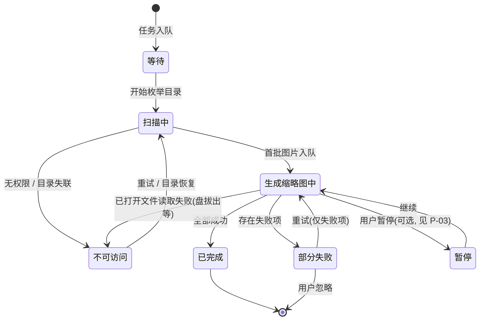

# 04 · M2 需求说明书 —— 关注文件夹 + 后台异步缩略图索引

| 项目 | 内容 |
| --- | --- |
| 文档编号 | 04 |
| 文档名称 | M2 需求说明书（关注文件夹 + 后台异步缩略图索引） |
| 版本 | **v1.1**（v1.0 基线 + 本轮增补：索引进度弹框与索引进度查看入口） |
| 作者 | PM |
| 日期 | 2026-10-31 |
| 状态 | 待评审（本轮只增补 **M2-FD-29～44**，基线 M2-FD-01～28 未变更） |
| 上游文档 | 01-产品功能清单.md（F1 图库域、F2 查看器域、F10 性能域） |
| 下游文档 | 02-技术架构与选型.md（实现方案）、03-测试策略与验收计划.md（用例登记） |

**修订记录**

| 版本 | 日期 | 变更摘要 |
| --- | --- | --- |
| v1.0 | 2026-10-30 | 基线：M2「关注文件夹 + 后台异步缩略图索引」—— 关注文件夹的注册/移除、目录递归扫描、后台异步生成并落库缩略图、栅格按需展示。条目 M2-FD-01～28 |
| **v1.1** | 2026-10-31 | **增补索引进度的可见性**：① **§2 右下角进度弹框**（M2-FD-29～36）；② **§3 索引进度查看按钮与面板**（M2-FD-37～44）；③ **§4 四处状态一致性**（弹框 / 面板 / 左栏文件夹 / 栅格计数同源）；④ **§5 验收演示脚本 6 步**。基线约束（照片目录零写入、不读写 `.picasa.ini`、异步不阻塞界面）全部继续有效，见 §0.2 |

**阅读说明**

- 编号规则：`M2-FD-<两位序号>`（FD = **F**older **D**iscovery，关注文件夹发现与索引）。**编号不复用、不重排**，作废条目留号并标注。
- 「验收要点」写的是**可被观察到、可被判定通过 / 不通过**的行为，不是测试步骤。
- 本文只回答"要做成什么样"。技术实现见 `docs/02`，测试用例见 `docs/03`（本轮新增用例的登记编号见 §6）。
- ⚠️ **凡标注「待确认」的条目，dev 侧不得自行拍板**——按 §8 的 P 编号提评审，结论回写到本文件。

---

## 0. 范围与不变式

### 0.1 本轮增补覆盖什么

| 增补项 | 解决的用户问题 | 条目 |
| --- | --- | --- |
| **右下角进度弹框** | 索引是后台行为，用户看不见它在干什么，于是怀疑"程序卡了 / 没反应" | M2-FD-29～36 |
| **索引进度查看按钮 + 面板** | 弹框会收起、会被关掉，用户需要一个**随时可回来查**的固定入口 | M2-FD-37～44 |
| **状态一致性** | 同一件事在四个地方显示四个数字，用户不知道该信哪个 | M2-FD-29～44 的横向约束，见 §4 |

> **一句话**：本轮**不新增任何索引能力**，只把"索引正在发生什么"如实、稳定、可回查地呈现出来。
> 因此本轮**不允许**为了做好看而改动索引算法、缩略图档位或落库结构。

### 0.2 基线约束（继续有效，任何增补不得削弱）

| 编号 | 约束 | 判定方式 | 说明 |
| --- | --- | --- | --- |
| **R-M2-1** | **照片目录零写入** | 索引前后对关注目录做全量 mtime/大小/文件清单比对，差异必须为 0 | 缩略图、索引状态**只写自有容器**。进度记录同样不得落在照片目录 |
| **R-M2-2** | **不读不写 `.picasa.ini`** | 目录内若存在 ini，其 mtime 与内容均不得变化；**不读取其任何字段** | 与 `docs/01` §0.2 的永久差异一致 |
| **R-M2-3** | **异步索引不阻塞界面** | 索引期间滚动 3 万张栅格、切换文件夹、进出查看器，帧时间不劣化（门禁见 `docs/03` §6） | 扫描、解码、写库**不得**出现在 UI 线程 |
| **R-M2-4** | **失败不静默** | 无权限 / 失联 / 解码失败必须在界面上有可见落点 | R-M2-4 由 M2-FD-34 与 M2-FD-43 共同兑现；**进度 UI 不得用"悄悄消失"掩盖失败** |

> ⚠️ **R-M2-1 的记忆衰减是本轮第一风险。** 加了进度 UI 之后，很容易顺手写一个"索引状态缓存文件"到照片目录旁边，或为了统计数量去 `stat` 一遍再顺手写个 `.done` 标记。**一律禁止**，状态全部进自有数据库。

### 0.3 与 `docs/01` 的关系（⚠️ 需评审同步）

`docs/01` §11 里 M2 的一句话定义仍是"**编辑内核（自有模型）+ 组织 + 输出**"，尚不包含"关注文件夹 + 异步索引"。本文件描述的是 M2 的**索引子范围**，两者暂不冲突但**口径未合并**。

- 在 `docs/01` §11 更新前，**M2 索引范围以本文件为准**。
- 合并方式见 §8 **P-01**。

---

## 1. 进度弹框（右下角）

### 1.1 需求条目

| 编号 | 要求 | 优先级 | 验收要点 |
| --- | --- | --- | --- |
| M2-FD-29 | 自动出现与收起 | P0 | 后台索引开始时自动出现；全部任务完成后自动收起，或收缩为可点击的摘要 |
| M2-FD-30 | 弹框内容 | P0 | 至少展示：当前处理的文件夹名、已完成 / 已发现数量、当前阶段（扫描中 / 生成缩略图）、总进度或阶段进度 |
| M2-FD-31 | 进度准确性 | P0 | 总数未知时显示「已发现 N 张」等不确定态，不展示虚假百分比；总数已知后百分比单调不减 |
| M2-FD-32 | 不遮挡主要操作 | P0 | 弹框为浮层，不挤占栅格；可手动关闭或收起，收起后不影响索引继续执行 |
| M2-FD-33 | 多任务汇总 | P0 | 同时索引多个关注文件夹时，弹框展示汇总进度，并可区分或切换查看各文件夹 |
| M2-FD-34 | 异常状态提示 | P0 | 出现部分失败、无权限或目录失联时，弹框给出明确状态，不静默消失 |
| M2-FD-35 | 与界面操作互不阻塞 | P0 | 弹框刷新不影响滚动、切换文件夹、查看器等操作；不弹模态对话框 |
| M2-FD-36 | 快速完成任务的处理 | P1 | 任务在极短时间内完成时，不长时间残留空弹框，避免闪烁干扰 |

### 1.2 交互约定

- 弹框位于**主窗口右下角**，层级**高于内容区、低于系统模态提示**。
- 用户手动关闭后，**本次应用运行期间**不再对同一批已完成任务重复自动弹出；**有新任务开始时可再次出现**（策略细节见 §8 P-02）。
- **点击弹框可展开为索引进度面板**（与第 2 节入口打开的是同一个面板）。

### 1.3 展示内容与字段口径

| 字段 | 来源（同一索引任务快照） | 空 / 不确定态表现 |
| --- | --- | --- |
| 当前文件夹名 | 当前正在处理的关注文件夹（多任务时按最近活跃） | 扫描阶段显示路径尾段，超长省略中段 |
| 当前阶段 | `扫描中` / `生成缩略图中` | 无任务时不显示弹框 |
| 已发现 | 扫描已识别的图片数（**分母未定时即最终展示值**） | 扫描初期即为"已发现 N 张" |
| 已完成 | 已生成并落库的缩略图数 | 扫描阶段可为 0 |
| 失败数 | 解码 / 权限 / 失联导致的失败条目数 | 0 时不显示该行；>0 时显示并在 M2-FD-34 下升级为异常态 |
| 进度形态 | 见 §4.3 的两种形态 | 总数未知 → **不确定态**（无百分比）；总数已知 → 百分比 + 条 |
| 操作 | 收起 / 关闭 / 展开面板 | 三者在任意状态下均可用 |

> **不得出现的字段**：剩余时间（ETA）。没有稳定的吞吐模型时给出 ETA 等于给用户一个必然落空的承诺。

### 1.4 出现与收起的时序规则

| 场景 | 行为 | 依据 |
| --- | --- | --- |
| 用户新增关注文件夹 / 启动时发现有未完成的索引 | **≤200 ms 内出现**，先出"扫描中"骨架，不等第一个数字 | M2-FD-29 |
| 任务总耗时 < 1.5 s（阈值待 P-05 确认） | **不出现弹框**（避免闪现）；或出现后 ≤1 s 自动收起 | M2-FD-36 |
| 全部任务完成 | 收起；若当时有失败项，**不收起**，降级为异常摘要 | M2-FD-29 / 34 |
| 用户点关闭 | 立即隐藏，索引**继续执行** | M2-FD-32 |
| 用户点收起 | 收缩为一行摘要（含百分比 / 已发现数），点击可再展开 | M2-FD-29 / 32 |
| 索引异常中断（失联、无权限） | **保持显示**，展示异常状态与受影响文件夹，不自动消失 | M2-FD-34 |

### 1.5 多任务汇总（M2-FD-33）

- 弹框默认展示**汇总态**：`N 个文件夹 · 已完成 X / 已发现 Y`，进度按**全部任务合计**计算（合计口径见 §4.3）。
- 汇总态下可**展开列表**，逐行展示各文件夹的 `名称 · 阶段 · 已完成/已发现 · 状态点`；点击某行切换为**单文件夹视图**，并有"返回汇总"入口。
- 单文件夹视图与汇总视图的**数据同源**（同一快照的不同切片），不得各自维护计数。

---

## 2. 索引进度查看按钮

### 2.1 需求条目

| 编号 | 要求 | 优先级 | 验收要点 |
| --- | --- | --- | --- |
| M2-FD-37 | 固定入口 | P0 | 主界面提供常驻可见的「索引进度」按钮，位置与样式符合 Picasa 风格的工具栏 / 状态栏布局 |
| M2-FD-38 | 随时打开面板 | P0 | 索引进行中、暂停、完成、失败、空闲（无任务）时点击均能打开面板并展示对应状态 |
| M2-FD-39 | 面板内容 | P0 | 展示：各关注文件夹的索引状态、已完成 / 已发现数量、失败数量、最近更新时间；进行中任务显示进度 |
| M2-FD-40 | 状态实时同步 | P0 | 面板打开期间进度实时更新；面板关闭时不影响后台任务 |
| M2-FD-41 | 入口状态提示 | P1 | 索引进行中时按钮给出轻量状态标识（如进度指示或文字），空闲时恢复普通态 |
| M2-FD-42 | 与右下角弹框一致 | P0 | 按钮打开的面板与弹框使用同一数据源，两处显示的进度、数量、状态必须一致 |
| M2-FD-43 | 失败项查看与重试 | P1 | 面板可查看失败图片数量，并提供「重试」入口；重试不重建已完成的有效缩略图 |
| M2-FD-44 | 空闲态说明 | P1 | 无索引任务时，面板给出明确空态（如「暂无索引任务」），不显示空白或报错 |

### 2.2 入口位置与三态

| 状态 | 按钮表现 | 依据 |
| --- | --- | --- |
| 空闲（无任务） | 普通图标 + 「索引进度」，无角标 | M2-FD-41 / 44 |
| 进行中 | 图标 + **轻量环形/条形指示**（不显示百分比数字，避免与弹框抢注意力）+ 悬停显示明细 | M2-FD-41 |
| 有失败 / 不可访问 | 普通态 + **警示点**（暖色圆点），悬停给出「N 项失败」 | M2-FD-34 / 43 |

- 位置：与会话状态同区（`crates/picasa-ui/src/statusbar.rs` 所在的状态栏右侧），**不占用栅格宽度**，不影响左栏布局。样式对齐 `docs/01` §11.5.6 的 Picasa 界面基线与 `docs/ui-baseline/` 截图。
- 该按钮**常驻**：任何视图（图库 / 查看器 / 空库）下都可见且可点。

### 2.3 面板内容（M2-FD-39）

| 列 | 内容 | 说明 |
| --- | --- | --- |
| 文件夹 | 名称 + 路径尾段 | 失联 / 无权限时整行标异常色并给出原因短语 |
| 状态 | 等待 / 扫描中 / 生成缩略图中 / 部分失败 / 已完成 / 暂停 / 不可访问 | 枚举与 §4.1 完全一致，**不另造词** |
| 已完成 / 已发现 | `X / Y`，Y 未知时显示 `X / 已发现 Y` | 与弹框同源 |
| 失败 | 数量 + 可展开为失败项列表（文件名 + 原因分类） | M2-FD-43 |
| 最近更新 | 相对时间（"刚刚 / 3 分钟前"）+ 悬停绝对时间 | M2-FD-39 |
| 进度 | 进行中任务显示阶段进度条；非进行中不显示假进度 | §4.3 |

- 面板底部固定操作区：`全部重试`（仅当存在失败项时可用）/ `关闭`。
- **面板是浮层或侧边抽屉，不是模态对话框**——打开时仍可滚动栅格、切换文件夹（M2-FD-35 的约束同样适用于面板）。

### 2.4 重试语义（M2-FD-43）

1. 重试**只针对失败项**，已完成且有效的缩略图**不重建**（不得因为重试而让 `已完成` 计数回退）。
2. 重试视为**新任务**：状态回到 `扫描中 → 生成缩略图中`，弹框**可再次自动出现**（与 §1.2"有新任务可再次出现"一致）。
3. 重试后仍失败的条目**保留在失败列表**并更新最近更新时间；不重复累加同一条目的失败次数到"失败数"（失败数统计的是**条目数**，不是尝试次数）。

### 2.5 空闲态文案（M2-FD-44）

- 主文案：**「暂无索引任务」**
- 副文案：说明如何产生任务（"添加关注文件夹后，程序会在后台建立缩略图"），并给出「添加关注文件夹」入口。
- 禁止出现：空白列表、加载骨架常驻、"未知错误"。

---

## 3. 状态与一致性要求

### 3.1 状态模型

- 状态枚举**至少**包含：`等待`、`扫描中`、`生成缩略图中`、`已完成`、`部分失败`、`暂停`（如实现）、`不可访问`。
- **四处的状态名完全一致**：弹框、面板、左栏文件夹、栅格内的状态点。禁止弹框说"部分失败"而面板说"有错误"。

### 3.2 四处一致（M2-FD-42 的横向约束）

| 展示位置 | 展示什么 | 一致性要求 |
| --- | --- | --- |
| 右下角弹框 | 汇总 / 单文件夹进度、阶段、失败数 | — |
| 索引进度面板 | 逐文件夹状态、数量、最近更新 | 与弹框**同源同值** |
| 左侧文件夹树 | 每个关注文件夹的状态点 / 计数 | 计数与面板同行数字一致 |
| 文件夹内栅格 | 已可展示的图片数量 | 与 `已完成` 一致（栅格只展示已就绪项或占位，见 P-06） |

**实现约束**：四处**必须**读同一个进度快照对象（单一数据源），**禁止**各自订阅"扫描事件"自行累加计数。任何"两处差 1"的偏差都按 P0 缺陷处理。

### 3.3 进度口径（M2-FD-31 的可判定化）

| 阶段 | 总数（分母）是否已知 | 展示形态 | 单调性 |
| --- | --- | --- | --- |
| 扫描中 | **未知**（边扫边发现） | **不确定态**：动画条 + 「已发现 N 张」+ 当前文件夹名 | 无百分比，故不涉及 |
| 扫描中（预估可用时，可选） | 半已知 | 仍按不确定态展示，**不得**把预估数当分母出百分比 | — |
| 生成缩略图中 | **已知**（= 本次已发现的图片数） | 百分比 + 条 + `已完成 X / Y` | 百分比**单调不减** |
| 汇总（多文件夹） | 已知（各任务分母之和） | 同阶段百分比 | 单调不减 |

> ⚠️ **口径冲突（必须在实现里处理）**：生成阶段若仍有新文件被发现，分母会变大，`已完成/已发现` 会**自然下降**——这与"百分比单调不减"直接冲突。裁决：
> 1. **分母在一次任务内冻结**：进入 `生成缩略图中` 时的"已发现数"即为分母，之后新发现的图片**并入下一批任务**（阶段可回到 `扫描中`）。
> 2. 展示值取**历史最大值的上包络**（`displayed = max(displayed, raw)`），只允许持平或前进，永不回退。
> 3. 两条都做：① 保证语义正确，② 保证视觉不回退。**只做 ② 会掩盖分母漂移，只做 ① 仍可能因失败重算抖动**。

- 百分比**取整方式固定**（向下取整），且 `已完成 == 已发现` 时必须显示 **100%**，不允许出现"100% 但还在转"。
- 任何"虚假百分比"（分母未知时给数字、休眠时给 0%、完成前给 100%）按 P0 缺陷处理。

### 3.4 线程与刷新（R-M2-3）

- UI 线程**只读快照**，不做目录遍历、不解码、不写库。
- 进度快照**批量合并刷新**（建议 ≤ 4 次/秒，即 ≥250 ms 一次），**不做逐张重绘**；大量小图时合并窗口内只取最后一次值。
- 弹框 / 面板的出现与刷新**不得重建栅格**、不得重置滚动位置、不得抢焦点（不使用 `request_focus`）。
- 面板打开时若正在滚动栅格，进度刷新**不打断惯性滚动**。

---

## 4. 验收演示脚本（本轮补充，6 步）

| # | 操作 | 期望观测 | 对应需求 |
| --- | --- | --- | --- |
| 1 | 添加一个含大量图片的关注文件夹 | 右下角**自动出现**进度弹框；先"扫描中 / 已发现 N 张"，随后切"生成缩略图中"并出现百分比，数值随推进单调增长 | M2-FD-29/30/31 |
| 2 | 关闭弹框；随后点「索引进度」按钮 | 关闭后索引**继续执行**（已完成数仍在涨）；点按钮可重新打开面板并看到当前进度 | M2-FD-32/38 |
| 3 | 索引进行中：持续滚动栅格、切换文件夹、进出查看器 | 弹框与面板**不卡顿、不遮挡**操作；滚动帧率无劣化；不弹模态对话框 | M2-FD-35 |
| 4 | 同时添加多个关注文件夹 | 弹框展示**汇总进度**并可切到单个文件夹；面板分项之和与汇总一致；左栏与栅格计数同值 | M2-FD-33、§3.2 |
| 5 | 等待索引完成 | 弹框**自动收起**；按钮恢复普通态；面板显示「暂无索引任务」 | M2-FD-29/41/44 |
| 6 | 人为制造损坏图片（截断 JPEG）+ 不可访问目录（`chmod 000` 或拔掉外置盘） | 弹框**不静默消失**，给出明确异常状态（部分失败 N 项 / 无权限 / 目录失联）；面板可查看失败项并「重试」；重试不重建已完成项 | M2-FD-34/43 |

> 演示脚本的执行版（含前置数据准备、截图归档位置）由 QA 落到 `docs/03`，本文只约定**可观察的通过判据**。

---

## 5. 需求追溯矩阵

| 需求 | 产品域（`docs/01`） | 建议代码触点（**非约束**） | 待登记用例（`docs/03`） |
| --- | --- | --- | --- |
| M2-FD-29/32 | F1 图库浏览 | `picasa-ui/src/statusbar.rs`、新增 `index_progress` 浮层模块、`app.rs` | M2-IDX-01/02 |
| M2-FD-30/39 | F1 | 同上 + 进度快照结构（`picasa-core/src/scanner.rs` / `thumbs.rs` 对外暴露只读快照） | M2-IDX-03 |
| M2-FD-31 | F10 性能 / F1 | 快照内的分母冻结与上包络逻辑 | M2-IDX-04 |
| M2-FD-33 | F1 | 快照的"汇总切片 / 单任务切片" | M2-IDX-05 |
| M2-FD-34/43 | F1、F10 | `scanner.rs` / `thumbs.rs` 的失败分类；`library.rs` 的失败项持久化 | M2-IDX-06/07 |
| M2-FD-35/40 | F10（性能门禁） | UI 线程只读快照 + 合并刷新 | M2-IDX-08 |
| M2-FD-36 | F1 | 出现/收起的阈值与去抖 | M2-IDX-09 |
| M2-FD-37/38/41 | F1、界面基线（U 清单） | 状态栏常驻按钮三态 | M2-IDX-10 |
| M2-FD-42 | 全局一致性 | 单一数据源约束 | M2-IDX-11 |
| M2-FD-44 | F1 | 空态文案与入口 | M2-IDX-12 |

> 用例编号为**建议位**，最终以 `docs/03` 登记为准；本表的作用是保证 16 条需求**没有一条漏测**。

---

## 6. 非目标（本轮明确不做）

| 不做 | 理由 |
| --- | --- |
| 系统级通知（macOS 通知中心 / 托盘弹窗） | 与系统模态提示层级打架，且用户已明确要求"右下角浮层"；跨平台一致性差 |
| 历史任务列表 / 索引进度曲线 | 无人会回看上一轮的索引进度；成本与价值不匹配 |
| 剩余时间（ETA）预估 | 见 §1.3：不稳定的 ETA 是负资产 |
| 索引暂停 / 恢复的完整 UI | 状态枚举保留 `暂停`，是否暴露 UI 待 P-03；**不做**比"做了但语义含混"更好 |
| 为进度 UI 修改索引算法、缩略图档位、落库结构 | 见 §0.1：本轮只做"如实呈现" |

---

## 7. 待产品确认（评审必答）

| 编号 | 待确认项 | 建议结论 | 影响 |
| --- | --- | --- | --- |
| **P-01** | `docs/01` §11 的 M2 定义（编辑内核）与本文件的索引范围如何合并 | 在 `docs/01` §11 的 M2 段落增加一行指针到本文件，索引范围以本文件为准；不重写 01 的 M2 功能清单 | 文档口径 |
| **P-02** | 手动关闭弹框后的再弹出策略 | 同批任务在本次运行内不再自动弹；**新增关注文件夹 / 重试 / 应用重启**视为新任务，可再次出现 | M2-FD-29 |
| **P-03** | 是否实现"暂停索引" | 首版**不暴露 UI**，状态机保留 `暂停` 位 | M2-FD-38 |
| **P-04** | 分母漂移与"单调不减"的裁决 | 采纳 §3.3 的两条同时执行（分母冻结 + 上包络） | M2-FD-31 |
| **P-05** | 快速任务的"极短时间"阈值 | **<1.5 s 不出弹框；1.5–3 s 出弹框、完成后 1 s 收起；>3 s 正常常驻** | M2-FD-36 |
| **P-06** | 索引未完成时栅格是否显示占位 | 显示**占位格**（灰底 + 不显示假图），占位不计入"已完成"；栅格数量按"已就绪"计 | §3.2 栅格一致性 |

---

## 8. 风险提示

| 风险 | 等级 | 说明与对策 |
| --- | --- | --- |
| **进度数字与栅格数量不一致** | 高 | 四个展示点各自累加计数是最常见的实现走样。对策：**单一快照**结构 + 一条"四处同值"的常驻回归用例（M2-IDX-11） |
| **进度刷新拖慢滚动** | 高 | 弹框/面板若每帧重绘并触发 `ctx.request_repaint()`，会与栅格虚拟化抢帧。对策：合并刷新 ≤4 Hz，且只在数值变化时请求重绘 |
| **R-M2-1 在实现进度功能时被破坏** | 高 | 见 §0.2 警示。对策：`docs/03` 的零写入用例继续作为常驻回归，覆盖"索引 + 进度 UI 全流程" |
| **失败状态被"完成"吞掉** | 中 | "全部任务完成即收起"若不区分失败，会让用户以为一切正常。对策：有失败项时**不收起**，降级为异常摘要（§1.4） |
| **多任务汇总额外的复杂度** | 中 | 汇总/单任务两套视图易出现两套计数。对策：快照只提供切片，视图不持有状态 |
