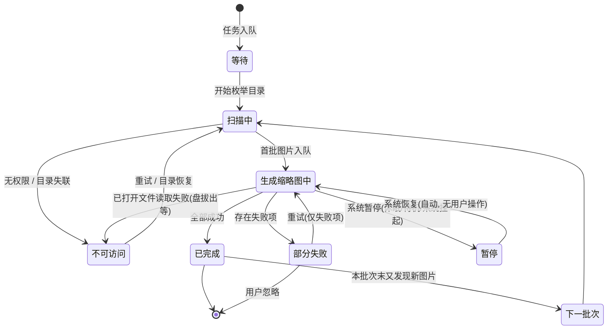

# 04 · M2 需求说明书 —— 关注文件夹 + 后台异步缩略图索引

| 项目 | 内容 |
| --- | --- |
| 文档编号 | 04 |
| 文档名称 | M2 需求说明书（关注文件夹 + 后台异步缩略图索引） |
| 版本 | **v1.5**（v1.0 基线 + v1.1 增补进度弹框与进度入口 + v1.2 追溯用例落地 + v1.3 P-01 双主线 + v1.4 **P-02～P-06 全部裁决** + v1.5 P-07 续编指向 `docs/05`） |
| 作者 | PM |
| 日期 | 2026-10-31 |
| 状态 | **待评审（P 项已清零，可直接进开发）**——本轮只增补 **M2-FD-29～44**，基线 M2-FD-01～28 未变更；v1.4 起 §7 六项待确认全部裁决；v1.5 起**新增问题续编到 `docs/05` §5**（P-07 已在彼处裁决） |
| 上游文档 | 01-产品功能清单.md（F1 图库域、F2 查看器域、F10 性能域） |
| 下游文档 | 02-技术架构与选型.md（实现方案）、03-测试策略与验收计划.md（用例登记）、05-M2.1-规划与路线图.md（数据层设计与排期） |

**修订记录**

| 版本 | 日期 | 变更摘要 |
| --- | --- | --- |
| v1.0 | 2026-10-30 | 基线：M2「关注文件夹 + 后台异步缩略图索引」—— 关注文件夹的注册/移除、目录递归扫描、后台异步生成并落库缩略图、栅格按需展示。条目 M2-FD-01～28 |
| **v1.1** | 2026-10-31 | **增补索引进度的可见性**：① **§1 右下角进度弹框**（M2-FD-29～36）；② **§2 索引进度查看按钮与面板**（M2-FD-37～44）；③ **§3 状态与一致性**（弹框 / 面板 / 左栏文件夹 / 栅格计数同源）；④ **§4 验收演示脚本 6 步**。基线约束（照片目录零写入、不读写 `.picasa.ini`、异步不阻塞界面）全部继续有效，见 §0.2 |
| **v1.2** | 2026-10-31 | **追溯落到 `docs/03` v2.2**：§5 的「建议用例位」改为已登记的 **`TC-IDX-001～021`**（`03` §11.18），并补「每条需求至少 1 条用例、零遗漏」的对账列；同时修正 v1.1 修订记录里的节号笔误（一致性是 §3、脚本是 §4）。**条目与判据无变化**，仅追溯关系落地 |
| **v1.3** | 2026-10-31 | **P-01 已裁决并落地**：`01` 升 v3.2，§11 的 M2 改为**双主线**（A 线索引底座 = 本文件；B 线编辑内核 = `01` 的 F 域）；本文件 §0.3 重写为「已合并」并写明两条线的先后与编号分层；§7 的 P-01 行标注已裁决并记录结论。**条目与判据仍无变化** |
| **v1.4** | 2026-10-31 | **P-02～P-06 全部裁决并写入正文**（§7 六项清零）：**P-02** 关闭语义与再弹条件落 §1.2.1（引入「批次」定义、关闭记忆只在内存不落盘）；**P-03** 暂停裁决落 §3.1.1（不做用户控件、但 `暂停` 状态必须实现、仅系统事件触发并自动恢复）；**P-04** 进度口径补「批次作用域」（跨批次允许重置但**必须标注第 N 批**，否则 P0）；**P-05** 阈值定值落 §1.4（1.5 s / 3 s / 1 s + 定时器判定 + 禁止假收起）；**P-06** 栅格占位落 §3.2.1（占位呈现、原地替换、不可点开、不计入已完成）。连带：§2.2 三态→四态（加系统暂停态）、§3.1 状态机补「下一批次」迁移、§4 增 6 组补充观测点、§6 非目标改写暂停与占位两条、§8 增 3 条风险；并修正 v1.1 遗留的 4 处错节号（§4.x → §3.x） |
| **v1.5** | 2026-10-31 | **P 编号序列移交**：新增问题自 **P-07** 起续编到新建的 **`docs/05-M2.1-规划与路线图.md` §5**（不在此处再开编号，避免双序列）。P-07「关闭子目录后是否计入父目录计数」已在 05 裁决：`direct_count` 是物理事实、不受关闭影响，M3 递归计数拆 `total` / `visible` 双列。**本文条目与判据无任何变化** |

**阅读说明**

- 编号规则：`M2-FD-<两位序号>`（FD = **F**older **D**iscovery，关注文件夹发现与索引）。**编号不复用、不重排**，作废条目留号并标注。
- 「验收要点」写的是**可被观察到、可被判定通过 / 不通过**的行为，不是测试步骤。
- 本文只回答"要做成什么样"。技术实现见 `docs/02`，测试用例见 `docs/03`（本轮新增用例的登记编号见 §6）。
- ⚠️ **凡标注「待确认」的条目，dev 侧不得自行拍板**——按 §8 的 P 编号提评审，结论回写到本文件。

---

## 0. 范围与不变式

### 0.1 本轮增补覆盖什么

| 增补项 | 解决的用户问题 | 条目 |
| --- | --- | --- |
| **右下角进度弹框** | 索引是后台行为，用户看不见它在干什么，于是怀疑"程序卡了 / 没反应" | M2-FD-29～36 |
| **索引进度查看按钮 + 面板** | 弹框会收起、会被关掉，用户需要一个**随时可回来查**的固定入口 | M2-FD-37～44 |
| **状态一致性** | 同一件事在四个地方显示四个数字，用户不知道该信哪个 | M2-FD-29～44 的横向约束，见 §4 |

> **一句话**：本轮**不新增任何索引能力**，只把"索引正在发生什么"如实、稳定、可回查地呈现出来。
> 因此本轮**不允许**为了做好看而改动索引算法、缩略图档位或落库结构。

### 0.2 基线约束（继续有效，任何增补不得削弱）

| 编号 | 约束 | 判定方式 | 说明 |
| --- | --- | --- | --- |
| **R-M2-1** | **照片目录零写入** | 索引前后对关注目录做全量 mtime/大小/文件清单比对，差异必须为 0 | 缩略图、索引状态**只写自有容器**。进度记录同样不得落在照片目录 |
| **R-M2-2** | **不读不写 `.picasa.ini`** | 目录内若存在 ini，其 mtime 与内容均不得变化；**不读取其任何字段** | 与 `docs/01` §0.2 的永久差异一致 |
| **R-M2-3** | **异步索引不阻塞界面** | 索引期间滚动 3 万张栅格、切换文件夹、进出查看器，帧时间不劣化（门禁见 `docs/03` §6） | 扫描、解码、写库**不得**出现在 UI 线程 |
| **R-M2-4** | **失败不静默** | 无权限 / 失联 / 解码失败必须在界面上有可见落点 | R-M2-4 由 M2-FD-34 与 M2-FD-43 共同兑现；**进度 UI 不得用"悄悄消失"掩盖失败** |

> ⚠️ **R-M2-1 的记忆衰减是本轮第一风险。** 加了进度 UI 之后，很容易顺手写一个"索引状态缓存文件"到照片目录旁边，或为了统计数量去 `stat` 一遍再顺手写个 `.done` 标记。**一律禁止**，状态全部进自有数据库。

### 0.3 与 `docs/01` 的关系（✅ v1.3 已合并）

**结论（`01` v3.2 已落地）**：`docs/01` §11 的 M2 已从单主线（编辑内核）改为**双主线**——

| 主线 | 内容 | 条目登记处 |
| --- | --- | --- |
| **A 线 · 索引底座** | 关注文件夹 + 后台异步缩略图索引 + **索引进度可见性** | **本文件**（`M2-FD-01～44`） |
| **B 线 · 编辑内核 + 组织 + 输出** | F3/F4 编辑、元数据、相册人物地点、幻灯片、导出、备份 | `docs/01` §11（F 域编号，条目未变） |

- **A 线先于 B 线落地**：B 线的编辑依赖「稳定的条目 ID + 可用的缩略图」，而 M1 的索引是单目录同步简化版。
- **两套编号各管一层**：`M2-FD` 是任务级编号（含进度 UI 这类过程性需求），不塞进 F 域；两边的桥是 `01` §12 域映射与 `03` §11.18 的 `TC-IDX-*`。
- **对 A 线的约束效力**：本文件的条目为**准**；`01` §11 只写范围与红线，不复述条目。

---

## 1. 进度弹框（右下角）

### 1.1 需求条目

| 编号 | 要求 | 优先级 | 验收要点 |
| --- | --- | --- | --- |
| M2-FD-29 | 自动出现与收起 | P0 | 后台索引开始时自动出现；全部任务完成后自动收起，或收缩为可点击的摘要 |
| M2-FD-30 | 弹框内容 | P0 | 至少展示：当前处理的文件夹名、已完成 / 已发现数量、当前阶段（扫描中 / 生成缩略图）、总进度或阶段进度 |
| M2-FD-31 | 进度准确性 | P0 | 总数未知时显示「已发现 N 张」等不确定态，不展示虚假百分比；总数已知后百分比单调不减 |
| M2-FD-32 | 不遮挡主要操作 | P0 | 弹框为浮层，不挤占栅格；可手动关闭或收起，收起后不影响索引继续执行 |
| M2-FD-33 | 多任务汇总 | P0 | 同时索引多个关注文件夹时，弹框展示汇总进度，并可区分或切换查看各文件夹 |
| M2-FD-34 | 异常状态提示 | P0 | 出现部分失败、无权限或目录失联时，弹框给出明确状态，不静默消失 |
| M2-FD-35 | 与界面操作互不阻塞 | P0 | 弹框刷新不影响滚动、切换文件夹、查看器等操作；不弹模态对话框 |
| M2-FD-36 | 快速完成任务的处理 | P1 | 任务在极短时间内完成时，不长时间残留空弹框，避免闪烁干扰 |

### 1.2 交互约定

- 弹框位于**主窗口右下角**，层级**高于内容区、低于系统模态提示**。
- **点击弹框可展开为索引进度面板**（与第 2 节入口打开的是同一个面板）。
- **自动收起**与**用户主动关闭**是两件事，判据不同（见下）。

#### 1.2.1 关闭语义与再弹条件（P-02 已裁决）

| 用户动作 | 弹框 | 后台索引 | 同批次内是否还会**自动**出现 |
| --- | --- | --- | --- |
| 点「关闭」 | 立即隐藏 | **继续执行** | **不会**（本次运行内记住该批次已关闭） |
| 点「收起」 | 缩为一行摘要（阶段 + 数字） | 继续执行 | 不需要再出，摘要本身仍可展开 |
| 关闭后又从按钮打开面板，再关面板 | 保持隐藏 | 继续执行 | **不会**（开面板≠重置关闭记忆） |
| 用户新增关注文件夹 / 重试失败项 / 应用重启后恢复未完成任务 | 出现 | — | **会**（这是新批次） |

**「批次」（batch）的定义**——判定"新任务"的唯一依据：

- 一个批次 = **一次任务入队**。产生新批次的动作只有三类：① 首次扫描某个关注文件夹；② 对失败项点「重试」；③ 应用重启后发现上次未完成的任务。
- 关闭记忆的键是 **`批次 ID` + 应用会话**，保存在内存里，**进程退出即清空**。
- **不落盘**：不往照片目录写（`R-M2-1`），也不往 Preferences 写「已关闭过」这类一次性状态——它没有跨会话价值，写下去只会制造脏状态。
- **同一批次只自动弹一次**；不同批次必弹，**即使前一批次被用户关闭过**。

> ⚠️ **用户关闭 ≠ 失败可以静默**：`M2-FD-34` 禁止的是**程序自己**在有失败时把弹框收掉（§1.4）。用户主动点关闭是知情选择，允许；但此时**入口按钮必须保留警示点**（§2.2 第三态），直到用户查看或重试——否则失败就真被吞了。

### 1.3 展示内容与字段口径

| 字段 | 来源（同一索引任务快照） | 空 / 不确定态表现 |
| --- | --- | --- |
| 当前文件夹名 | 当前正在处理的关注文件夹（多任务时按最近活跃） | 扫描阶段显示路径尾段，超长省略中段 |
| 当前阶段 | `扫描中` / `生成缩略图中` | 无任务时不显示弹框 |
| 已发现 | 扫描已识别的图片数（**分母未定时即最终展示值**） | 扫描初期即为"已发现 N 张" |
| 已完成 | 已生成并落库的缩略图数 | 扫描阶段可为 0 |
| 失败数 | 解码 / 权限 / 失联导致的失败条目数 | 0 时不显示该行；>0 时显示并在 M2-FD-34 下升级为异常态 |
| 进度形态 | 见 §3.3 的两种形态 | 总数未知 → **不确定态**（无百分比）；总数已知 → 百分比 + 条 |
| 操作 | 收起 / 关闭 / 展开面板 | 三者在任意状态下均可用 |

> **不得出现的字段**：剩余时间（ETA）。没有稳定的吞吐模型时给出 ETA 等于给用户一个必然落空的承诺。

### 1.4 出现与收起的时序规则

| 场景 | 行为 | 依据 |
| --- | --- | --- |
| 用户新增关注文件夹 / 启动时发现有未完成的索引 | **≤200 ms 内出现**，先出"扫描中"骨架，不等第一个数字 | M2-FD-29 |
| 任务总耗时 **< 1.5 s** | **完全不出现**（连骨架都不画），避免闪现 | M2-FD-36 |
| 任务总耗时 **1.5–3 s** | 出现；**全部完成后 1 s 内自动收起** | M2-FD-36 |
| 任务总耗时 **> 3 s** | 正常常驻至完成 | M2-FD-36 |
| 全部任务完成 | 收起；若当时有失败项，**不收起**，降级为异常摘要 | M2-FD-29 / 34 |
| 用户点关闭 | 立即隐藏，索引**继续执行** | M2-FD-32 |
| 用户点收起 | 收缩为一行摘要（含百分比 / 已发现数），点击可再展开 | M2-FD-29 / 32 |
| 索引异常中断（失联、无权限） | **保持显示**，展示异常状态与受影响文件夹，不自动消失 | M2-FD-34 |

**阈值判定规则（P-05 已裁决，实现须照此判定）**

1. 三个阈值 **1.5 s / 3 s / 1 s** 是**命名常量**，集中在进度浮层的配置里；**不得**散落成魔法数字，也不得由测试反推。
2. 计时起点 = **任务入队时刻**，终点 = **最后一张缩略图落库时刻**（不是界面渲染完成时刻）。
3. 判定用**一次性定时器**：入队时挂 1.5 s 定时器，到点时若任务**已结束**则不出现；若未结束则出现，并按住 2 中的终点再决定"1 s 内收起"还是"常驻"。
4. **不允许**"先出现再立刻消失"作为 < 1.5 s 的替代实现——那就是闪烁本身。
5. 反向要求：**> 3 s 的任务不得提前收起**。为了少画一帧而让用户以为已完成，属于制造误导。

### 1.5 多任务汇总（M2-FD-33）

- 弹框默认展示**汇总态**：`N 个文件夹 · 已完成 X / 已发现 Y`，进度按**全部任务合计**计算（合计口径见 §3.3）。
- 汇总态下可**展开列表**，逐行展示各文件夹的 `名称 · 阶段 · 已完成/已发现 · 状态点`；点击某行切换为**单文件夹视图**，并有"返回汇总"入口。
- 单文件夹视图与汇总视图的**数据同源**（同一快照的不同切片），不得各自维护计数。

---

## 2. 索引进度查看按钮

### 2.1 需求条目

| 编号 | 要求 | 优先级 | 验收要点 |
| --- | --- | --- | --- |
| M2-FD-37 | 固定入口 | P0 | 主界面提供常驻可见的「索引进度」按钮，位置与样式符合 Picasa 风格的工具栏 / 状态栏布局 |
| M2-FD-38 | 随时打开面板 | P0 | 索引进行中、暂停、完成、失败、空闲（无任务）时点击均能打开面板并展示对应状态 |
| M2-FD-39 | 面板内容 | P0 | 展示：各关注文件夹的索引状态、已完成 / 已发现数量、失败数量、最近更新时间；进行中任务显示进度 |
| M2-FD-40 | 状态实时同步 | P0 | 面板打开期间进度实时更新；面板关闭时不影响后台任务 |
| M2-FD-41 | 入口状态提示 | P1 | 索引进行中时按钮给出轻量状态标识（如进度指示或文字），空闲时恢复普通态 |
| M2-FD-42 | 与右下角弹框一致 | P0 | 按钮打开的面板与弹框使用同一数据源，两处显示的进度、数量、状态必须一致 |
| M2-FD-43 | 失败项查看与重试 | P1 | 面板可查看失败图片数量，并提供「重试」入口；重试不重建已完成的有效缩略图 |
| M2-FD-44 | 空闲态说明 | P1 | 无索引任务时，面板给出明确空态（如「暂无索引任务」），不显示空白或报错 |

### 2.2 入口位置与四态

| 状态 | 按钮表现 | 依据 |
| --- | --- | --- |
| 空闲（无任务） | 普通图标 + 「索引进度」，无角标 | M2-FD-41 / 44 |
| 进行中 | 图标 + **轻量环形/条形指示**（不显示百分比数字，避免与弹框抢注意力）+ 悬停显示明细 | M2-FD-41 |
| 有失败 / 不可访问 | 普通态 + **警示点**（暖色圆点），悬停给出「N 项失败」 | M2-FD-34 / 43 |
| **已暂停（系统）** | 图标 + **静态暂停标记**（无动画），悬停给出「已暂停：<原因>」 | M2-FD-38、P-03 |

> **暂停态只在系统触发时出现**（详见 §3.1 的 P-03 裁决），且**按钮上没有「继续」**——恢复由系统事件自动发生。四态互斥，不得同时出现两种标识（如既转圈又亮警示点）。

- 位置：与会话状态同区（`crates/picasa-ui/src/statusbar.rs` 所在的状态栏右侧），**不占用栅格宽度**，不影响左栏布局。样式对齐 `docs/01` §11.5.6 的 Picasa 界面基线与 `docs/ui-baseline/` 截图。
- 该按钮**常驻**：任何视图（图库 / 查看器 / 空库）下都可见且可点。

### 2.3 面板内容（M2-FD-39）

| 列 | 内容 | 说明 |
| --- | --- | --- |
| 文件夹 | 名称 + 路径尾段 | 失联 / 无权限时整行标异常色并给出原因短语 |
| 状态 | 等待 / 扫描中 / 生成缩略图中 / 部分失败 / 已完成 / 暂停 / 不可访问 | 枚举与 §3.1 完全一致，**不另造词** |
| 已完成 / 已发现 | `X / Y`，Y 未知时显示 `X / 已发现 Y` | 与弹框同源 |
| 失败 | 数量 + 可展开为失败项列表（文件名 + 原因分类） | M2-FD-43 |
| 最近更新 | 相对时间（"刚刚 / 3 分钟前"）+ 悬停绝对时间 | M2-FD-39 |
| 进度 | 进行中任务显示阶段进度条；非进行中不显示假进度 | §3.3 |

- 面板底部固定操作区：`全部重试`（仅当存在失败项时可用）/ `关闭`。
- **面板是浮层或侧边抽屉，不是模态对话框**——打开时仍可滚动栅格、切换文件夹（M2-FD-35 的约束同样适用于面板）。

### 2.4 重试语义（M2-FD-43）

1. 重试**只针对失败项**，已完成且有效的缩略图**不重建**（不得因为重试而让 `已完成` 计数回退）。
2. 重试视为**新任务**：状态回到 `扫描中 → 生成缩略图中`，弹框**可再次自动出现**（与 §1.2"有新任务可再次出现"一致）。
3. 重试后仍失败的条目**保留在失败列表**并更新最近更新时间；不重复累加同一条目的失败次数到"失败数"（失败数统计的是**条目数**，不是尝试次数）。

### 2.5 空闲态文案（M2-FD-44）

- 主文案：**「暂无索引任务」**
- 副文案：说明如何产生任务（"添加关注文件夹后，程序会在后台建立缩略图"），并给出「添加关注文件夹」入口。
- 禁止出现：空白列表、加载骨架常驻、"未知错误"。

---

## 3. 状态与一致性要求

### 3.1 状态模型

- 状态枚举**至少**包含：`等待`、`扫描中`、`生成缩略图中`、`已完成`、`部分失败`、`暂停`、`不可访问`——**七态全部实现，不得省略**（省略 `暂停` 会导致系统挂起时界面卡在"生成中"不动，比没有更糟）。
- **四处的状态名完全一致**：弹框、面板、左栏文件夹、栅格内的状态点。禁止弹框说"部分失败"而面板说"有错误"。

#### 3.1.1 「暂停」的裁决（P-03 已裁决）

| 项 | 结论 |
| --- | --- |
| M2 是否提供用户可点的「暂停 / 继续」 | **不提供**。M2 不做暂停控件 |
| 状态枚举是否保留 `暂停` | **保留并实现**。否则休眠唤醒后任务停在"生成中"却不动，界面在说谎 |
| 谁能让任务进入 `暂停` | **只有系统事件**：休眠、待机、系统挂起（线程池被 OS 挂起）。**不接受用户操作触发** |
| 如何退出 | **系统事件自动恢复**，回到进入前的状态（`生成缩略图中`），不要求用户点任何东西 |
| 界面怎么显示 | 弹框：汇总行写「已暂停」+ 一行原因（如「系统休眠」）；面板：该行状态列显示 `暂停`、附原因短语；按钮：静态暂停标记（§2.2 第四态） |
| 暂停期间进度数字 | **冻结不动**，不出现"边暂停边涨"；恢复后从冻结值继续，**不回退** |
| 暂停是否影响"有失败不收起" | 不冲突。暂停不是终态，弹框保持（不收起但也不闪警示点） |

> **为什么不做用户暂停**：索引是后台低优先级任务，用户真正的诉求是"别拖慢我"，而这个诉求由**限速 + 不阻塞 UI**（`R-M2-3`、§3.4）解决，不是靠"暂停"解决。加一个暂停按钮，等于承认索引会拖慢界面，还把「暂停后忘了恢复」变成新的支持成本。M3 若确有需求再补，**状态位已预留，不需要返工状态机**。

### 3.2 四处一致（M2-FD-42 的横向约束）

| 展示位置 | 展示什么 | 一致性要求 |
| --- | --- | --- |
| 右下角弹框 | 汇总 / 单文件夹进度、阶段、失败数 | — |
| 索引进度面板 | 逐文件夹状态、数量、最近更新 | 与弹框**同源同值** |
| 左侧文件夹树 | 每个关注文件夹的状态点 / 计数 | 计数与面板同行数字一致 |
| 文件夹内栅格 | **两个数**：格子总数（= 已发现，含占位）/ 已就绪数（= 已完成，真图） | 已就绪数必须等于 `已完成`；格子总数必须等于 `已发现`（口径见 §3.2.1） |

**实现约束**：四处**必须**读同一个进度快照对象（单一数据源），**禁止**各自订阅"扫描事件"自行累加计数。任何"两处差 1"的偏差都按 P0 缺陷处理。

#### 3.2.1 栅格占位规则（P-06 已裁决）

**结论：显示占位格。** 索引未完成的图片**占位呈现**，不隐藏、不显示假图。

| 项 | 规则 |
| --- | --- |
| 是否显示占位 | **显示**。灰底格 + 居中「待生成」文字，**不放任何图片内容**（不放低清预览、不放图标化的假缩略图） |
| 占位格位置 | **按发现顺序固定**。占位格在缩略图就绪后**原地替换**为真图，**不重排**、不挪位、不引起滚动跳动 |
| 占位格能否点开 | **不能**。不进入查看器、不参与选中计数、不响应双击；右键菜单只保留「查看所在文件夹」这类不依赖缩略图的项 |
| 占位格是否计入「已完成」 | **不计入**。`已完成` 只数真图。栅格顶部若显示计数，用 `已完成 / 已发现` 双数，不写成单一数字 |
| 占位格是否影响排序 / 过滤 | 排序键以文件元数据（拍摄时间 / 名称）为准，占位不影响顺序；过滤只按元数据判定。**任何"先出真图的排前面"式临时排序都是缺陷** |
| 索引失败后的占位格 | 变为 **失败态格**（灰底 + 警示角标），并计入失败数；不静默消失（`R-M2-4`），也不假装"这张图不存在" |

> **为什么必须占位而不是隐藏**：隐藏会让栅格在索引过程中**不断重排**，用户正看的那张图会随缩略图完成而位移，比慢更难受。占位把"未就绪"表达成**稳定的布局 + 明确的状态**，代价只是多画一个灰块。
>
> ⚠️ **占位 ≠ 骨架屏**：骨架屏用于"数据还没到"，占位格用于"这一张确实还没做"。两者混用会让"目录里到底有几张图"变得不可知。

### 3.3 进度口径（M2-FD-31 的可判定化）

| 阶段 | 总数（分母）是否已知 | 展示形态 | 单调性 |
| --- | --- | --- | --- |
| 扫描中 | **未知**（边扫边发现） | **不确定态**：动画条 + 「已发现 N 张」+ 当前文件夹名 | 无百分比，故不涉及 |
| 扫描中（预估可用时，可选） | 半已知 | 仍按不确定态展示，**不得**把预估数当分母出百分比 | — |
| 生成缩略图中 | **已知**（= 本次已发现的图片数） | 百分比 + 条 + `已完成 X / Y` | 百分比**单调不减** |
| 汇总（多文件夹） | 已知（各任务分母之和） | 同阶段百分比 | 单调不减 |

> ⚠️ **口径冲突（必须在实现里处理）**：生成阶段若仍有新文件被发现，分母会变大，`已完成/已发现` 会**自然下降**——这与"百分比单调不减"直接冲突。
>
> **裁决（P-04 已裁决）：两条同时执行，并给单调性划定作用域。**
>
> 1. **分母在批次内冻结**：进入 `生成缩略图中` 时的"已发现数"即为本批次分母。之后新发现的图片**不并入当前分母**，而是**排入下一批次**。
> 2. **展示值取上包络**：`displayed = max(displayed, raw)`，同一批次内只允许持平或前进，永不回退。
> 3. **两条都要**：① 保证语义正确（分母不撒谎）；② 保证视觉不回退（数字不倒退）。**只做 ② 会掩盖分母漂移，只做 ① 仍会因失败重算抖动。**
>
> **单调不减的作用域 = 同一批次之内**，这是本条裁决的关键补充：

| 情形 | 百分比行为 | 界面要求 |
| --- | --- | --- |
| 同一批次内，分母冻结、新文件入下一批 | 单调不减（可持平） | 无需额外标注 |
| 本批次 100% 完成，但下一批非空（自动接续） | **允许回到 0%**（新批次重新计） | **必须**在弹框/面板的进度旁显式标注「第 2 批」/「批次 2/3」，否则按 **P0 缺陷**处理 |
| 跨批次但不标注批次号，用户看到 100% → 5% | — | **禁止**。这是本条唯一不能让步的地方：数字可以重置，但来源必须写着 |
| 批次中途又发现新文件 | 本批次分母**不变**，新文件计入下一批 | 可在进度条下方显示一行「另有 N 张待下一批处理」（可选，不强制） |

> **批次切换的唯一合法时机**：上一批到达 `已完成`。**不允许**在批次进行中换批（那会让分母凭空变动，等价于本条裁决失效）。

- 百分比**取整方式固定**（向下取整），且 `已完成 == 已发现` 时必须显示 **100%**，不允许出现"100% 但还在转"。
- 任何"虚假百分比"（分母未知时给数字、休眠时给 0%、完成前给 100%）按 P0 缺陷处理。

### 3.4 线程与刷新（R-M2-3）

- UI 线程**只读快照**，不做目录遍历、不解码、不写库。
- 进度快照**批量合并刷新**（建议 ≤ 4 次/秒，即 ≥250 ms 一次），**不做逐张重绘**；大量小图时合并窗口内只取最后一次值。
- 弹框 / 面板的出现与刷新**不得重建栅格**、不得重置滚动位置、不得抢焦点（不使用 `request_focus`）。
- 面板打开时若正在滚动栅格，进度刷新**不打断惯性滚动**。

---

## 4. 验收演示脚本（本轮补充，6 步）

| # | 操作 | 期望观测 | 对应需求 |
| --- | --- | --- | --- |
| 1 | 添加一个含大量图片的关注文件夹 | 右下角**自动出现**进度弹框；先"扫描中 / 已发现 N 张"，随后切"生成缩略图中"并出现百分比，数值随推进单调增长 | M2-FD-29/30/31 |
| 2 | 关闭弹框；随后点「索引进度」按钮 | 关闭后索引**继续执行**（已完成数仍在涨）；点按钮可重新打开面板并看到当前进度 | M2-FD-32/38 |
| 3 | 索引进行中：持续滚动栅格、切换文件夹、进出查看器 | 弹框与面板**不卡顿、不遮挡**操作；滚动帧率无劣化；不弹模态对话框 | M2-FD-35 |
| 4 | 同时添加多个关注文件夹 | 弹框展示**汇总进度**并可切到单个文件夹；面板分项之和与汇总一致；左栏与栅格计数同值 | M2-FD-33、§3.2 |
| 5 | 等待索引完成 | 弹框**自动收起**；按钮恢复普通态；面板显示「暂无索引任务」 | M2-FD-29/41/44 |
| 6 | 人为制造损坏图片（截断 JPEG）+ 不可访问目录（`chmod 000` 或拔掉外置盘） | 弹框**不静默消失**，给出明确异常状态（部分失败 N 项 / 无权限 / 目录失联）；面板可查看失败项并「重试」；重试不重建已完成项 | M2-FD-34/43 |

**v1.4 增补的观测点（并入上表对应步骤，不新增步骤）**

| 针对 | 在哪一步看 | 期望观测 |
| --- | --- | --- |
| P-02 关闭后不再弹 | 第 2 步 | 关闭弹框后**整段索引期间不再自动出现**；「索引进度」按钮仍可打开面板；按钮指示灯/警示点正常 |
| P-02 新批次会再弹 | 第 6 步 | 点「重试」后弹框**再次自动出现**（新批次），即使第 2 步关过 |
| P-03 无用户暂停 | 任意步骤 | 全流程中**找不到**暂停/继续按钮；休眠唤醒后状态从 `暂停` 自动回到 `生成缩略图中`，数字从冻结值继续 |
| P-05 阈值 | 第 1 步 + 小样本 | 5 张的小目录添加后**完全不出现弹框**；约 200 张时出现且完成后 1 s 内收起 |
| P-06 占位 | 第 1、3 步 | 栅格先出**灰底占位格**，随索引推进**原地变色**为真图；占位格点不开；滚动位置不因占位变真图而跳动 |
| P-04 批次标注 | 索引中新增文件 | 若触发第 2 批，进度旁出现「第 2 批」标注；**不出现**无标注的 100% → 低百分比 |

> 演示脚本的执行版（含前置数据准备、截图归档位置）由 QA 落到 `docs/03`，本文只约定**可观察的通过判据**。

---

## 5. 需求追溯矩阵

> **v1.2 起，用例编号已是 `docs/03` 的正式登记号**（`03` §11.18，`TC-IDX-001～021`，全部 `M2 新增`），不再是"建议位"。
> 本表的作用只有一个：保证 16 条增补需求**没有一条漏测**，且每条至少 1 条用例。

| 需求 | 产品域（`docs/01`） | 建议代码触点（**非约束**） | 登记用例（`docs/03` §11.18） |
| --- | --- | --- | --- |
| M2-FD-29 自动出现与收起 | F1 图库浏览 | `picasa-ui/src/statusbar.rs`、新增 `index_progress` 浮层模块、`app.rs`；批次 ID 与关闭记忆（§1.2.1） | `TC-IDX-001`（出现）、`TC-IDX-002`（收起/摘要）、`TC-IDX-022`（关闭与再弹） |
| M2-FD-30 弹框内容 | F1 | 同上 + 进度快照结构（`picasa-core/src/scanner.rs` / `thumbs.rs` 对外暴露只读快照） | `TC-IDX-003`（含"不得出现 ETA"） |
| M2-FD-31 进度准确性 | F10 性能 / F1 | 快照内的**分母冻结**、**上包络**、**批次号**（§3.3） | `TC-IDX-004`（未知分母不造百分比）、`TC-IDX-005`（单调不减 + 分母漂移）、`TC-IDX-024`（跨批重置须带「第 N 批」） |
| M2-FD-32 不遮挡 | F1 | 浮层布局（不参与栅格布局计算） | `TC-IDX-006`（取坐标，非目测）、`TC-IDX-002`（关闭后继续）、`TC-IDX-022`（关闭后整段不再弹） |
| M2-FD-33 多任务汇总 | F1 | 快照的"汇总切片 / 单任务切片" | `TC-IDX-007`（分项之和 = 汇总） |
| M2-FD-34 异常提示 | F1、F10 | `scanner.rs` / `thumbs.rs` 的失败分类；`library.rs` 的失败项持久化 | `TC-IDX-008`（三类故障 + 不自动消失） |
| M2-FD-35 互不阻塞 | F10（性能门禁） | UI 线程只读快照 + 合并刷新 | `TC-IDX-009`（帧时间不劣化、无模态） |
| M2-FD-36 快速任务 | F1 | 出现/收起的阈值与去抖（三个**命名常量** 1.5 s / 3 s / 1 s，见 §1.4） | `TC-IDX-010`（阈值已定值，不得反推或改阈值让用例通过） |
| M2-FD-37 固定入口 | F1、界面基线（U 清单） | 状态栏常驻按钮 | `TC-IDX-011`（四视图可见 + ≤2px） |
| M2-FD-38 随时打开 | F1 | 面板不依赖任务存在；`暂停` 仅由系统事件触发（§3.1.1） | `TC-IDX-012`（五态均可打开 + 暂停无「继续」、唤醒自动恢复） |
| M2-FD-39 面板内容 | F1 | 面板行渲染 + 最近更新时间 | `TC-IDX-013` |
| M2-FD-40 实时同步 | F10 | 面板与弹框共用同一快照订阅 | `TC-IDX-014`（关闭面板不中断任务） |
| M2-FD-41 入口状态提示 | F1 | 按钮三态 | `TC-IDX-015` |
| M2-FD-42 与弹框一致 | 全局一致性 | **单一数据源**（禁止各自累加计数） | `TC-IDX-016`（同刷新周期逐字段相等）、`TC-IDX-019`（四处一致） |
| M2-FD-43 失败重试 | F1、F10 | 失败项列表 + 仅失败项重试 | `TC-IDX-017`（失败数 = 条目数、已完成不回退） |
| M2-FD-44 空闲态 | F1 | 空态文案与添加入口 | `TC-IDX-018` |

**横向约束的落点（不在 29～44 里的三条，同样有用例）**

| 约束 | 出处 | 登记用例 |
| --- | --- | --- |
| 状态枚举与"四处一致" | 本文 §3.1、§3.2 | `TC-IDX-019`（状态名逐字一致 + 四值相等） |
| 进度口径（分母冻结 + 上包络） | 本文 §3.3 | `TC-IDX-004`、`TC-IDX-005` |
| 刷新节流（≤4 Hz、不打断滚动、不重建栅格） | 本文 §3.4 | `TC-IDX-021` |
| `R-M2-1` 零写入（含隐藏文件、禁止状态缓存落照片目录） | 本文 §0.2 | `TC-IDX-020`（M2 门禁强制项） |
| `R-M2-4` 失败不静默 | 本文 §0.2 | `TC-IDX-008`、`TC-IDX-017` |
| 关闭语义与再弹（批次） | 本文 §1.2.1（P-02） | `TC-IDX-002`、**`TC-IDX-022`**（同批次不重弹 / 新批次必弹 / 关弹框后警示点保留） |
| 暂停仅系统触发、无用户控件 | 本文 §3.1.1（P-03） | `TC-IDX-012`（五态含暂停；休眠唤醒后自动恢复） |
| 批次作用域与批次标注 | 本文 §3.3（P-04） | `TC-IDX-005`、**`TC-IDX-024`**（跨批重置必须带「第 N 批」，无标注回落 = P0） |
| 栅格占位与原地替换 | 本文 §3.2.1（P-06） | `TC-IDX-019`、**`TC-IDX-023`**（占位不可点、不计入已完成、就绪原地替换不重排） |

> **对账**：16 条增补需求 → **24 条**用例（`TC-IDX-001～024`，1.5 条/需求），无零覆盖需求；其中 022 / 023 / 024 是 v1.4 裁决 P-02/P-06/P-04 后**新增**的，专测「关闭与再弹」「占位」「批次标注」三类此前无法判定的行为。基线条目 `M2-FD-01～28` 不在此表——它们由 `03` 的 LIB / PERF / DM 组既有用例承载，本文件不重复登记。

---

## 6. 非目标（本轮明确不做）

| 不做 | 理由 |
| --- | --- |
| 系统级通知（macOS 通知中心 / 托盘弹窗） | 与系统模态提示层级打架，且用户已明确要求"右下角浮层"；跨平台一致性差 |
| 历史任务列表 / 索引进度曲线 | 无人会回看上一轮的索引进度；成本与价值不匹配 |
| 剩余时间（ETA）预估 | 见 §1.3：不稳定的 ETA 是负资产 |
| 索引暂停 / 恢复的**用户控件** | **已裁决（P-03）**：M2 不提供用户可点的暂停/继续。状态枚举实现 `暂停`（仅系统休眠/挂起触发）并如实展示，但**不给操作**。理由见 §3.1.1 |
| 占位格的模糊预览 / 低清缩略图 | **已裁决（P-06）**：占位只显示灰底 + 「待生成」，不做任何图片内容。低清预览会让"这张图可不可用"变得含混，且需要额外解码路径 |
| 用户在进度弹框里改索引并发 / 限速档位 | 进度弹框的职责是「如实呈现」，不是控制台（§0.1） |
| 为进度 UI 修改索引算法、缩略图档位、落库结构 | 见 §0.1：本轮只做"如实呈现" |

---

## 7. 待产品确认（评审必答）

> **v1.4 起本表**：**P-01～P-06 全部已裁决**。原问题划掉保留（便于追溯"当初为什么这么定"），结论写在第三列，正文对应章节已按结论改写。
> **v1.5 起**：新增问题**续编到 [`docs/05`](05-M2.1-规划与路线图.md) §5（P-07 起）**，本表不再开新编号，避免出现两条 P 序列。P-07 已在那里裁决。

| 编号 | 原问题 | 裁决结论 | 落在哪 |
| --- | --- | --- | --- |
| ~~**P-01**~~ ✅ | ~~`docs/01` §11 的 M2 定义（编辑内核）与本文件的索引范围如何合并~~ | **改为双主线**——`01` v3.2 §11 的 M2 标题与段落重写为「索引底座 + 编辑内核 + 组织 + 输出」，A 线条目仍以本文件为准、**不重写 01 的 F 域功能点** | §0.3 |
| ~~**P-02**~~ ✅ | ~~手动关闭弹框后的再弹出策略~~ | **同批次不再自动弹；新批次必弹。** 批次 = 一次任务入队，产生新批次的只有三类动作（首次扫描 / 重试 / 重启后恢复未完成任务）。关闭记忆只在内存，进程退出即清空，**不落盘**。开面板再关面板**不重置**关闭记忆。用户关掉后**入口按钮保留警示点**，失败仍不可静默 | **§1.2.1** |
| ~~**P-03**~~ ✅ | ~~是否实现「暂停索引」~~ | **M2 不提供用户可点的暂停/继续**；但状态枚举**必须实现 `暂停`**，仅由系统事件（休眠 / 待机 / 挂起）触发，系统恢复后自动回到原状态、数字从冻结值继续。界面：按钮静态暂停标记 + 面板/弹框给原因，**多处一律无「继续」按钮** | **§3.1.1**、§2.2 |
| ~~**P-04**~~ ✅ | ~~分母漂移与「单调不减」的裁决~~ | **两条同时执行**：① 分母在**批次内冻结**，新发现排入下一批；② 展示值取**上包络**。**并追加关键限定**：单调不减的作用域是**同一批次之内**；跨批次必须显式标注「第 N 批」，否则按 **P0 缺陷**处理 | **§3.3** |
| ~~**P-05**~~ ✅ | ~~快速任务的「极短时间」阈值~~ | **< 1.5 s 完全不出现；1.5–3 s 出现且完成后 1 s 内收起；> 3 s 常驻。** 阈值为命名常量；计时起点 = 入队时刻、终点 = 最后一张落库；用一次性定时器判定；**禁止**"先出现再立刻消失"冒充；**> 3 s 不得提前收起** | **§1.4** |
| ~~**P-06**~~ ✅ | ~~索引未完成时栅格是否显示占位~~ | **显示占位格**（灰底 + 「待生成」，不放任何图片内容）。占位按发现顺序固定、就绪后**原地替换**、不重排；占位**不可点开**、**不计入** `已完成`；失败后的占位转失败态格。栅格计数用 `已完成 / 已发现` 双数 | **§3.2.1** |

**由此连带确定的三件事**

1. **「已发现」与「已完成」是两个数，不是一个数**：栅格、左栏、面板、弹框四处都必须能同时表达"总共多少张"和"好了多少张"，只报一个数（尤其是只报已完成）会让用户误判目录规模。
2. **批次号是 UI 元素，不是内部实现细节**：只有把它显示出来，P-04 的"允许跨批重置"才成立；否则就是给用户看一个来路不明的回落。
3. **`暂停` 与 `部分失败` 都不是终态**，都不能让弹框"完成即收起"的逻辑生效（§1.4）。终态只有 `已完成`、`部分失败`（用户忽略后视为结束）、`不可访问`（用户处理后结束）。

---

## 8. 风险提示

| 风险 | 等级 | 说明与对策 |
| --- | --- | --- |
| **进度数字与栅格数量不一致** | 高 | 四个展示点各自累加计数是最常见的实现走样。对策：**单一快照**结构 + 一条"四处同值"的常驻回归用例（M2-IDX-11） |
| **进度刷新拖慢滚动** | 高 | 弹框/面板若每帧重绘并触发 `ctx.request_repaint()`，会与栅格虚拟化抢帧。对策：合并刷新 ≤4 Hz，且只在数值变化时请求重绘 |
| **R-M2-1 在实现进度功能时被破坏** | 高 | 见 §0.2 警示。对策：`docs/03` 的零写入用例继续作为常驻回归，覆盖"索引 + 进度 UI 全流程" |
| **失败状态被"完成"吞掉** | 中 | "全部任务完成即收起"若不区分失败，会让用户以为一切正常。对策：有失败项时**不收起**，降级为异常摘要（§1.4） |
| **多任务汇总额外的复杂度** | 中 | 汇总/单任务两套视图易出现两套计数。对策：快照只提供切片，视图不持有状态 |
| **跨批次百分比回落被当成 bug 修** | 中 | P-04 允许跨批重置，但**必须标注批次号**。对策：批次号是验收项（§4 增补观测），不是可选装饰；无标注的回落按 P0 判定 |
| **占位格被做成"先出真图排前面"** | 中 | 这类临时排序会让用户正在看的图突然位移，且破坏"四处一致"的可比性。对策：排序键只取元数据，占位与真图同序；`TC-IDX-019` 采样时须包含"占位变真图"的中间态 |
| **暂停态被实现成"死住"** | 低 | 系统休眠唤醒后若没接恢复事件，任务永久停在 `暂停`，用户以为卡死。对策：`暂停` 必须有明确的自动恢复路径（§3.1.1），并在验收中实际休眠一次验证 |
