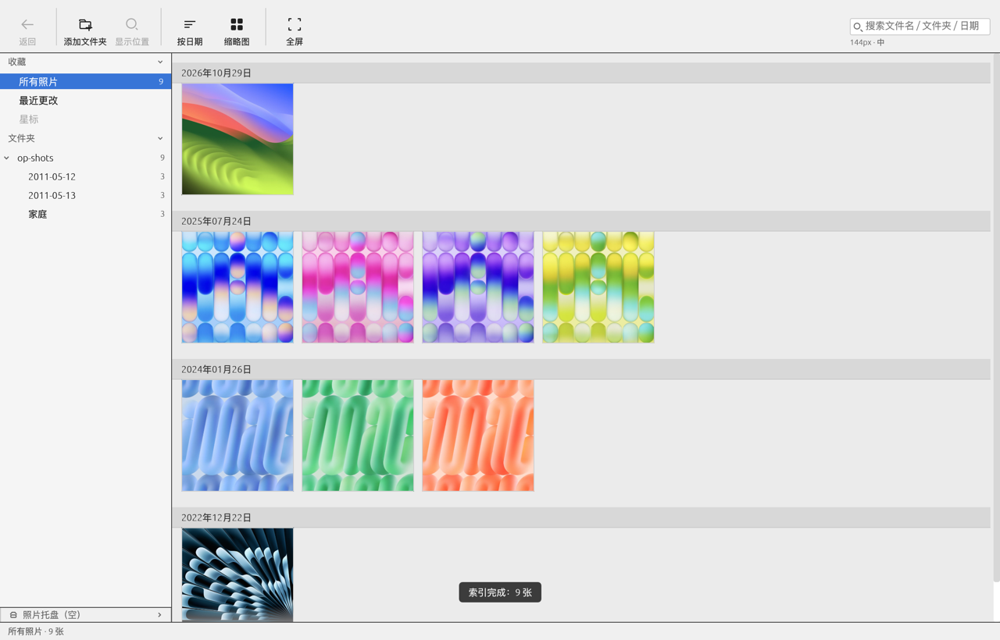
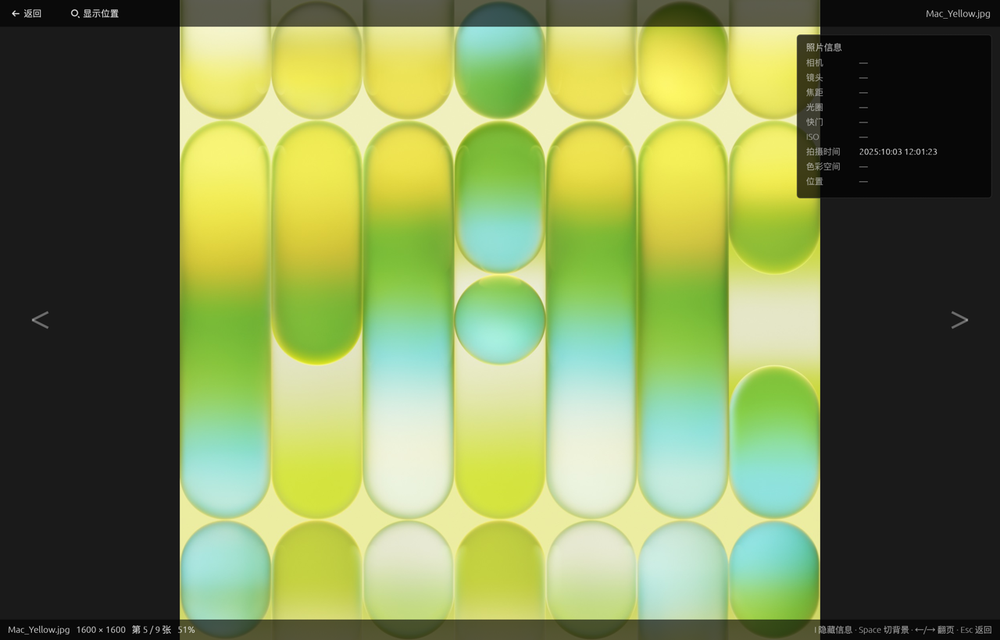
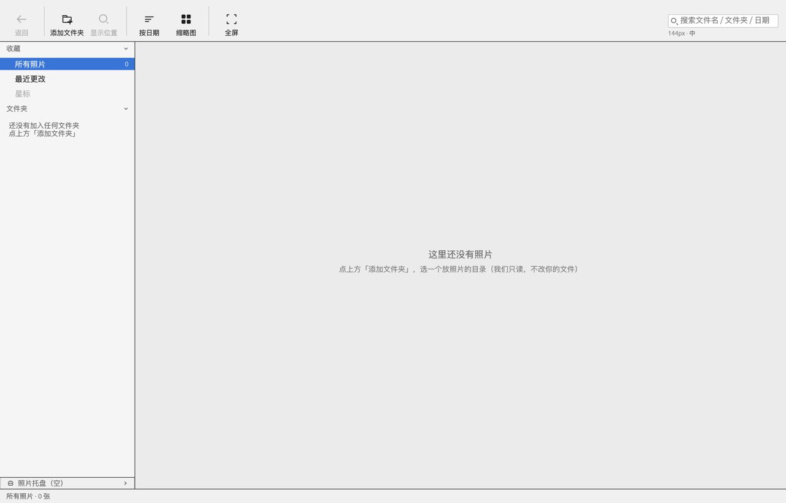

# 界面还原基线（M1 / M2）

这三张是**当前实现的真实渲染**，不是设计稿、不是参考图。用途只有一个：
把「界面还原」从主观判断变成可比对的证据（03 §5A）。

> **M2 的基线待补（见文末「M2 索引进度界面：为什么没有截图」）**——
> 本轮用来跑截图的环境（沙箱）**拿不到 `/dev/dri` 节点**（机器本身有 i915 GPU），
> 软件光栅下帧连 `wl_surface` 都送不进去，`ViewportCommand::Screenshot` 的回调自然不触发。
> 代码行为由 87 条测试 + 运行日志证明，**不靠截图**。

> **为什么这三张能入库**：03 §5A 的「仓库只提交派生数据、不提交原版截图原图」约束，
> 针对的是**原版 Picasa 3.9 的截图**（他人版权，只能进内部制品库）。
> 这三张由本项目的 `capture.rs` 从自己的窗口帧缓冲导出，版权归本项目，
> 因此用 `git add -f` 入库（合计约 1.2MB），便于在 GitHub 上直接查看当前实现。
> 原版对照图仍按 03 §5A 走内部渠道，**永远不进仓库**。

| 文件 | 内容 | 生成方式 |
| --- | --- | --- |
| `m1-library-1280x820.png` | 图库视图（日期分组 + 6 列栅格 + 左栏树 + 状态栏） | `.app` 内可执行文件 + `OPENPICASA_SCREENSHOT` |
| `m1-viewer-1280x820.png` | 查看器（暗底、EXIF 面板、上下信息条） | 同上，另加 `OPENPICASA_OPEN_INDEX=4` |
| `m1-empty-1280x820.png` | 空库首屏（空态文案 + 置灰按钮） | 同上，不预置 roots |

## 预览







## 生成与复核

```bash
# 1) 造可复现的样本（系统壁纸转 jpg，日期分组天然分散）
# 2) 预置偏好，指向样本目录
# 3) 截图（窗口帧缓冲，不含桌面其他窗口）
OPENPICASA_DATA_DIR=/tmp/op-data \
OPENPICASA_SCREENSHOT=$PWD/docs/ui-baseline/m1-library-1280x820.png \
OPENPICASA_SCREENSHOT_WARMUP=55 \
  dist/OpenPicasa.app/Contents/MacOS/OpenPicasa

# 4) 量数值（不要靠眼睛）
python3 tools/pngprobe.py docs/ui-baseline/m1-library-1280x820.png --row 300 --scale 2
```

## 更新基线

`.gitignore` 对 `docs/ui-baseline/*.png` 有忽略规则，**新增或替换截图默认不入库**，
避免每次调主题都产生二进制 diff。确实要更新时显式强制添加：

```bash
OPENPICASA_SCREENSHOT=$PWD/docs/ui-baseline/m1-library-1280x820.png \
  dist/OpenPicasa.app/Contents/MacOS/OpenPicasa    # 覆盖渲染
git add -f docs/ui-baseline/m1-library-1280x820.png
git commit -m "docs(ui-baseline): 重新生成图库基线"
```

替换后必须复核下表数值——截图变了但数值没变，说明只是配色变了；
数值也变了，说明布局常量被改动，需要同步检查 `theme.rs`。

## 已实测对齐的硬数值（1280×820，Retina 2x 截图）

| 项 | 实测 | 来源常量 |
| --- | --- | --- |
| 工具栏高度 / 底色 | 68 / `#F0F0F0` | `Metrics::TOOLBAR_H` / `Theme::chrome_bg` |
| 左栏宽度 / 底色 | 220 / `#F5F5F5` | `Metrics::SIDEBAR_W` / `Theme::sidebar_bg` |
| 选中行底色 | `#3875D7` | `Theme::sidebar_selected` |
| 栅格底色 / 起点 x | `#EBEBEB` / 236（=220+16） | `Theme::grid_bg` / `Metrics::GRID_PAD` |
| 单元格边长 / 间距 | 144 / 10（行距 154） | `Metrics::CELL_SIZES[1]` / `CELL_GAP` |
| 列数 | 6（content_w=1052） | 由宽度推导，非固定 |
| 分组头高度 / 底色 | 26 / `#D8D8D8` | `Metrics::GROUP_HEADER_H` / `Theme::header_bg` |
| 滚动条宽度 | 8 | `Metrics::SCROLLBAR` |
| 提示框底边距窗口底 | 48 | `draw_overlays` 内常量 |

## 还缺什么

1. **原版 Picasa 3.9 的对照截图**：M1 不做数据兼容，但仍然需要视觉基准图。
   目前 `theme.rs` 里的配色与尺寸是目测近似值，逐项标了 `TODO(U-xx)`，
   等 PM 提供原版截图后按上表逐项回填。
2. 这三张图只是**当前状态**，不是验收目标。回填原版数值后需要重新生成一次。
3. **M2 索引进度界面的基线三张（未完成）**，见下节。

---

## M2 索引进度界面：为什么没有截图

**结论：本轮没有产出 M2 的界面截图。这不是漏做，是环境缺件。** 记录如下，避免下一个人重走一遍。

### 现场

| 项 | 实测 |
| --- | --- |
| 设备 | Google Pixelbook Go（Atlas）。**机器本身有 GPU**：`/sys/class/drm/` 下有 `card1` + `renderD128`，驱动 `i915`（PCI `8086:591C`），`card1-eDP-1` 为 connected |
| 真正的缺件 | **运行环境（沙箱）没有把 `/dev/dri` 映射进来**——节点不存在，于是 Mesa 找不到 DRM 设备 |
| 图形栈 | Wayland 会话；Mesa 26.2.4 + llvmpipe（纯 CPU 软件光栅） |
| 后端选择 | EGL 直接失败：`ZINK: failed to choose pdev` / `egl: failed to create dri2 screen` / `Failed to query drm device` |
| 退让后 | `WGPU_BACKEND=vulkan` 能建窗口对象，wgpu 明确告警 `Software rasterizer detected ... name: "llvmpipe"` |

> ⚠️ **这里曾经写错过一次，改正如下**：最初记成「这台机器没有 GPU」，那是**把沙箱的缺件当成了机器的缺件**。
> 实际是 i915 在、`renderD128` 在，只是沙箱不给 `/dev/dri` 节点。**在桌面终端里直接跑（不经沙箱）是有 GPU 的。**

**应用本身是能跑的**：`openpicasa.log` 里索引全流程走通，栅格布局也正常。

```text
DEBUG picasa_core::library:  索引入队 roots=1
DEBUG picasa_ui::grid:       栅格布局 cols=6 cell=144.0 content_w=1052.0 groups=1 total_h=7760.0 photos=300
INFO  picasa_core::scanner:  索引队列排空 photos=300 dirs=4
DEBUG picasa_core::library:  目录已落库 path=.../2011-05-01 added=0 removed=0   (×3 子目录)
```

### 卡点（现象 → 根因）

**窗口在沙箱里根本不显示**，不只是截不到图。用 `WAYLAND_DEBUG=1` 抓协议，20 秒内只有初始提交，**没有任何 `wl_surface.attach`**：

```text
-> xdg_wm_base#14.get_xdg_surface(new id xdg_surface#29, wl_surface#28)
-> xdg_toplevel#30.set_title("OpenPicasa")            # 窗口对象建好了
<- xdg_toplevel#30.configure(0, 0, array[0])          # 合成器也回话 222
<- xdg_surface#29.configure(222)
-> wl_surface#28.commit()                             # 只有这次空提交
（之后 20 秒：无 attach、无 damage、无 buffer）
```

`ViewportCommand::Screenshot` 的回调始终不触发，也是同一个根因——**从来没渲染出过一帧**。

已排除：不是预热帧数不够（`WARMUP` 从 200 降到 **2**）、不是超时太短（240 s）、
不是没连上合成器（协议全对）、不是崩溃（进程活到 timeout）。

**根因**：没有 `/dev/dri` → 软件光栅拿不到可导出的 DMA-BUF → 帧送不进 `wl_surface` →
合成器按规矩不映射窗口。所以「看不到窗口」与「截不到图」是同一件事，**都只在这个沙箱里发生**。


### 真机上怎么补（在有能力时照做）

```bash
# 1) 造样本：300 张 640×480 JPEG，三个日期子目录（索引要跑够久才看得见弹框）
#    photos-m2/2011-05-01..03 各 100 张
# 2) 预置偏好：roots 指向该目录
# 3) 抓三张（WARMUP 决定抓到第几帧：小=索引中，大=索引后）
OPENPICASA_DATA_DIR=$DATA OPENPICASA_SCREENSHOT=$PWD/docs/ui-baseline/m2-indexing-1280x820.png \
  OPENPICASA_SCREENSHOT_WARMUP=20  dist/OpenPicasa.app/Contents/MacOS/OpenPicasa
```

| 目标文件 | 要拍到的状态 | 断言（用 `tools/pngprobe.py` 量，不靠眼睛） |
| --- | --- | --- |
| `m2-indexing-1280x820.png` | 索引中：右下角弹框 + 栅格灰底「待生成」 | 弹框包围盒**右边缘距窗口右边 < 24px、下边缘距状态栏上沿 < 24px**；栅格内存在连续灰底块 |
| `m2-panel-1280x820.png` | 面板展开：逐文件夹状态 + 失败项 | 面板四态标识与 `IndexSnapshot` 同值（对照日志） |
| `m2-idle-1280x820.png` | 完成：按钮回空闲、面板「暂无索引任务」 | 状态栏右侧按钮存在且宽 86，**不挤压栅格 content_w**（应仍为 1052） |

### 在此之前，M2 的正确性依据

| 判据来源 | 覆盖 |
| --- | --- |
| `cargo test --workspace`（87 条） | 批次冻结 / 上包络 / 失败保留 / 重试继承 / 七态文案 / 汇总=分项和 / 弹框状态机（含 1.5-3-1 s 阈值）/ 零写入 / ini 不动 |
| 运行日志 | 索引队列、目录落库、栅格列数、失联探测 |
| 代码结构 | 四处同源（`IndexBoard` 是唯一快照来源），「差 1」在结构上无法发生 |

